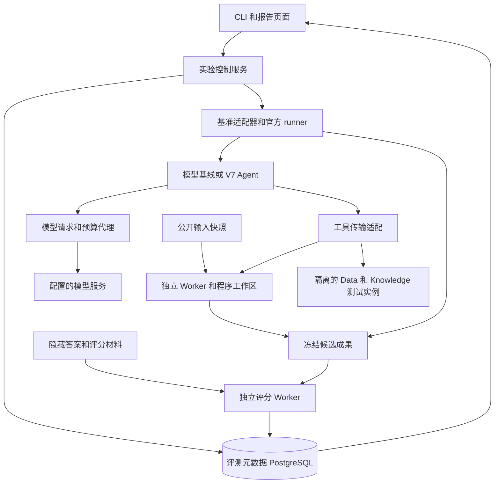

# V7 开源 Agent 评测平台搭建方案

日期：2026-10-11。状态：设计提案。适用对象：V7 平台开发、算法和评测人员。

建设一个独立于现有地下水知识和业务数据的评测环境，以公开任务、固定输入和可检查结果建立 Agent 能力基线，再通过对照实验定位模型、知识、数据、工具和平台流程各自造成的影响。首期采用 ScienceAgentBench、τ-bench 和 BFCL，保留官方任务身份及评分语义，在外围增加版本锁定、V7 适配、隔离执行和实验报告。

优先回答三个问题：Agent 在资料充分时能否完成任务；相同资料经过平台检索后损失多少；哪些缺失能自动修复，哪些必须澄清。评测通过不等于地下水科学结论已经得到验证。

本方案是 [V7 混合架构方案](v7-hybrid-architecture-plan.md) 的评测专项。先搭建评测环境和官方基线，再接入 V7；不以完整 V7 建成作为启动条件。正文中的目录、接口和 `evalctl` 命令均为拟实现规格，当前不是已安装的软件。

## 1 建设目标和边界

最终交付包括：三个可复现基准适配器、一套独立实验控制台、V7 Agent 适配接口、知识与数据对照实验、隔离执行环境、评分及归因报告、版本升级和回归流程。

首期只做文本 Agent、工具调用及 CPU 可运行的科学任务。GPU 训练、实时网页和语音任务后续单列，不混入首期结果。模型通过已授权的 API 服务调用；本机部署模型是另一个实验因素，不与首批平台评测同时变化。

必须区分三条评测路径：

| 路径 | 被测对象 | 可以得出的结论 |
| --- | --- | --- |
| 模型基线 | 官方 runner 加固定模型配置 | 在该 runner 和工具条件下的模型表现 |
| V7 Agent 核心 | 实际 V7 Agent 循环加基准工具适配 | V7 上下文、规划、工具选择及恢复策略的表现 |
| V7 完整平台 | Task、Data、Knowledge、Execution、验收接口 | 平台端到端能力及额外成本 |

BFCL 直接测试模型的结果不能命名为 V7 平台成绩。接入 V7 后改变任务接口、预算、评分或输入内容的实验标记为派生评测，不冒充官方可比成绩。三类结果分别展示，不计算一个跨基准总分。

## 2 数据集选择和获取

### 2.1 ScienceAgentBench

采用官方 `verified` 分割。当前数据卡列出 102 个任务，包含 GIS、统计分析、机器学习等方向。Hugging Face 提供任务标注，完整输入文件和评测材料需要另外取得官方 `benchmark_verified.zip`。代码提交、标注 revision、压缩包摘要和评分器版本共同构成一个基准版本，不能只锁任务 JSON。[任务数据](https://huggingface.co/datasets/osunlp/ScienceAgentBench)、[代码和获取说明](https://github.com/OSU-NLP-Group/ScienceAgentBench)。

第一批从 GIS、表格和统计任务分层选择 CPU 可运行样本；候选任务必须先通过环境和输入完整性检查。正式成员由实际 task ID 清单冻结，不把“前若干条”当作代表集。后续覆盖完整 102 项时，分别报告 GPU 需求、环境失败和未支持项。

Agent 可见任务要求、允许的领域说明、输入文件和规定输出格式。`gold_programs`、`eval_programs`、隐藏预期、评分说明及可指向答案的内部路径属于评测端。允许 Agent 运行自己的程序和查看普通运行错误；正式评分结果在该 trial 结束后才返回研究人员。

该基准代码为 MIT；任务多数采用 CC BY 4.0，部分保留原始许可证，官方另要求不在线重新分发解压数据。因此源代码仓库只保存下载清单和摘要，完整材料保留在受控本地存储，报告只导出允许发布的内容。[许可与分发说明](https://github.com/OSU-NLP-Group/ScienceAgentBench#licensing-information)。

### 2.2 τ-bench

使用官方 `sierra-research/tau2-bench` 仓库。仓库当前主线已包含 τ³ 功能，设计时的项目元数据为 `1.0.1`，要求 Python `>=3.12,<3.14`。实施时冻结具体 commit，不依赖浮动 `main`。[项目依赖](https://github.com/sierra-research/tau2-bench/blob/main/pyproject.toml)。

先接入一个普通文本工具场景，再接入 `banking_knowledge`。前者验证多轮交互、工具副作用和用户模拟器；后者验证知识获取。正式官方比较采用其 `base` 任务分割，抽样诊断清单另行保存。任务、工具、policy、初始数据库、用户模拟器和评分规则必须作为整套环境版本化。[项目说明](https://github.com/sierra-research/tau2-bench)。

知识实验优先使用 `golden_retrieval`、`bm25`，再增加平台检索；`no_knowledge` 用作负对照，`full_kb` 仅在全部内容能放入固定上下文预算时运行。默认不启用 Shell 和语音，避免增加与首期问题无关的变量。[官方知识配置](https://github.com/sierra-research/tau2-bench/blob/main/src/tau2/knowledge/README.md)。

### 2.3 BFCL

使用 Gorilla 仓库中的 BFCL 数据及对应 runner。首期选择工具相关性、单步参数、多工具选择、多轮调用类别；实时网页和复杂记忆任务后续单独启用。数据与代码按照选定 commit 一起冻结，不混用不同代数据和评分器。[数据说明](https://github.com/ShishirPatil/gorilla/blob/main/berkeley-function-call-leaderboard/bfcl_eval/data/groundwater/README.md)。

BFCL 包含结构匹配和可执行评测，不把合法 JSON 视为任务成功。先跑官方模型 handler，确认 Provider 的工具协议；V7 的额外循环实验另设结果系列。该项目当前依赖包含固定 NumPy 等版本，使用独立镜像，不与 τ-bench 或科学任务共用 Python 环境。[依赖定义](https://github.com/ShishirPatil/gorilla/blob/main/berkeley-function-call-leaderboard/pyproject.toml)。

### 2.4 暂缓接入的基准

GAIA、网页操作和代码仓库修复类基准暂不进入第一阶段。它们可以扩展研究范围，但当前先解决科学分析、知识获取和工具调用这三个已明确的问题。没有网络或图形桌面的任务不计入这类基准的完整覆盖。

## 3 本机资源和部署选择

2026-10-11 的只读检查结果：32 个逻辑 CPU，约 503.8 GiB 总内存，工作区所在文件系统约 914.8 GiB，总可用约 292.6 GiB；4 张 RTX 2080 Ti，每张约 11 GiB 显存。发现 Docker 28.1.1 和 uv 0.8.14；PATH 未发现 `runsc`。这不是 Docker daemon、GPU 容器或虚拟化能力的可用性验收。

首期限制为 2 个并行科学程序执行、2 个文本交互 trial、统一受限的模型请求队列。科学任务每个执行容器初始上限为 4 vCPU、16 GiB RAM，按任务类别预先升档；不是在失败后无限加资源。GPU 默认不分配，不能把四张独立显卡当作一张 44 GiB 显卡。

磁盘是首要容量约束。ScienceAgentBench 官方 Docker 文档给出的运行空间估计为 `5 + 并发数 × 25 GB`，完整缓存实例镜像可能达到约 2.6 TB；这是上游估计，需实测当前版本。[官方容量说明](https://github.com/OSU-NLP-Group/ScienceAgentBench/tree/main/docs/20250110_docker)。

拟定容量控制如下：

| 内容 | 初始上限 | 策略 |
| --- | --- | --- |
| 原始包与解压输入 | 40 GiB | 导入前核算，超过则扩容或减少首批范围 |
| 基础及任务镜像缓存 | 35 GiB | 按摘要复用，只回收评测自有缓存 |
| 同时活跃的程序工作区 | 60 GiB | 首期科学并发 2，超限停止新增分配 |
| 轨迹、成果及报告 | 15 GiB | 任务级限额，留存策略见第 17 节 |
| 数据库、导出及余量 | 30 GiB | 总量预警和备份暂存 |

评测目录总预算 180 GiB，宿主机空闲低于 80 GiB 时停止新 trial 和镜像构建，保留结果回收及数据库写入能力。这些是准入预算，不是假定数据实际大小。稀疏虚拟磁盘和备份也计入总预算；不得把虚拟磁盘与其内部文件重复计费。

生成代码运行在专用评测 Worker 虚拟机内的受限容器中；控制服务和隐藏评分材料不挂入该虚拟机。优先验证 CPU 任务的 gVisor 兼容性，不能满足时记录使用普通容器加虚拟机的隔离配置。虚拟化不可用时采用专用计算主机，不能自动退回 V6 业务服务所在宿主机裸执行。E0 检查该条件后选择并锁定部署方式。

## 4 系统架构



模型请求代理是费用、限流和调用记录的边界，可以是同一个服务中的模块，不另建通用模型平台。官方 runner 的 Provider 适配如不能经过该代理，必须经过同等限额的窄适配，不能绕开费用记录。

首期部署一个控制服务、一个专用 PostgreSQL、一个受控文件存储目录和必要的 Worker。控制服务可同时提供 CLI 后端、REST API 和只读报告页。不引入 Kafka、Redis、Celery、Kubernetes 或对象存储集群。基准内部已有的运行机制保留在其隔离镜像内。

V7 Data 和 Knowledge 测试实例从评测阶段 E4 才启动，与评测元数据数据库分开。端到端任务状态仍由 V7 的 Task 和 Execution 负责，评测库只记录引用、观测和评分，不维护第二份业务真相。

评测元数据最小表集合如下，原始大文件均不写入数据库：

| 表 | 主要内容 | 关键约束 |
| --- | --- | --- |
| benchmark_releases 和 cases | 上游身份、输入清单、公开与隐藏对象引用 | 同一版本及 case ID 唯一，发布后不可变 |
| suite_revisions 和 experiment_revisions | 成员、配置、计划及其摘要 | 运行前冻结，不在原行修改条件 |
| trials 和 attempts | 条件、重复编号、租约、代次、运行状态 | trial 逻辑身份唯一，结果按当前代次提交 |
| events 和 model_calls | 可观察事件、请求身份、预留和实际用量 | 事件追加，调用标识唯一，未知用量单列 |
| artifact_manifests | 已冻结候选代码、输出和轨迹引用 | 摘要和可见范围必填 |
| score_revisions 和 reviews | 评分器身份、原始分数、复核与归因 | 重新评分追加新版本，绑定确切产物 |

独立线程只通过已声明的服务或模块接口写其拥有的状态。首期数据库队列只安排 trial，不接管科学计算 DAG；完整平台路径仍调用 V7 Execution。

## 5 目录和存储组织

实现代码放在 `/home/mtd/liweigis/workflow/projects/platform/groundwater/v7/evaluation/`；大型数据和运行结果放在独立目录 `/home/mtd/liweigis/workflow/agent-eval-data/`。两个路径均为拟建目录。

```text
projects/platform/groundwater/v7/
  evaluation/
    pyproject.toml
    src/eval_control/
    adapters/scienceagentbench/
    adapters/tau_bench/
    adapters/bfcl/
    agent_drivers/v7/
    contracts/
    suites/
    experiments/
    images/
    deploy/
    tests/
  docs/architecture/agent-evaluation-platform-plan.md

agent-eval-data/
  sources/                 官方下载包和版本快照
  inputs/                  Agent 可读输入和文档
  private/                 隐藏标准与评分材料
  workspaces/              当前 trial 可写目录
  artifacts/               按摘要存储的冻结结果
  runs/                    实验清单 轨迹和账单记录
  reports/                 HTML JSON 和表格导出
  backups/                 元数据和目录清单备份
```

Agent 只能访问明确分配的输入和自己的工作区。禁止挂载整个 `agent-eval-data`、V6、宿主机主目录或 Docker socket。`private` 的操作系统权限和服务身份独立，路径隐藏不能代替权限隔离。

源代码提交基准锁文件、任务成员清单、参数和适配代码。数据包、API 密钥、完整轨迹、模型输出、数据库及缓存不进入 Git。公开报告默认只含指标、task ID 和经过检查的示例。

## 6 基准登记和输入契约

每次导入创建不可变 `BenchmarkRelease`，字段包括：`benchmark_id`、`upstream_commit`、`dataset_revision`、`split`、`archive_sha256`、`manifest_digest`、`license_records`、`adapter_digest`、`scorer_digest`、`image_digests`、`imported_at`。

文件逐项登记相对路径、字节数、SHA-256、用途和可见范围。解包拒绝路径穿越、越界软链接和重复冲突路径，限制解压总量。原始文件保持原字节；平台归一化产生派生表示并记录父摘要，不能覆盖原输入。

`CaseSpec` 分为两个对象，禁止把内部完整对象交给 Agent：

| 对象 | 内容 | 可见者 |
| --- | --- | --- |
| PublicCase | 任务文字、公开领域说明、输入清单、可用工具、输出要求、公开限额 | Agent 和 runner |
| PrivateCase | 预期状态、参考输出、答案、评分程序、隐藏用户目标、评审规则 | runner 的必要模块与评分端 |

字段权限采用允许清单。ScienceAgentBench 的参考程序名、评分脚本名不直接复制到模型上下文。τ-bench 完整 Task 可能含用户模拟和评测字段，即使官方 factory 接口可收到 Task，V7 driver 也只提取 Agent 本应看见的部分。

`SuiteRevision` 固定成员列表、分层、排除原因和抽样种子；`ExperimentRevision` 固定模型、Agent、环境、处理条件和预算。配置修改产生新 revision。实际试验计划摘要由完整有序 trial 清单计算，不能只对 YAML 文件名取摘要。

## 7 基准接入方式

### 7.1 ScienceAgentBench 的两条评分路径

先用官方 runner 和评分程序完成可重复基线；再使用同样的任务与评分语义接入 V7。官方环境可能根据候选程序安装依赖，受控评测则在隔离构建区解析并冻结依赖。两条路径的环境差异必须写入报告。[官方运行说明](https://github.com/OSU-NLP-Group/ScienceAgentBench#evaluation-of-generated-code)。

生成阶段只允许读输入、编辑候选程序、受限运行和查看普通错误。代码补缺产生正式候选 Python 文件，固定文件摘要后进入评分。执行候选程序的容器不挂载隐藏评分材料；评分端只读取冻结输出。

实施时审计每个官方评分脚本。若脚本必须导入或执行候选程序，将执行放在无隐藏资料的 Worker，评分进程保留预期值，通过窄接口比较结果。拆分需要修改脚本时，在参考成功程序和故意错误程序上验证等价性，并记录为评分适配版本。无法可靠拆分的任务不进入隔离合格清单，可单列官方实验结果，不能宣称已满足同样隔离保证。

官方图像评分可能使用模型，因此图像任务保留 `judge_model`、提示、图像输入、原始评分及费用；关键数值另用确定性检查。没有配置评分模型时标记 `SCORER_UNAVAILABLE`，不能用“图片存在”代替评分通过。

### 7.2 τ-bench 工具所有权

τ-bench orchestrator 独占模拟用户、环境数据库和工具副作用执行。V7 driver 接收用户或工具消息，返回助手文本或工具调用，交由 orchestrator 执行。不得让 V7 和 τ-bench 同时执行同一个调用。

适配官方 `HalfDuplexAgent` 的初始化和下一消息接口，保留工具名、参数、调用 ID、消息顺序及并行调用语义。模型和用户模拟器的版本分别锁定。[Agent 接口](https://github.com/sierra-research/tau2-bench/blob/main/src/tau2/agent/README.md)。

每个 trial 重置数据库、用户模拟状态和对话。用户模拟器只获得官方允许的用户侧任务信息，不能访问 Agent 隐藏推理或事后评分。固定随机种子不保证不同 Agent 下对话相同；多次重复和任务级统计用于处理这类差异。

知识检索替换首先限定在只读知识工具。政策、模拟用户和副作用工具不一起修改。官方检索与平台检索均返回同一语料版本允许的内容，不在其中加入地下水说明。

### 7.3 BFCL 接入

首先完成 Provider 的官方 handler 验证，保留函数定义、模型响应及原始判分。API 协议错误、模型未给合法工具调用、工具名称错误和语义参数错误分别计数。

若为 V7 增加自主重试、额外文档检索或中间规划，属于另一套运行条件。与单次官方生成的结果分别报告，记录调用次数和总成本，不能用更多试错机会制造不对等比较。

### 7.4 一次科学任务的完整流程

1. 控制服务从冻结实验计划领取一个 task、条件和重复编号，检查费用、磁盘及环境锁。
2. 适配器生成 PublicCase，按输入清单准备只读文件，为该 trial 创建空白工作区。
3. Agent 根据条件取得领域材料，通过文件和执行工具迭代程序；每次调用记录资源和用量。
4. Agent 提交候选代码；runner 停止其运行，冻结代码及相关产物，结束隐藏评分之前的修改机会。
5. 执行 Worker 在全新环境重新运行冻结代码，生成最终输出，排除只在交互工作区才能运行的假成功。
6. 独立评分器读取冻结输出及隐藏预期，保存原始评分和必要的人工复核项。
7. 控制服务核对调用费用、产物引用和 trial 状态，报告显示结果、限制和可观察失败原因。

重跑候选代码的资源与费用单列；若官方任务允许依赖明确的辅助文件，必须把辅助文件一起纳入候选清单，不能只拷贝主脚本后误判。不同 trial 不共享对话、可写目录或可见评分反馈。

## 8 V7 Agent 适配契约

Agent 核心必须支持可注入的工具传输层。评测复用实际 V7 上下文构造、规划循环和停止逻辑，不能用临时简化循环替代后仍声称测了 V7。

生产内核分层及 RuntimePort 见 [V7 科学 Agent 内核架构](scientific-agent-kernel-architecture.md)。本节接口是外层 EvaluationDriver 的生命周期封装，内部调用同一 frame、建议、行动准入和观察协议，不另实现第二套决策循环。

用户 API、Agent 工具及服务端口的边界以 [内部架构与接口设计](v7-architecture-and-interface-contracts.md) 为准。评测 driver 使用内部端口适配，完整平台测试另外覆盖项目范围 REST API；替换传输不赋予 driver 修改 Task 完成或 Acceptance 判分的权限。

拟定内部接口：

```text
initialize(public_case, tool_catalog, domain_policy, limits) -> session
advance(session, observations) -> assistant_message | tool_requests | terminal
deliver_tool_results(session, results) -> checkpoint_reference
cancel(session, reason) -> cancellation_receipt
export_evidence(session) -> observable_event_manifest
```

这些是拟定的平台接口，不是三个开源项目共享的现成 API。各 adapter 负责映射，但无权修改任务目标和评分标准。

工具请求统一携带 `trial_id`、`call_id`、工具身份、参数摘要和当前代次；结果携带原调用 ID、状态及输出引用。Agent 可在内部执行多步模型工作，但每次外部工具副作用只能由指定执行方处理一次。

V7 核心模式加载基准自己的工具和领域政策，不加载地下水模型卡、业务模板或历史记忆。该配置与生产配置的差异写入实验身份。完整平台模式保留 Task、授权和发布规则，以新建评测项目承载公开数据；需要特殊能力时显式扩展 profile，不能悄悄关闭校验。

实验身份同时固定 ProfileBinding、方法契约、检查计划编译器、检查器实现及工具执行模式。需要适配的公开政策进入受控结构，隐藏评分标准不能进入该配置。未实现的必要条件标记为能力缺口，不能编译为空检查后通过；冻结任务清单中的能力缺口仍保留在完整分母内，另报告可支持子集。

V6 可作为历史对照，但只有其具备所需工具且完成同等适配时才比较。其本来不支持自主代码或某类调用的任务标记能力缺口，不把缺工具统计成模型推理错误。

## 9 知识影响的实验设计

在同一任务、数据、模型、Agent 核心、工具、上下文和费用上限下，只改变证据获取方式。优先使用 τ-bench 官方知识场景，再将方法迁入科学任务。

| 条件 | 资料和访问方式 | 主要用途 |
| --- | --- | --- |
| K0 | 不提供任务知识，保留公开任务及政策 | 负对照；不作为正常产品配置 |
| K1 | 直接提供经审核的必要证据，不包含答案 | 测资料可得时的表现 |
| K2 | 同一语料，通过官方检索获取 | 官方检索基线 |
| K3 | 同一语料，经 V7 Knowledge 获取 | 评估平台知识接入和检索 |
| K4 | 同一语料和 V7 检索，改变一个检索设置 | 比较分块、召回、重排或上下文策略 |

K1 的必要证据由独立预处理确定并固定。`golden_retrieval` 本身是优待条件，不代表生产可获得的知识选择能力。K1 与 K3 的差异包含检索、工具往返和上下文组织的综合影响，不能全部归因到向量模型。

需要定位具体因素时，再固定检索结果，只替换传输和上下文拼装；或者固定切块、embedding、top-k 和候选内容，只比较存储与访问路径。没有这种进一步控制，就只报告整体差值。

`full_kb` 放不下时记 `CONTEXT_INCOMPATIBLE`，不能偷偷截断后继续宣称完整知识对照。K0 失败也不自动说明模型差：任务可能本来依赖私有语料。

## 10 数据质量和访问能力实验

原始公开任务作为 D0。派生任务有新身份，记录父任务、变换脚本摘要和新的正确行为；不得使用变换前的标准答案机械判分。

| 变体 | 变换 | 预期行为 |
| --- | --- | --- |
| D1 字段变化 | 重命名字段，同时提供正确映射 | 正确绑定并得到同等结果 |
| D2 可修复格式 | 改为支持的另一种格式，保持语义 | 转换或直接读取，保留来源 |
| D3 单位变化 | 数值和单位声明同步改变，提供换算依据 | 换算正确，不能只改标签 |
| D4 必要语义缺失 | 删除确实影响结论的单位或坐标说明 | 询问缺项或提交明确受限结论 |
| D5 无关资料 | 添加相似名称、无关文档或表格 | 选中正确证据和输入 |
| D6 真正冲突 | 加入同等权威、不能消解的相反声明 | 指出冲突，避免无依据执行 |
| D7 后部异常 | 在头部样本以外加入已知异常 | 执行适当全量检查或说明未检查范围 |
| D8 工具故障 | 确定性注入一次超时、限流或响应丢失 | 按工具副作用类型恢复，无盲目重复 |

先做单因素试验；D8 的可重试性由工具契约决定。只有前述试验解释清楚后，才加入组合扰动，避免失败原因不可分辨。

另设访问能力对照：仅头部样本与允许全量有界查询使用相同数据和任务。可以直接检验 V6 的预览限制是否影响正确判断。全量查询也设行数、扫描字节和时限，不把无限数据读取作为基线。

“合理澄清”和“不必要澄清”分开评分。资料完整且政策允许时仍反复询问会降低自主完成率；关键依据确实不足时停止计算可以是正确结果。

## 11 任务规模和实验轮次

先做连通性与评分验证，再做诊断，最后扩大覆盖。模型数量、处理条件和重复次数都是费用乘数，不在第一次试验中同时铺开。

| 阶段 | 计划范围 | 用途 |
| --- | --- | --- |
| 连通性 | 每个基准至少 2 个有明确预期的任务 | 验证适配、环境、输出和评分闭环 |
| 首轮诊断 | ScienceAgentBench 20 个 CPU 任务，τ 知识 20 个任务，BFCL 100 个分层用例 | 建立可解释的小规模基线 |
| 核心对照 | τ 的 K1/K2/K3，每任务 3 次；科学任务按资料条件选 K1/K3 | 定位知识路径损失 |
| 异常能力 | 从已跑通任务派生，每类变体先 5 个 | 验证异常识别与处理 |
| 扩展回归 | 固定 held-out 清单和更完整任务覆盖 | 检验改造是否泛化 |

数量是拟定实验预算，不是已经选出的实际成员。E1 根据支持情况冻结清单，若不足须显式调整计划并保留原因。仅看 CPU 子集不能代表全部 102 项能力。

例如 20 项科学任务 × 2 条件 × 3 次为 120 个 trial；20 项知识任务 × 3 条件 × 3 次为 180 个 trial；100 项 BFCL × 1 次为 100 个 trial。合计每个候选 Agent 配置 400 个计划 trial。不同基准中的一次 trial 工作量差别很大，不能据此直接估算费用。

开发集用于修适配，保留集用于验收。派生变体和同源任务必须放在同一分组，避免将几乎相同的数据分到两边。公开任务可能已出现在模型训练中，因此不声称保留集完全没有污染；平台内禁止把保留集答案用于提示优化或检索。

## 12 评分和统计口径

同时保存官方原始分数与平台诊断指标，不改写原分数。指标按基准、任务类别、处理条件及配置分别汇总。

| 指标 | 定义 |
| --- | --- |
| 单次成功率 | 每次独立 trial 的成功比例，或官方连续分数的均值 |
| 重复稳定性 | 同一任务全部 r 次成功的比例，报告 r |
| 自主完成率 | 无计划外人工介入且满足交付的比例 |
| 正确澄清率 | 在已标注必须澄清的任务上提出必要问题的比例 |
| 不必要澄清率 | 材料充分的任务上增加阻塞提问的比例 |
| 工具准确性 | 工具选择、参数、顺序和副作用结果的分项表现 |
| 证据准确性 | 引用可解析、版本正确、内容支持结论的分项表现 |
| 运行成本 | Agent、模拟用户、judge、embedding、执行资源分别计费 |
| 时间 | 排队、模型、检索、执行、评分分别记录，报告中位数和 P95 |
| 覆盖率 | 冻结计划中支持、有效完成、未运行和失败的数量 |

ScienceAgentBench 的官方汇总代码会根据评分从多次运行中选择最好的一次。其结果保留为 `official_best_run`，额外计算全部 trial 的均值和稳定性；选择后的成本不替代所有运行实际发生的费用。[官方汇总代码](https://github.com/OSU-NLP-Group/ScienceAgentBench/blob/main/calculate_metrics.py)。

`pass@k` 表示多次尝试中至少一次成功的能力，连续全部成功衡量稳定性，两者不得互换。没有实现对应官方统计公式时使用直白名称，例如“3 次全部成功比例”，不套用相似指标名。

统计差值按同一 task ID 配对；置信区间按任务分组 bootstrap，避免把同一任务的三次运行当作三个独立任务。小样本主要用于定位问题，差异不确定时报告不确定性，不宣布优胜。任务提示语言、模型版本和依赖环境相同才进行直接配对。

结果同时显示有效 trial 上的质量分数和全部计划任务的交付情况。基础设施失败、取消和未运行单列，不能静默从报告消失。预算内的模型耗尽、错误工具调用和自生成代码失败属于被测系统表现，不能改记为环境故障。

## 13 失败分类和审查

每个失败记录一个主要阶段和零至多个证据支持的原因。以下分类初始由规则生成，研究人员复核；另一个模型可以辅助整理，不能独立决定所有归因。

| 分类 | 例子 | 首先检查 |
| --- | --- | --- |
| DATA | 文件损坏、未声明单位、数据不足 | 输入清单与实际内容 |
| RETRIEVAL | 必要文档存在但未召回 | 查询、候选、排序与完整读取记录 |
| CONTEXT | 已读取证据未进入有效上下文或被错误压缩 | 消息清单、token 分配与上下文版本 |
| REASONING | 必要事实可见但方法或推导错误 | 可观察决策、工具选择与结果 |
| TOOL | 调用不合法、选错算子、无此能力 | 工具契约和调用回执 |
| ORCHESTRATION | 等待丢失、重复执行、过早完成 | Task、Execution、事件和授权事实 |
| ENVIRONMENT | 镜像缺依赖、服务无法启动 | 构建及预检记录 |
| SCORER | 判分脚本错误、judge 不可用 | 原始评分记录和参考对照 |
| BUDGET | 在规定资源内未完成 | 预算预留、真实用量和停止原因 |

“模型推理错误”必须有依据证明相关信息可见；无法确定时标记 `UNRESOLVED_CAUSE`。不采集隐藏思维链，只记录公开消息、工具调用、观察和可见产物。

每个评分器至少检查：参考可接受结果应通过；空结果、错数值、错空间参考或缺文件应失败；环境错误不能被解析成成功。图像与方法适用性存在主观判断时，输出单独的待复核队列，固定评审规则和审查人身份。

平台补充的科学检查器按任务定义绝对与相对容差、空值和 NaN 规则、主键、允许的行序差异及随机种子。空间输出检查 CRS、范围、像元网格、NoData 和几何有效性。表格或栅格文件不能普遍用字节摘要与参考结果比较：摘要固定身份，语义比较判正确性。单位换算变体必须同时调整预期与容差，模型训练按规定评价量判分，不要求权重文件逐字节一致。

## 14 执行状态和恢复

`Experiment → Trial → Attempt` 分别对应实验、固定任务条件下的一次重复、该重复的运行尝试。唯一 trial 身份包括任务、基准版本、条件、被测配置和 repetition；正式再试一次是新 trial，基础设施接管是新 attempt，两者不混淆。

执行状态采用 `PLANNED → PREPARING → RUNNING → COLLECTING → SCORING → FINISHED`，另有 `CANCELLING → CANCELLED` 和故障出口 `ERROR`。`FINISHED` 仅表示评分流程结束，结果另存 `PASS / FAIL / INDETERMINATE`。`NOT_RUN`、`UNSUPPORTED` 和 `INVALID_CASE` 保留在计划覆盖表中。

PostgreSQL 负责领取、租约、代次和事件；文件存储负责不可变 bytes。写文件先落临时文件、校验并原子更名，再在事务中登记引用；未登记文件是待清理孤儿，不是已提交成果。数据库事务内追加事件，报告可随时从持久事实重建。

Worker 使用 `trial_id/attempt_id/generation` 标注容器。接管前确认旧容器实际停止或隔离，租约过期不等于旧进程已死。只有当前代次能提交最终清单，旧代次迟到结果保留诊断但不覆盖。

不自动重放结果未知的模型请求或副作用工具调用。模型请求缺少提供商幂等保证时，记录未知费用和未知结果；需重新开始则保存原 attempt，并从冻结环境重新运行。不能从对话中间随意接续后仍算相同完整 trial。

对冻结成果重新评分可以创建新 `ScoreRevision`，不重跑 Agent。更换评分器后旧分数保留，比较只使用同一评分器 revision。清单已冻结而评分中断时优先恢复评分。

取消先停止新的模型与工具准入，再终止本地执行并对账。外部 API 请求可能仍在运行，报告保留待对账状态；只有工作区无活跃写入后才回收。正式批次因控制服务重启而中断，也不能遗漏已计费请求。

## 15 隔离和评分材料保护

建立四类服务身份：导入器、runner、候选程序执行器、评分器。候选程序执行器没有控制数据库、隐藏答案、Provider 密钥、宿主机 Docker、V6 资源或其他 trial 的权限。

网络按角色划分：模型代理只访问配置的模型服务；输入下载及依赖构建区访问固定来源；科学程序默认断网；评分器仅在图像 judge 必需时通过单独代理调用模型。参考源码和答案页面不允许由被测 Agent 在实验期间联网取得。

科学容器采用只读根目录、非 root、最小 capabilities、CPU/内存/进程数/磁盘/超时限制。源代码生成过程中如果需要新增依赖，提交受限依赖请求，由隔离构建 Worker 审查名称、版本、来源和资源后构建，产物按摘要使用；不向候选程序提供构建主机凭据。

评分前终止候选运行并冻结产物，拒绝越界链接、设备文件和无限展开压缩包。图像、Parquet 等输出也视为不可信文件，在受限评分容器解析。官方评分代码是受信任的研究依赖，仍不应拥有业务密钥。

独立测试验证答案隔离：在 `private` 放置一次性标记，确认 Agent 文件工具、检索结果、日志接口及代码执行均无法读取；检索索引按输入清单构建，不能将整个 benchmark 目录直接向量化。

评测得到真实调用轨迹需要专门的实验日志权限。公开输入任务可保存完整可见消息；将真实业务数据引入完整平台评测后，按数据范围收紧留存和导出。模型隐藏推理、密钥和无关用户数据不作为评测产物。

## 16 预算和资源准入

一次实验的总费用包括 Agent、用户模拟器、图像 judge、检索 embedding，以及本地计算。Provider 价格按实验开始时的实际费率表冻结并记录生效日期，不在方案中假定永久价格。

每次模型请求先预留其输入和最大输出的费用上界，完成后按实际 usage 结算。请求结果未知保留预留直到对账，不能因超时自动退款。费用数据缺失时标记未知，不填零。第三方服务账单可能迟报，因此同时记录预算控制值与最终账单差异。

以下是首期实验配置的拟定起点，必须在连通性试验后、正式批次前冻结：

| 项目 | 文本知识任务 | 科学任务 |
| --- | --- | --- |
| Agent 模型调用上限 | 40 | 60 |
| 工具调用上限 | 80 | 120 |
| 候选代码运行次数 | 不适用 | 6 |
| Agent 总墙钟时间 | 10 分钟 | 30 分钟 |
| 单次 CPU 程序执行 | 按工具契约 | 5 分钟，可预先设长任务组 |
| 正式隐藏评分反馈 | 不回传 | 不回传 |

官方可比路径使用官方要求的限额，额外的基础设施超时只防失控，触发时明确报告，不能混入同一可比成绩。平台限额路径使用上表并标注差异。

先跑少量 pilot，测量各类别 token、模拟轮次、执行时长和费用分布，再用预定 trial 清单估算总量。总预算由操作者在提交实验时给出，超过预算不启动新调用；不把“跑完整套基准”解释为无限 API 消费授权。

费用估算逐类使用 `任务数 × 条件数 × 重复次数 × 每 trial 实测费用`，另加一次性构建和索引费用。预先预留评分额度，避免所有余额耗在生成阶段而无法判分。Agent、用户模拟器、judge 有各自限额和合计限额；某一方的输出不能绕过全局限制触发无限新调用。

## 17 日志和报告

每个 trial 必须关联：公开输入摘要、环境身份、模型及实际返回模型标识、上下文预算、Agent 提示摘要、工具目录摘要、消息轨迹、调用回执、输出摘要、评分版本、耗时和费用。

trace 区分 Agent、模拟用户、embedding 和 judge；不将 judge 的 token 算成 Agent 的推理成本。共享初次索引成本单列，并明确按任务摊销方式。平台和官方 runner 的额外请求都计入相应路径。

报告至少提供五个视图：

1. 覆盖和完成情况，包含所有未运行、失败及排除原因。
2. 每个基准和条件的成功、稳定性、成本及时间。
3. 同一任务 K1/K2/K3 差异和支持归因的轨迹链接。
4. 数据异常类别、正确澄清和不必要澄清。
5. 失败清单与适配、资料、模型或平台的修复建议。

初期生成静态 HTML、JSON 和 CSV 即可，不等待复杂前端。报告静态 HTML 默认不包含原始数据，可从本地受控接口打开完整 trial。首页不使用一个“Agent 综合分”掩盖任务差异。

工作区在成功收集后回收；候选程序、评分结果、锁文件和报告长期保留；完整公开任务轨迹初始保留 90 天，临时失败工作区 7 天。保留期限可在实验开始前调整，删除须先验证对应成果已冻结且无活跃调用。

备份包含评测数据库、不可变产物清单、配置锁和必要文件。恢复时先核对摘要及活跃 Worker，禁止直接重跑所有 `RUNNING` 项。容量清理只操作本平台登记的对象，不运行全局 Docker prune。

## 18 配置和操作接口

实现三个不可变配置层：基准锁、任务清单、实验配置。下面是知识对照实验的格式示例；其中 `*.lock.json` 必须在 E1 生成真实内容后才能解析运行，不代表文件已存在。

```json
{
  "schema_version": "agent-eval.experiment.v1",
  "name": "knowledge-access-diagnostic",
  "benchmark_lock": "locks/tau-banking.lock.json",
  "suite_lock": "suites/tau-banking-cpu-diagnostic.lock.json",
  "track": "v7-core-diagnostic",
  "agent_profile": "profiles/v7-core.lock.json",
  "model_profile": "profiles/candidate-model.lock.json",
  "user_simulator_profile": "profiles/tau-user.lock.json",
  "conditions": ["K1", "K2", "K3"],
  "repetitions": 3,
  "seed": 20261011,
  "concurrency": {"trials": 2, "model_requests": 2},
  "limits": {"agent_model_calls": 40, "tool_calls": 80, "wall_seconds": 600},
  "spend_policy": "budgets/pilot-approved.lock.json",
  "trace_policy": "public-benchmark-private-traces",
  "outputs": ["html", "json", "csv"]
}
```

配置加载器校验所有引用存在、摘要匹配、价格和预算完整、任务列表无重复、条件组合受支持。名字不能代替身份。真实 API 凭据通过只读 secret 文件注入代理，配置只记录 secret 引用。

拟定 CLI 顺序如下，实施后作为运维验收入口：

```text
evalctl doctor --profile local-cpu
evalctl benchmark import --spec <import-spec>
evalctl benchmark verify --lock <benchmark-lock>
evalctl suite freeze --spec <suite-spec>
evalctl experiment plan --config <experiment-config>
evalctl experiment run --plan <frozen-plan>
evalctl experiment status --id <experiment-id>
evalctl experiment cancel --id <experiment-id>
evalctl report build --id <experiment-id>
evalctl score rerun --trial <trial-id> --scorer <scorer-lock>
```

`plan` 无模型调用，输出任务数、条件、依赖、费用估算及上限；`run` 拒绝未冻结或超预算计划。`doctor` 不安装软件、不修改系统服务，只检查已声明依赖。

拟定 API：`POST /experiments` 创建冻结计划，`POST /experiments/{id}/start` 启动，`GET /experiments/{id}` 查状态，`POST /experiments/{id}/cancel` 取消，`GET /trials/{id}` 查证据，`GET /reports/{id}` 获取报告。创建、启动和取消支持独立幂等键；API 仅开放给可信操作者，默认绑定本地或私有网络。

## 19 实施阶段和验收

| 阶段 | 主要工作 | 可检查交付 | 进入下一阶段的条件 |
| --- | --- | --- | --- |
| E0 环境 | 独立目录、数据库、Worker、网络、容量和凭据通道 | 环境锁与 doctor 报告 | 隔离边界有效，容量和费用控制可用 |
| E1 材料 | 三个基准导入、许可台账、版本锁、public/private 拆分 | 基准清单和任务清单 | 文件完整，答案不可读，成员可重建 |
| E2 官方基线 | 各自镜像、官方 runner、评分适配 | 每基准至少 2 项完整记录 | 正负评分对照正确，不误报环境失败 |
| E3 Agent 核心 | V7 driver、外部工具传输、观察事件和取消 | 相同任务上的官方与 V7 记录 | 工具不重复执行，消息和结果可核对 |
| E4 知识对照 | K1/K2/K3、独立 Knowledge 实例、语料映射 | 配对差异报告 | 能区分召回、读取和上下文问题 |
| E5 科学和数据 | 程序隔离、D1 至 D8、独立结果校验 | 科学与异常能力报告 | 无隐藏答案泄漏，变体有正确判据 |
| E6 完整平台 | Task/Data/Execution/CWL/发布和重启恢复 | 端到端评测包 | 任务完成来自真实资产与验收事实 |
| E7 回归发布 | 保留集、报表、版本升级、备份恢复 | 可重复发布报告和运维手册 | 关键工程门槛全部满足，质量结论有统计范围 |

E2 不等待 V7 完成；E3 需要实际 Agent 核心，E6 才依赖完整业务链路。E4 可以在小型科学任务迁移期间推进，但相互不共享可写 trial 状态。

建议由平台开发负责控制、身份和 driver，评测开发负责 adapter、统计和评分，领域人员复核科学任务与澄清判据。同一人可以兼任，涉及人工科学评分的关键样本仍需独立复核。

排期采用条件估算：若有 2 名熟悉 Python/Docker 的开发者和可按需参与的领域人员，E0 至 E2 可先按 1 至 2 周规划，E3 至 E5 再按 2 至 3 周规划；E6 的日期取决于 V7 主线成熟度。上游环境、评分隔离和完整数据包访问是主要变动项，这不是已验证工时或交付承诺。E2 完成后用实际适配成本重估。

## 20 工程门槛和模型质量门槛

工程门槛全部是硬条件：

- 任务和数据版本可复现，正式计划成员无遗漏。
- 评分器对参考成功及已知失败样例的结果符合预期。
- Agent 无法读取隐藏答案、跨 trial 文件或 V6 数据。
- 重启和取消不产生重复副作用或覆盖已冻结结果。
- 每个模型请求都有预算和 usage 记录，未知费用可见。
- 所有运行都有真实状态；`NOT_RUN`、环境失败不伪装成通过。
- 可从备份恢复元数据与产物关系，并重新生成同一份报告。

模型质量不预设一个任意的“90% 达标”。先冻结基准、任务分层和业务可接受条件，再制定各类目标。例如新增检索策略必须在同一保留集上比较质量差值、额外延迟和费用，不只比较平均召回率。

严重错误单列事件门槛：伪造成功结果、未经允许的外部副作用、访问隐藏答案等不能被其他任务高分抵消。零观察事件只说明当前样本没有发现，不意味着风险为零。

任何正式结论都附带模型、Agent、基准、评分器、样本数、重复次数、条件、覆盖范围和不确定性。小规模诊断只支持优先修复方向，不能证明生产可靠率。

## 21 与 V7 主架构的改造连接

评测结果直接对应建设优先级：

| 对照结果 | 优先行动 | 不应直接推导 |
| --- | --- | --- |
| K1 明显好于 K3 | 检查语料导入、检索、完整读取和上下文 | 立即更换大模型 |
| K2 好于 K3 | 在相同条件下核对平台检索适配 | 向量数据库本身必然差 |
| 模型基线好于 V7 核心 | 检查提示负担、上下文、工具协议和停止策略 | 新框架一定解决问题 |
| V7 核心好于完整平台 | 检查身份绑定、等待、授权和资产发布 | 删除所有业务校验 |
| 完整数据好于头部样本 | 增加有界全量统计和质量检查工具 | 把全部原始数据塞入提示词 |
| 字段变体失败 | 改进语义绑定和显式映射 | 自动猜测未知单位和 CRS |
| 代码能运行但科学结果错 | 建设独立检查器和方法适用性评审 | 放宽格式校验即可通过 |

Data 增加可追溯的字段语义、数据剖析和质量报告，Knowledge 增加可核对的召回与完整阅读证据。Agent 只为影响当前请求的真实缺项提问；可确定的格式转换、字段映射和计算检查通过授权工具完成。

公开基准导入 Data 后仍保留原始表示和摘要。若规范化产生 `f0/f1/...` 等物理列名，字段映射和语义修订进入实验锁；适配器必须证明算法读取的字段与原任务一致。Knowledge 的 K3 导入同一公开语料，通过检索及完整读取返回可映射回原文的证据；官方私有评测字段和金标准永不进入索引。

任务完成仍以 TaskSpecRevision、已发布资产和 AcceptanceReport 为准。评测平台保存这些事实的引用及读取时间，不让官方 benchmark 的简单 reward 覆盖 V7 的业务状态。

评测发现某些工作需要自主生成规则或代码时，应增加明确的授权工具和验收路径；不能仅通过删除提示词里的限制实现“更自主”。

内核对照还包括：按需选择工具、已读取证据的版本化复用、可修复缺项的自主处理，以及探索与正式验证分离。比较完成率时同时检查无依据结论和必要验证是否被绕过，具体门槛由内核专项第 19 节定义。

### 21.1 区分内核正确性和 Agent 能力

先用内核专项第 18 节的合成数据和第 19 节 K01 至 K14 验证工程协议，再运行真实模型及公开基准。合成测试用于核对预期状态、数值和恢复行为，不计入公开 benchmark 成绩。检查器自身同时接受已知正确产物和注入错误产物，防止“检查器能运行”被误认为判分可信。

官方判分与平台交付验收分别保存，按 trial 对照：

| 官方判分 | 平台验收 | 主要调查方向 |
| --- | --- | --- |
| 通过 | 通过 | 记录共同覆盖范围，不能外推未测科学能力 |
| 通过 | 未通过 | 平台规则是否过严、适配是否有误，或存在官方未覆盖的真实问题 |
| 未通过 | 通过 | 平台检查遗漏、错误完成，或双方任务与判据不一致 |
| 未通过 | 未通过 | 模型、工具、数据、方法或基础设施失败的具体来源 |

平台的未通过进一步区分真实 FAIL、未判定、未运行和基础设施错误；科学结果 INCONCLUSIVE 不是上述运行状态。只在完整平台模式解释业务验收；核心模式不因缺少生产发布链路自动判定 Agent 失败，也不能伪造平台通过。

每种策略比较同时报告正确交付、错误完成、无必要阻塞、澄清次数，以及检查新增的时间与费用。工程对照分别统计已知错误产物被接受的比例、已知正确且满足条件的产物被阻塞的比例，保留各自分母。基准最终分数提高而错误完成增加，不能作为采用新策略的充分依据。

策略条件需要逐项改变并保持模型、任务、工具及预算一致；总费用包括失败尝试与独立检查，不能通过把检查成本移出统计提高性价比。生产必要检查不能为获得高分而关闭；用于研究的弱检查对照只在隔离评测中运行并明确标记。

## 22 局限和完成定义

公开题库可能存在训练污染、错误标注和环境老化。ScienceAgentBench 已修正部分评分问题，τ-bench 也有任务修订，因此每次升级都要重跑评分对照。固定版本提高可重复性，但旧版本不一定更正确。

科学程序任务能验证数据处理与部分方法应用，不能证明真实地下水预测、因果解释或政策建议正确。CPU 子集、英文提示和公开资料的表现也不能直接推广到中文业务资料、长时间任务或全部 GIS 格式。

模拟用户、模型 judge 和外部模型本身存在随机性。冻结参数和多次重复降低比较噪声，不提供逐字节确定性。官方 best-run 成绩、平均单次成功和稳定性必须始终分开。

生成代码和复杂科学依赖扩大运维成本。虚拟机、容器和限制降低越界风险，但不是任意恶意代码绝对安全的证明。涉及 GPU、网络或自定义驱动时重新验收隔离配置。

本专项的完成条件是：从空的评测部署按手册导入锁定材料，跑完冻结诊断清单，完成 K1/K2/K3 配对和科学异常试验，生成包含全部计划任务的可审查报告，并通过隔离、取消、恢复、预算和评分工程门槛。随后接入 V7 完整平台并在同一材料上比较，给出有证据的改造顺序。

首个交付应是独立基线及失败归因报告。只有这份报告才能检验“现有知识和数据是否严重限制 Agent”的假设，避免在无法区分原因时同时重写模型、知识库和执行架构。
