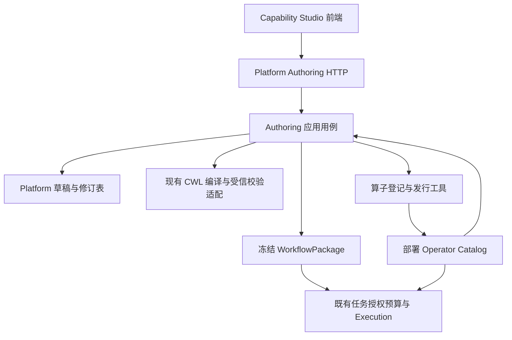

# 算子与工作流工作台：分轮实施计划

文档版本：1.3，已合入源码与开源调研的两轮评估反馈及逐项完成审计。日期：2026-10-16。

实施基线：P7.3a / `0.13.0`。实施状态：**A1–A5 已分别交付为 `0.14.0`–`0.14.4`；A6 / `0.14.5` 已补齐项目版本库和不可变 Release 正式执行；A7 / `0.14.6` 已补齐 Release 生命周期、节点许可与发布仲裁**。

本计划回应“单独的算子、工作流注册编辑模块”。“单独”指独立前端、明确的应用模块和 HTTP 契约；首期后端仍属于 Platform，不增加一套计算调度、独立注册数据库或新的服务间事务。A1–A7 已按逐轮规则完成。V6 保持原状。

评估过程、问题分级与修订对应关系见 [评估反馈与修订记录](capability-studio-design-review.md)。本文是修订后的实施依据；A1–A5 所列接口、表、脚本和状态已经实现并验收。

本版已采用[开源调研与二次设计评估](capability-studio-research-assessment.md)中的 E-01–E-07：派生描述符、表单行为、只读结构预览、数据流连线、冻结试运行断言和受限高级 CWL 语义。对应能力已经实现。

1.3 完成审计进一步固定了：原子创建受信空白 revision 1、状态投影与历史保留、服务端生成 trial_case、A1–A5 发行/迁移身份及模块总体完成条件。

## 1. 交付目标与范围

最终形成两个入口：

1. **算子中心**：查看当前部署能力、参数及输入输出语义；提交算子登记材料；查看审核、测试和部署匹配事实。
2. **工作流中心**：创建草稿、图形编辑、精确修订、校验、冻结候选包、真实试运行、发布可复用版本和查询历史。

保留一条正式运行路径：

```text
工作流草稿 → 冻结候选包 → 既有任务与精确授权
→ Action / 预算 → Execution / Toil → 原子成果发布
→ 按任务需要另行发起独立 Acceptance
```

首期不包含：用户代码、任意镜像、Shell、插件安装、URL/Git 自动抓取、实时多人协同、公开市场、DOI、RO-Crate 导出、Join、多输入计算协议、自动科学结论、Agent 自主登记或发布。

不因增加编辑器而调整 Toil 参数、Worker 资源布局、节点身份、重算规则、预算、Data 发布仲裁或 Checker 独立性。

### 1.1 本版固定取舍

| 决定 | 实施结果 |
| --- | --- |
| 描述符由已锁定代码和目录确定性派生 | A1 不增加外部描述符配置或 release lock 格式；保留原运行目录核验 |
| 先覆盖现有 11 个算子 | 不开发通用插件 ABI，不在本轮新增算法 |
| A2 只增加一个只读预览用例 | 同时返回参数错误与结构提示；不增加预览表、预算或计算状态机 |
| 连线只表示数据传递 | 不提供隐藏控制边，不承诺 Validate 会先于独立分支计算 |
| 样例预期随 Trial 冻结 | 运行事实与样例判定分开；不新增测试执行引擎 |
| 语义与展示身份分开 | 帮助文字不单独触发语义过期；运行目录和镜像仍精确冻结 |
| 保留 A1–A5 五轮 | A3 首次形成完整闭环；每轮通过后结束 |

## 2. 当前实现基线与需要补齐的边界

### 2.1 已核对的源码事实

| 当前事实 | 源码或证据 | 对实施的约束 |
| --- | --- | --- |
| 当前有 11 个算子，Aggregate 已接入真实三节点工作流 | [P7.3a 报告](../verification/p73a-release-report.md) | 先使用现有能力验证编辑链路，不同时新增算法 |
| 目录是部署生成的不可变锁 | [catalog.py](../../packages/platform-core/src/platform_core/application/catalog.py)、[目录说明](p70-operator-catalog.md) | 登记申请不直接修改运行目录；保留停机更新 |
| 参数联合和实现注册仍有明确白名单 | [science.py](../../packages/contracts/src/platform_contracts/science.py)、[Execution 目录校验](../../apps/execution-service/src/platform_execution/operator_catalog.py) | 编辑器不能宣称新增 JSON 即可运行任意算子 |
| 现有包登记保存请求，Worker 编译后得到 READY/REJECTED | [workflows.py](../../packages/platform-core/src/platform_core/application/workflows.py) | 复用注册、租约和编译规则，不复制第二套包处理器 |
| 每个新包目前使用 package_id + version_id=1 | [工作流 DTO](../../packages/contracts/src/platform_contracts/workflows.py) | 新工作流版本系列在上层映射，保留旧 PackageRef |
| CWL 编译器支持注入 resolver，但 PackageProcessor.freeze 当前使用默认解析 | [workflow_compiler.py](../../packages/platform-core/src/platform_core/application/workflow_compiler.py)、[Worker 装配](../../packages/platform-infrastructure/src/platform_infrastructure/worker.py) | 新校验与候选编译必须显式绑定部署目录；不能依赖执行时的隐式全局配置 |
| 当前算子文件端口只声明 File | [catalog.py](../../packages/platform-core/src/platform_core/application/catalog.py) | 补充编辑视图的表示、Schema 与字段结构描述 |
| A7 前的最小页面主要运行预设流程 | 旧静态预设页面已在 A7 迁移中移除；当前入口见 [Capability Studio](../../apps/capability-studio/src/app/App.tsx) | React Studio 已实现；旧页及旧接口按兼容策略保留或移除 |
| release lock 支持记录 11 个 wheel、3 个目录及 7 个镜像；wheel 目录参数当前可省略 | [发行锁构建](../../scripts/build_p7_release_lock.py) | Authoring 生产交付必须校验完整 wheel 集；前端与描述生成逻辑随 wheel 锁定 |

报告中的既有测试成绩是历史基线，本次文档工作没有重新运行它们，不据此宣称新模块已通过测试。

### 2.2 明确三种“注册”

| 行为 | 产生什么 | 是否直接可执行 |
| --- | --- | --- |
| 算子登记申请 | 包来源、契约、测试材料和审核记录 | 否；需受信实现接入及部署 |
| 工作流候选冻结 | 经现有校验的精确 PackageRef | READY 后可在正常授权和预算下执行 |
| 工作流版本发布 | 工作流系列到精确候选包、测试证据的不可变映射 | 便于发现与复用；不额外授予计算权限 |

**工作流版本发布不是新的权限关卡。** 当前有权用户已经能通过 `/workflow-packages` 注册包；本轮不收回该能力。候选包同项目可见，可以通过已有接口执行，始终仍需 Task、grant 和预算。未发布候选不进入 Studio 的“已发布版本”列表，但不能声称它在所有旧 API 中不可见。

## 3. 开源参考与选型

以下来源在前序调研中已核对。采用其可复用模式，不整体接入另一套平台。

| 来源 | 采用的模式 | 本项目的适配决定 |
| --- | --- | --- |
| [Galaxy 工作流编辑器](https://training.galaxyproject.org/training-material/topics/galaxy-interface/tutorials/workflow-editor/tutorial.html) | 算子面板、参数表单、输入输出和版本说明 | 采用交互模式；执行仍使用 V7 |
| [Planemo](https://github.com/galaxyproject/planemo) | lint、测试输入、结果断言、可审查报告 | 建设 V7 自身的契约/真实执行门禁，不在生产运行时另装 Galaxy |
| [QGIS Model Designer](https://docs.qgis.org/3.44/en/docs/user_manual/processing/modeler.html) | 输入与算法分离、可连接参数、最终输出选择 | 采用字段/图层选择体验；不将整条流程封装为绕过节点账本的 QGIS 模型 |
| [Dockstore 快照](https://docs.dockstore.org/en/stable/advanced-topics/snapshot-and-doi.html) | 描述、测试材料和精确版本冻结 | 候选包和测试证据绑定；不引入 DOI |
| [WorkflowHub 登记 API](https://about.workflowhub.eu/developer/ro-crate-api/) | 工作流系列与新版本分开登记 | 增加系列与发布映射；RO-Crate 只预留映射方向 |
| [React Flow](https://reactflow.dev/index) | MIT 许可的节点画布和交互组件 | 作为前端组件；不承担 CWL 或科学语义判断 |
| [JSON Forms](https://jsonforms.io/docs/validation/) | Schema 表单与后端字段错误接入 | 优先验证为表单组件；受信特殊控件及原 DTO 仍负责复杂约束 |
| [Rabix Composer](https://github.com/rabix/composer) | 图形与源码联动 | 仅参考；其维护说明及 CWL 1.0 定位不适合作为当前基础 |
| [GA4GH TRS](https://ga4gh.github.io/tool-registry-service-schemas/DataModel/) | 工具、版本、描述文件和测试材料发现 | 保留字段映射；首期不新增 TRS 服务 |

A1 已核对官方兼容信息并锁定 Node `>=22.12.0`、React/React DOM `19.3.1`、TypeScript `7.0.2`、Vite `8.3.4` 和 `@vitejs/plugin-react 6.1.2`。React Flow 属于 A2，A1 未提前安装。

A1 用契约夹具验证 Schema 输出；A2 用 Rule、Filter、Aggregate 三类表单验证 JSON Forms。只有无损序列化和后端错误定位通过才采用；若不满足，使用少量受信 React 控件，不另建通用表单规则语言，也不维护两套生产表单引擎。

## 4. 架构与所有权



### 4.1 工程位置

| 位置 | 内容 |
| --- | --- |
| `apps/capability-studio/`（新增） | React/TypeScript、画布、表单、API 客户端、前端锁文件 |
| `packages/contracts/src/platform_contracts/authoring.py` | 严格 DTO、描述符与错误位置契约 |
| `platform_core/domain/authoring.py`（新增） | 修订、身份、发布前提；标准库依赖 |
| `platform_core/application/authoring/`（新增） | 草稿、校验、候选、试运行关联、发布用例 |
| `platform_infrastructure`（扩展） | 仓储、迁移、校验 Worker 装配、部署 CLI |
| `platform_api/adapters/http/authoring.py`（新增） | 鉴权、路由、错误封套；不直接运行容器 |
| `tests/authoring/`（新增） | 分轮契约、数据库、HTTP、浏览器及真实运行测试 |

新前端独立开发和构建，生产静态文件打包进入 Platform API wheel，在 `/studio/` 同源提供。仍保持 11 个 Python 发行包，不为纯前端创建空 Python 包。旧任务页保留。

### 4.2 运行边界

- 编辑器只通过 Platform API，不能直读数据库、访问 Docker 或携带内部服务令牌。
- Authoring 只拥有草稿、校验和版本映射。资产内容仍由 Data 管理；执行、容器和恢复仍由 Execution 管理。
- 原子成果发布指 Data publication；工作流版本发布称 workflow release，接口、表和界面中明确区分。
- Worker 复用短事务领取、租约和 generation 回写；编译与容器校验在数据库事务外完成。
- 增加校验队列时采用有界轮询，不能使现有 outbox、验收或生命周期处理长期饥饿；首期不做 Worker 池优化。
- Studio 关闭或浏览器断线不终止已经接受的试运行。候选包一旦提交，不从草稿重新生成运行材料。

## 5. 身份、修订与摘要

### 5.1 持久对象

| 对象 | 核心字段与约束 | 引入轮次 |
| --- | --- | --- |
| WorkflowDefinition | project、definition_id、stable_key、head_revision、创建者/时间；stable_key 在项目内唯一 | A1 |
| WorkflowRevision | definition、revision、source、source_digest、layout、layout_digest、版本化 metadata、作者、时间；保存后不可覆盖 | A1 |
| AuthoringValidation | revision、source/目录/语义契约/编译器/校验镜像摘要；完整描述符及发行身份作审计记录；结论、问题、lease/generation | A2 |
| WorkflowCandidate | revision、validation、package_id、expected manifest、环境快照；package_id 唯一绑定 | A3 |
| WorkflowTrial | candidate、task、Action、冻结输入与 trial_case 摘要、环境；执行状态投影及独立 case_verdict/result_digest | A3 |
| WorkflowRelease | definition、version_label、candidate、PackageRef、trial_ids、环境与作者；版本唯一且不可覆盖 | A3 |
| OperatorProposal / Revision | project、proposal、不可变申请修订、受信材料引用、审核事件 | A4 |
| ProposalDeploymentReceipt | proposal revision、实际部署 release/catalog/implementation 摘要、导入者 | A4 |

复用现有幂等、身份与项目访问控制机制，不为这些对象建立平行用户系统。

Candidate 只绑定既有包状态；Trial 的执行状态只投影原 Action/Execution；Release 是不可变映射。结构预览不持久化；样例判定保存在 Trial 内，不增加 TestCase 服务、第二套运行状态机或独立测试调度。

Definition 不另存一份可独立修改的标题/说明；GET Definition 从 head revision 投影当前 metadata，历史显示读取指定 revision。创建 Definition 与初始 revision 1 在同一事务完成，失败全部回滚。A1 的初始 source 由服务端固定 `blank-workflow-v1` 工厂生成：一个受限根 Workflow、空 inputs/outputs/steps、无实现引用；客户端不能上传另一套初始化模板。A1 只允许修改版本化标题/说明及受限空布局，A2 才允许画布修改 source。这样 A1 能验证真实修订链，不提前开放源码编辑。

首期不提供 Definition、Revision、Candidate、Trial、Release 或 Proposal 的物理删除接口。列表可按状态和历史分页；取消执行、撤回申请、目录停用均记录事实，不级联删除修订、Action、预算、包或证据。测试项目清理由既有受控运维流程处理，不通过业务 API 绕过保留规则。

### 5.1.1 状态所有权

| 对象 | 权威状态 | 转换原则 |
| --- | --- | --- |
| WorkflowDefinition/Revision | 无业务状态；head 指向最新不可变修订 | 仅追加；旧修订永远可精确读取 |
| AuthoringValidation | QUEUED → RUNNING → PASSED / REJECTED / ERROR | lease/generation 隔离；环境变化产生 ERROR/STALE 视图，不改写历史 PASSED |
| WorkflowCandidate | 不复制包状态；查询时投影关联 WorkflowPackage | 包 QUEUED/VALIDATING/READY/REJECTED 即候选当前编译事实 |
| WorkflowTrial | execution_outcome 投影 Action/Execution；case_verdict 独立 | Action 事实不回退；样例 PASS/FAIL 不覆盖；ERROR 只重试判定读取 |
| WorkflowRelease | 不可变，无可移动 latest 状态 | 新版本创建新记录；当前可执行性是单独投影 |
| OperatorProposal | DRAFT / SUBMITTED / CHANGES_REQUESTED / APPROVED / REJECTED 由追加事件投影 | 任何决定绑定精确 proposal revision；部署匹配不属于申请状态 |

状态投影必须携带来源对象与修订摘要，不能在 Studio 表中复制一个会与 WorkflowPackage、Execution 或 Operator Catalog 漂移的“当前状态”。API 可返回方便展示的组合视图，但仓储所有权仍按上表分开。

### 5.2 工作流系列与包身份

```text
definition_id = wf_example
  revision 1 → revision 2 → revision 3（编辑修订）
  release 1.0.0 → candidate A → package A / version_id 1 / digest A
  release 1.1.0 → candidate B → package B / version_id 1 / digest B
```

`version_label` 是 Studio 发布版本；现有 `PackageRef.version_id` 保持原语义。运行时提交精确 PackageRef，不使用可移动的 latest 指针。复制旧版编辑生成新修订，不更改旧包、历史输入或报告。

`stable_key` 使用现有 Identifier 语法并在创建后不可修改。`version_label` 使用规范 `MAJOR.MINOR.PATCH`，可带点分隔的 ASCII 预发布标识，不接受 build metadata、前导零、`latest` 或前后空白，总长不超过 64；服务端按语义版本排序并保存规范字符串。版本只要求在同一 Definition 内唯一，不暗示底层 PackageRef.version_id 变化，也不自动比较科学质量。

### 5.3 草稿与图形的唯一权威

- 保存的 source 使用受限 CWL 文档对象及实现引用；允许编辑中的缺端口、缺参数等不完整语义。
- 草稿仍必须通过严格 JSON、大小、深度、键名和禁止内容检查；不完整不能等同于允许任意代码或 URL。
- React Flow nodes/edges 是 source 的投影，不另存一套可独立执行的图。
- layout 仅含节点位置、折叠与视口。移动节点不修改 source_digest。
- 展示名称与稳定 step_key 分开；复制节点产生新 step_key；修改展示名称不得重命名调用路径。
- 无法完整呈现的既有工作流先只读展示并提示原因，不能保存一个丢失 scatter/条件的简化图。
- 首期源码只读；A5 才加入受限导入与可验证的源码编辑。

### 5.4 摘要规则

统一使用项目既有规范 JSON 摘要工具。新快照拒绝 NaN/Infinity；明确 UTF-8、排序键和无额外空白规则。

1. `source_digest`：精确的执行源请求内容；不含界面 layout、帮助文本或测试 AssetRef。
2. `layout_digest`：独立布局对象。
3. `semantic_contract_digest`：端口、参数 Schema、受信校验/结构规则的实现身份及语义版本；不能只哈希导出的 JSON Schema。
4. `presentation_digest`：UI 分组、标签、帮助和展示提示；完整 `descriptor_digest` 覆盖语义与展示身份。
5. `validation_context_digest`：source、完整 Operator Catalog 摘要、semantic_contract_digest、编译器身份和校验镜像身份。
6. `package_ref.manifest_digest`：继续由既有 PackageProcessor 算法生成，不以新摘要替代。
7. `trial_case_digest`：候选 PackageRef、解析后的精确输入、预期步骤/输出及受信断言版本；随 Trial 在准入事务中冻结。
8. release 同时记录 source_digest 与 PackageRef，不能只记录界面版本号。

帮助文本默认保存在 authoring metadata，不自动写入 CWL doc/label。若源码模式显式修改了 CWL 字段，则按实际源码变化重新计算摘要；不承诺把任意注释变化自动识别为语义等价。

仅 presentation_digest 变化不使原语义校验过期；目录、语义规则、编译器或镜像变化仍按原冻结规则处理。每条证据保存完整发行身份用于追溯，不把整个前端包摘要作为语义相等判断。跨修订自动复用验证、按部分算子放宽目录锁均不在首期范围。

### 5.5 编辑并发

`POST revisions` 必须带 `expected_revision` 和 Idempotency-Key。锁定所属 definition 行后比较 head，成功时追加修订并更新 head；冲突返回 409，不静默覆盖。

`POST workflow-definitions` 原子创建 Definition 和 revision 1，固定使用 `expected_revision=0`；同项目 stable_key 及幂等范围内重放原对象。后续 `POST revisions` 必须使用当前正整数 head。Definition 创建与追加修订不共享幂等操作名，避免相同请求键发生别名碰撞。

同键同内容重放原修订，同键异内容冲突；重放仍检查当前身份和项目权限。保存不完整草稿不创建预算、Action 或工作流包。A1 的 revision 请求只能改变 metadata/layout 并携带原 source_digest；服务端从上一修订复制 source，拒绝 source 内容变化。A2 起画布用例才提交新的 source，并执行相同乐观锁规则。

首期只做显式保存和离开页面未保存提醒，不按每次拖动生成持久修订，不引入 CRDT 或自动多用户合并。

## 6. AuthoringDescriptor 与端口语义

### 6.1 生成与权威

Platform 从已锁定 wheel 内的 DTO、受信描述映射和已校验 Operator Catalog 确定性生成只读描述符。通过鉴权 API 返回，不加载工作目录或用户提供的 `authoring-descriptors.json`。描述符包含 schema_version、operator_catalog_digest、逐算子版本、semantic_contract_digest、presentation_digest 和 descriptor_digest。

- 参数 JSON Schema 从现有 DTO 导出；UI hints 来自受信映射，不允许项目用户修改运行参数约束。
- 目录决定算子身份、端口、实现和生命周期；描述符不能新增目录没有的实现。
- `model_validator` 等跨字段规则无法完整导出时，明确标记 server_validation_required；服务端调用原契约验证。
- JSON Schema 不含可执行函数、动态远程 ref 或任意表达式。引用只解析发布物内的受信定义。
- 前端不能只信自己内置的参数表。启动握手核对 frontend_contract_version、当前静态构建身份和当前目录；请求携带使用中的语义上下文，服务端独立比较。前端记录服务端返回的完整 descriptor_digest，纯展示更新刷新视图。
- 生成逻辑、语义映射、UI 映射随包发行，语义与展示模块分开取摘要。生成结果可按精确输入摘要缓存；失败时禁止 Authoring 写入和冻结，不返回占位描述。
- 来源追溯链为“release lock → wheel 文件摘要/目录摘要 → 已安装受信生成逻辑 → 派生描述”。A1 必须验证安装产物，不能仅比较版本号。详细发行步骤见 12.2。

部署描述符与项目远程绑定分开：前者只描述固定算子语义，后者是按当前身份授权后返回的项目级实现视图，不并入全局 descriptor_digest。客户端状态和服务端缓存至少按项目、访问范围和对应修订隔离；切换项目或退出登录清除旧实现选项。精确版本查询继续支持历史定义，新建节点只能选择当前可准入实现。

### 6.1.1 表单行为与服务端规则

为 11 个算子建立受信覆盖清单：参数 DTO、Schema、控件、条件字段、省略/null/默认值语义、跨字段校验与错误位置。不得由用户上传 UI rules 或可执行表达式。

- 服务端原 DTO 验证已解析的具体参数；JSON Schema 通过只表示基础检查通过。参数来自尚未绑定的根端口时标记待绑定，不用空对象或猜测默认值制造错误结论。
- 首批阻断夹具包括 ROW_COUNT 缺边界、COUNT_ROWS 错带 field_id、Profile 重复字段，均不能显示最终有效。
- 修改规则类型导致旧字段不适用时，保留编辑值并指出需清除的字段，或由明确的“清除不适用字段”操作处理；隐藏控件不等于悄悄改写输入。
- 保存/加载不自动填默认值、强制类型转换或删除未知字段；缺省、null 和显式值按原 DTO/CWL 语义分别处理。用户明确采用默认值时才写入源对象。
- 参数错误统一为 step_key、参数 JSON pointer、固定错误码和消息，前端定位到表单；不得只显示无法定位的 HTTP 422。
- A2 通过 6.3 的统一预览用例调用参数与结构校验，不为每个控件增加路由。草稿可以保存错误；候选必须通过正式验证。

### 6.2 每个文件端口至少说明

| 字段 | 示例 | 含义 |
| --- | --- | --- |
| transport_type | File | 对应 CWL 传输类型 |
| representation_kind | TABLE / VECTOR / IMAGE / REPORT | 表示类型 |
| media_types | application/vnd.apache.parquet | 传输格式提示 |
| schema_ids | table-aggregate-table-v1 | 固定 Schema 或受信动态结构规则 |
| content_role | SOURCE_TABLE / DERIVED_TABLE / PROFILE_TABLE / VALIDATION_REPORT | 输出内容用途提示 |
| structure_rule | PRESERVE / PROJECT / CAST / AGGREGATE / FIXED / RUNTIME | 结构如何确定 |
| constraints | 允许物理类型、行列上限、CRS 前提 | 结构与方法约束 |

`content_role` 用于明确含义和提示，不强行阻止合法研究。例如允许对规则结果表做统计，但界面不能把它标成原始数据的透传。

### 6.3 字段结构预览

首期只为已经实现的表格算子提供受限结构转换：Filter 保留列；Project 按已有字段映射；Cast 显式改类型；Aggregate 使用冻结 group/measure 规则生成字段；Profile/Validate 使用固定报告表结构。

复用或提取既有标准库结构校验函数，不调用生产算子执行，也不在前端复制数值算法。派生字段必须保持实际 field_id/来源映射，不能只按显示名称连接。

检查结果固定为：

- `COMPATIBLE`：已知结构满足条件。
- `INCOMPATIBLE`：存在明确冲突。source 自身冲突禁止冻结候选；仅样例绑定冲突阻止使用该样例试运行，不把模板永久判为无效。
- `REQUIRES_BINDING`：需要资产、字段或 CRS 事实；允许保存和模板校验，但试运行准入必须补齐。

不进行自动列重命名、隐式 Cast、CRS 选择、单位解释或文件扩展名推断。检查能力显示精确的 Checker 匹配范围；通用运行完整性通过不能覆盖缺少领域检查器的结果。

新增只读 `POST P/authoring/previews`：请求包含二选一的精确 revision_ref / 未保存 source，以及可选根端口 `sample_bindings`。每个样例仍使用现有精确 Selection；最多 64 个绑定，source 沿用 1 MiB/深度上限。不接受文件路径、URL、内联数据或内部服务地址。

处理顺序：当前身份/项目访问权 → 参数 DTO 校验 → 对已提供绑定调用 Data.resolve → 受信结构规则按拓扑传播 → 返回逐节点/端口结构与问题。没有绑定也可检查参数，未知字段事实保持 REQUIRES_BINDING。VIEWER 可使用只读预览；它不授予计算许可。

响应冻结本次 source_digest、bindings_digest、semantic_contract_digest、catalog_digest，返回各端口结构与问题。前端按请求序号及完整编辑上下文丢弃乱序响应；切换项目清理缓存；上游参数变化使下游提示失效。不把预览保存为权威 validation，也不把样例资产写进可复用 source。

问题增加 `scope=SOURCE|SAMPLE_BINDING`。例如已知输出 PNG 连接 Table 是 SOURCE 冲突；某份样例没有 f3 是 SAMPLE_BINDING 冲突。未绑定模板只能核对静态可知事实；正式候选校验不能从一次失败预览推断所有输入非法。换一份符合条件的样例重新解析，不复用原失败样例的字段判断。

预览不创建记录、Action、预算或运行容器，不要求 Idempotency-Key；采用有界请求、超时和限流。Data 不可达返回明确依赖错误，不使用跨项目缓存或旧结构伪装成功。只返回字段/类型/CRS 等元数据，不返回原始行或样本值。试运行仍重新解析输入并检查 grant、预算及版本。

### 6.3.1 数据连接与执行顺序

每条画布边都对应真实 CWL source→input 数据传递。首期没有独立 dependsOn、无数据的控制边、隐式门控或前端顺序调度；节点位置不影响执行顺序。

`table-validate.table` 是规则报告。连接给 Aggregate 表示统计该报告；要分析原表，Aggregate 仍绑定原输入，此时两分支可能并发。Validate 失败阻止父级整组发布，但已经开始的兄弟节点仍按实际计算计费。

界面明确展示上述差别；不使用虚假 File、隐藏输入或伪造参数模拟“先检查成功再计算”。通用校验门控需要独立设计，不在 A1–A5 偷改当前执行协议。

### 6.4 浏览器数值精度

P7 规则中的规范 int64/double 字符串保持字符串，不经过 JavaScript Number 再序列化。对于 CWL long 等真正的 JSON 数字，超过 JavaScript 安全整数范围时采用经过测试的无损处理；若当前编辑模式尚未支持，则保留原源码只读并明确提示，不能改写为近似数。不得把真正的数字擅自改成字符串来通过表单。

测试覆盖 2^53 两侧、int64 边界、负零和规范数值字符串；保存、重新读取、候选摘要和运行参数必须保持原契约语义。此项属于内容正确性门槛，不因前端表单显示“相同”而放宽。

## 7. 校验、候选冻结、试运行与版本发布

### 7.1 校验分层

1. **前端即时提示**：必填、端口连接、重复 step_key、环等；只改善交互。
2. **服务端契约**：严格 DTO、身份、支持范围、参数组合和结构规则。
3. **受信编译与 cwltool 预检**：复用现有编译器及固定校验镜像。
4. **绑定检查**：试运行时按真实 Data binding 检查字段、项目、表示摘要和语义。
5. **真实执行及独立验收**：分别记录执行证据、必要的 Checker 结果。

校验不消耗科学执行额度，但仍有请求大小、队列配额、固定资源和审计。实际科学节点和 Checker 继续按既有规则计费。

### 7.2 异步上下文不能漂移

校验接受时持久保存服务端取得的目录快照、语义契约、编译器身份和 cwltool 镜像；完整 descriptor_digest 与 release 身份另作审计记录。Worker 必须显式向 compiler/resolver 注入该上下文。

若语义执行上下文已变化，不能静默使用新目录继续旧任务。返回可查询的 `VALIDATION_ENVIRONMENT_CHANGED`，保留原请求，用户对新上下文发起新校验。历史 PASSED 报告不改写；当前有效性通过摘要比对显示为 STALE。仅 UI 提示或布局变化不触发该错误；不据此允许替换运行镜像或算子版本。

校验任务状态：QUEUED、RUNNING、PASSED、REJECTED、ERROR。临时数据库/容器不可达保留重试事实，不能伪装成源定义错误；重试使用同一校验身份，回写检查 generation。

### 7.3 候选包冻结

冻结请求指定 definition、revision、validation_id，不接受客户端 compiled 内容或镜像。

在一个 Platform 事务内：重新授权 → 验证修订/上下文 → 检查幂等 → 创建既有 workflow_package → 创建 candidate 绑定 → 返回 202。

从现有 register 中提取可复用的事务内建包函数；原公开注册入口继续调用同一函数。不通过内部 HTTP 回调自身，不在两个事务分别创建候选和包。

现有 PackageProcessor 对有 candidate 的包读取冻结校验上下文，使用同一受信编译路径并比较 expected manifest；只有一致且校验通过才标 READY。无 candidate 的历史包保持原兼容路径。不得从当前草稿 head 取源码，也不得因摘要不一致自动生成另一包。

### 7.4 试运行

首期试运行要求已有 DIRECT Task，不自动创建 Task、扩大预算或授予 grant。EDITOR 没有有效授权时显示缺项，由 OWNER 通过现有授权接口处理。

试运行请求包含 candidate_id、task_id、expected_spec_revision、inputs、max_node_executions 和 `trial_expectations`。客户端只能声明 7.4.1 允许的输出断言，不能提交 required_steps、required_outputs、断言实现版本或判定。后端把 candidate 转成精确 WorkflowTarget，复用既有解析和 Workflows.admit，并从冻结候选/计划生成规范 trial_case。

**WorkflowTrial 与 Action、预算预留、Command、outbox 在最终准入事务内创建。** 为共享准入用例增加受限的内部 authoring context，不能把客户端任意回调或元数据当作可信关联。Data 查询和计划编译仍在数据库写事务外进行。

返回有类型的 TrialReceipt，其中包含 trial_id、trial_case_digest 和既有 CommandReceipt。客户端请求幂等摘要包含原 `trial_expectations`；服务端在最终写事务前确定性生成 trial_case，并将其摘要与 Trial/Action 一起保存。同一请求必须产生相同规范 case，否则按环境/候选变化拒绝准入，不静默改写。重放先重查当前身份/项目权，再恢复已有 Trial/Action，不因 Task 后来完成或环境变动重新准入。首次准入仍检查当前 Task、输入、许可和目录。查询执行状态读取既有 Action/Execution，Trial 不维护新的计算状态机。

输入解析、计划和 trial_case 生成在数据库写事务外完成；最终事务重新锁定 Task，核对 candidate、PackageRef、计划/目录/输入摘要及幂等记录后写入。重放路径在这些外部解析之前命中原记录，避免历史输入当前不可达时错误地新建 Trial。

试运行产物按现有 Data 协议发布在试运行所属项目中，可查询和清理；**不能宣称试运行成果不可见或不计账**。界面明确显示测试任务。隔离演练使用独立测试项目与离线合成资产。

### 7.4.1 冻结样例与判定

trial_case 在试运行提交前确定，随 Trial、Action 在同一事务保存。它冻结：

| 内容 | 首期规则 |
| --- | --- |
| profile | 固定 `workflow-trial-case-v1` |
| expected_execution | A3 固定 SUCCEEDED；失败执行可保留诊断，不能单独满足版本发布 |
| required_steps | 服务端从 A3 基础候选生成所有计算步骤的完整调用路径；客户端不能删减 |
| required_outputs | 包声明的最终输出端口、类型和形状；不得省略声明的必要成果 |
| assertions | 从客户端 trial_expectations 规范化；最多 64 个固定断言：精确输出选择、受信 Schema、可选预期表示 SHA-256；不允许任意表达式或文件路径 |
| identity | 精确 candidate/PackageRef、解析后的输入摘要、断言实现版本及 trial_case_digest |

A3 仅接受至少一个计算节点的基础流程；高级条件/scatter 的 coverage 到 A5 实施。输出选择沿用端口及数组/record 路径；Schema 缺失或暂不可判定时不得猜测 PASS。既有兼容目录可以提供有明确来源的 Schema。

判定只读取既有 Execution 节点事实和父级 Data 发布 manifest，不访问私有输出，不执行科学算法，不消耗新的计算额度。图形生成流程的数值正确性仍由现有独立 Checker 验收。

Trial 读取分别展示：

- `execution_outcome`：原 Action/Execution 的权威状态。
- `case_verdict`：PENDING、PASS、FAIL 或 ERROR。
- `case_result_digest`：固定预期、所用节点/发布事实摘要和逐项判定；PASS/FAIL 后不可覆盖。

父执行仍未知时维持 PENDING；确定执行失败、必要步骤未实际完成或断言不符时为 FAIL；读取依赖/内部评估错误为 ERROR，允许对原身份重新读取和判定，不自动重算。PASS 的含义仅为该冻结样例满足预期。计算已成功但样例 FAIL 时，已发布事实不删除，Execution 不改写为 FAILED。取消按原 Action/Execution 事实展示，不新增 `case_verdict=CANCELLED`；执行未成功时最终判定为 FAIL，并记录 `EXECUTION_CANCELLED` 等固定原因。

判定复用 Platform Worker 的有界投影处理，使用现有 lease/generation 和唯一 trial_id 回写，不另建测试队列或公开“写入判定”接口。实际 HTTP 查询在数据库事务外进行，提交判定及发布引用时检查固定身份。Worker 重启或响应丢失只能补全同一判定，不能创造第二个 Action。ERROR 保存 attempt、错误类别和下次重试时间；瞬时依赖故障按现有有界退避重试，协议/身份冲突停止自动重试并保留 ERROR。旧 generation 不能覆盖新判定；PASS/FAIL 不自动重算。修改 trial_expectations 必须使用新幂等键发起新 Trial；同键异内容冲突，不能事后填入输出摘要来使旧试运行变为 PASS。

### 7.5 发布工作流版本

请求包含 candidate_id、version_label、trial_ids。首期 Studio 新版本至少关联一条同候选、同语义执行上下文、`execution_outcome=SUCCEEDED + case_verdict=PASS` 的真实试运行，且至少一个计算节点实际执行、父执行成果完整发布。这个要求只约束 Studio 的版本发布，不改变已有包 API 的准入规则。

发布事务重新检查权限、候选 READY、精确 manifest、trial_case/case_result 摘要、测试关联、目录生命周期及语义执行上下文。外部查询在事务外获得，事务中核对固定引用和不可变结果；不持有数据库锁等待服务。唯一约束为 `(project_id, definition_id, version_label)`。成功返回 201；重放返回同一个 release。发布不再次编译，不再次计算，不复制成果。

如果候选引用远程实现，重新检查的是候选固定的项目绑定和修订；新增修订不替换旧引用。旧修订被禁用时新发布明确失败，历史试运行仍按原身份查询。元数据中不能写入服务凭据或通过其他项目的同名绑定消除冲突。

试运行只证明声明样例的行为，不证明任意输入或自然语言科学目标。版本页显示“在这些样例上通过”、输入/断言摘要、已测试节点和明确限制；不显示“已完成科学验证”。不把测试成功转换为 Task VERIFIED Completion。

发布版本不随编辑 head 移动；修订期间仍可发布明确选择的历史修订，前提是它的上下文和证据仍有效。不能通过“总是最新”悄悄替换用户选择。

### 7.6 升级后的旧版本

历史 release、validation、trial 保持可读。当前可执行性按部署目录、精确实现及现有准入规则重新判断；不保证任意旧候选跨发行自动可运行。

目录或编译环境变化后，界面区分“历史证据有效描述过去运行”与“当前环境可运行”。需要重新验证时复制成新修订/候选并测试，不覆盖旧证据。活动执行依旧按当前既有停机升级规则先收敛。

## 8. 权限与接口

### 8.1 权限矩阵

| 操作 | VIEWER | EDITOR | OWNER | 维护者 CLI |
| --- | --- | --- | --- | --- |
| 读取同项目草稿、版本、校验和试运行 | 是 | 是 | 是 | 按运维身份 |
| 只读参数/结构预览 | 是，需有输入读取权 | 是 | 是 | 按运维身份 |
| 创建/修改草稿、校验、冻结候选、发布工作流版本 | 否 | 是 | 是 | 非默认业务入口 |
| 发起试运行 | 否 | 还需现有任务/grant/预算 | 仍需显式 grant/预算 | 不绕过计算许可 |
| 创建算子登记申请 | 否 | 是 | 是 | 可导入受信材料 |
| 授予任务权限、管理成员 | 否 | 否 | 依既有规则 | 依既有 CLI |
| 审核包、启用实现、变更全局目录 | 否 | 否 | 否 | 是，沿用部署权限 |

项目 OWNER 不自动成为平台维护者。首期不增加全局管理员网页、不把维护者 Token 下发浏览器。远程实现只展示当前项目已有的绑定及冻结修订；项目凭据、服务内部 URL 和令牌不写入工作流定义。

### 8.2 拟新增公开接口

令 `P=/api/v1/projects/{project_id}`。所有状态写入 POST 使用 Idempotency-Key，并在重放时重新检查当前权限；所有列表分页。

| 接口 | 行为与成功码 | 轮次 |
| --- | --- | --- |
| GET `P/authoring/operator-descriptors` | 当前部署的编辑描述，200 | A1 |
| POST / GET `P/workflow-definitions` | 原子创建系列及受信空白 revision 1，201 / 分页 200 | A1 |
| GET `P/workflow-definitions/{id}` | 系列、head 和发布列表入口，200 | A1 |
| POST / GET `P/workflow-definitions/{id}/revisions` | 追加修订 201 / 分页 200 | A1 |
| GET `.../{id}/revisions/{revision}` | 精确修订，200 | A1 |
| POST `P/authoring/previews` | 只读参数与结构预览，200；无持久写入，不要求幂等键 | A2 |
| POST `.../{id}/validations` | 持久接受指定修订校验，202 | A2 |
| GET `P/authoring/validations/{validation_id}` | 状态、问题和上下文，200 | A2 |
| POST / GET `.../{id}/candidates` | 冻结候选 202 / 分页 200 | A3 |
| GET `.../{id}/candidates/{candidate_id}` | 包状态及精确 PackageRef，200 | A3 |
| POST / GET `.../{id}/trial-runs` | 原子准入试运行 202 / 分页 200 | A3 |
| GET `.../{id}/trial-runs/{trial_id}` | 原 Action/Execution 进度，200 | A3 |
| POST / GET `.../{id}/releases` | 发布不可变版本 201 / 分页 200 | A3 |
| GET `.../{id}/releases/{version_label}` | 精确发布版本，200 | A3 |
| POST / GET `P/operator-proposals` | 创建登记申请 201 / 分页 200 | A4 |
| GET `P/operator-proposals/{id}` | 材料、审核事件和部署匹配，200 | A4 |
| POST `P/operator-proposals/{id}/revisions` | 带 expected_revision 追加材料，201 | A4 |
| POST `P/operator-proposals/{id}/submit` | 固定申请修订供审核，200 | A4 |

原 `/operators`、`/workflow-packages`、`/executions`、授权、交付和验收接口保持兼容。不要提前添加未实现轮次的路由、占位成功响应或 OpenAPI 类型。

预览在可解析请求下返回问题列表，即使某个节点参数错误也可定位；非法请求封套、权限错误或依赖不可用使用对应 HTTP 错误。异步正式 validation 仍用于候选冻结，预览结果不能替代它。

### 8.3 请求及问题位置示例

以下是 API 字段示例，不是可直接运行的完整 CWL 包：

```json
{
  "expected_revision": 3,
  "source": {
    "profile": "v7-cwl-p4-v1",
    "name": "table-summary",
    "entrypoint": "main",
    "documents": {},
    "implementations": {}
  },
  "layout": {
    "nodes": {"filter_1": {"x": 120, "y": 80}},
    "viewport": {"x": 0, "y": 0, "zoom": 1}
  },
  "metadata": {"title": "表格汇总", "description": "编辑中的草稿"}
}
```

草稿允许该示例暂时缺少 entrypoint 文档；冻结候选必须通过现有严格 WorkflowPackageCreate。

该 source 示例用于 A2 及以后。A1 的页面不提供 JSON 文本框，只由 `blank-workflow-v1` 创建空白 revision，并可版本化编辑 metadata；读取 API 仍返回完整 source，便于契约和历史核验。

```json
{
  "code": "INPUT_FIELD_NOT_FOUND",
  "severity": "ERROR",
  "scope": "SOURCE",
  "location": {
    "document_id": "main",
    "step_key": "aggregate_1",
    "port": "parameters",
    "pointer": "/measures/0/field_id"
  },
  "message": "所选字段不在上游已知输出结构中"
}
```

错误码加入现有错误注册与封套，不从渲染文本推断错误类型。401/403、404、409 修订/摘要冲突、422 契约不支持、503 依赖不可用继续保持可区分；精确项目隔离遵循现有 API 规则，不泄漏其他项目对象是否存在。

### 8.4 输入边界

- 冻结包继续执行现有上限：1 MiB、最多 100 个文档、32 个实现引用、嵌套深度 8、展开计算节点最多 1,000。
- 草稿 source 同样有 1 MiB 上限；metadata 最多 128 KiB、layout 最多 256 KiB，另设 JSON 深度与元素数上限，超限明确拒绝。
- A1–A3 仅接收 JSON 对象，不开放 YAML、压缩包和外部导入。
- A5 的 YAML 使用安全解析并拒绝重复键、自定义 tag、别名放大和外部引用；统一映射到同一受限源对象。
- 不记录 Token、资产内容或请求正文。日志使用 definition/revision/validation/candidate/Action、generation 和错误类别。
- Token 只保存在内存，不写 URL、localStorage、导出包或测试材料；帮助文本按纯文本或受限渲染处理。

## 9. 算子登记、审核与部署

### 9.1 材料

申请修订保存：算子与版本、作用和限制、输入参数输出契约、包/源码身份、已支持协议和资源档选择、测试集与证据摘要、Checker 覆盖说明。

上传材料只是文本和受限描述；不在 API 中 clone、pip install、构建镜像或执行材料中的命令。包来源字符串只作来源记录，不作为服务器主动获取地址。维护者通过现有受控工程流程取得和检查实际代码。

新增算法需要代码接入的现实保持明确：DTO、目录工厂、实现注册、输出校验及必要独立 Checker 仍需开发测试。本模块用于管理这项工作，不宣称已经建设通用插件 ABI。

页面使用“提交接入材料”“评审记录”“部署匹配”等具体名称，不把材料保存按钮称为“安装算子”。A4 使用既有受控发行 CLI；没有零代码插件安装、自动构建集群或独立审批系统。

### 9.2 事件与启用事实

申请流程记录 DRAFT、SUBMITTED、CHANGES_REQUESTED、APPROVED、REJECTED。评审决定绑定精确申请修订与材料摘要；修改材料创建新 revision，并使原评审只适用于历史版本。再次提交追加新事件，不覆盖旧决定。

审核通过不等于可运行。可运行性从当前部署 Operator Catalog 读取；`deployment_match` 比较精确算子、实现、契约和发行身份，不保存一个可能过期的“已启用”布尔值。

审核与部署凭据通过维护者 CLI 导入。CLI 记录维护者身份、操作时间、实际 release lock 与证据身份，不提供项目 OWNER 可调用的自我批准接口。伪造 receipt 与实际目录不匹配时拒绝匹配成功。

### 9.3 生命周期

沿用 `ACTIVE / DISABLED / REVOKED` 和现有停机更新约束。Studio 提示影响的草稿、发布版本和匹配 Checker；它不直接变更目录生命周期。

已有成果、历史版本、预算和 provenance 均保留。Checker 与 SERVICE_TOOL 只能查询其独立说明，不混入可拖入计算图的 Operator 列表。

## 10. 分轮开发与测试

当前基线明确为 `0.13.0 + Platform 0018_agent_acceptance_identity`，为本模块预留以下发行和迁移身份：

| 轮次 | 发行版本 | Platform 迁移 | 其他服务迁移 |
| --- | ---: | --- | --- |
| A1 | `0.14.0` | `0019_authoring_drafts` | 无 |
| A2 | `0.14.1` | `0020_authoring_validation` | 无 |
| A3 | `0.14.2` | `0021_authoring_release` | 无 |
| A4 | `0.14.3` | `0022_operator_proposals` | 无 |
| A5 | `0.14.4` | 无；复用既有 source/revision/trial 表 | 无 |

若实施前 Platform head 已被其他已批准工作推进，迁移编号顺延但语义名称和依赖顺序不变，并在阶段报告记录映射；不得产生两个相同 revision ID。每轮统一提升 11 个 Python 包与 CWL runtime 版本，重新构建相关静态资源、目录、镜像和 release lock；未修改镜像也记录并验证其固定摘要。

### A1：工程、描述符与草稿基础

**交付：** 能查询 11 个算子的精确描述，创建工作流系列、保存和读取修订；没有图形运行或发布按钮。

顺序：

1. 先用 Rule、Filter、Aggregate/Profile 契约夹具验证确定性描述生成、跨字段差异及参数无损往返；不提前建设画布或运行模块。
2. 定义 authoring DTO、受限草稿、语义/展示摘要与 expected_revision；形成 11 个算子的契约/控件覆盖清单。
3. 固定“wheel 内代码/映射 + 已校验目录 → 派生描述”单一路径，验证源码规则身份、完整 wheel 安装核验和生产启动；不引入外部描述符回退。
4. 增加仅含 definitions/revisions 的 Platform 迁移与仓储；Definition 与受信空白 revision 1 原子创建，复用权限和幂等。
5. 建立前端锁、同源入口、目录列表、详情、草稿列表和 metadata 修订保存页；A1 不提供 source 文本编辑或画布。
6. 前端/描述生成逻辑进入原 wheel/release lock 链，完成独立安装和当前功能的测试；release lock 格式保持 schema v2。

必测：空库与 0018 升级、重复迁移、Definition/revision 1 原子回滚、稳定空白 source、不同项目访问、成员降权后的幂等重放、创建与追加相同键不混用、两个编辑者同时保存、响应丢失恢复原 revision、A1 修改 source 拒绝、草稿非法结构、布局与源码摘要分离、11 个算子描述精确覆盖、三类 Schema/DTO 差异、纯展示不改变语义摘要、篡改/缺少 wheel 被部署核验拒绝、checker/tool 排除、旧任务页继续可用。

**停止条件：** A1 当前功能通过；不提前实现 A2–A5 表和接口。

### A2：基础图形编辑与受信校验

**交付：** 输入、算子、数据连线、固定参数、数据依赖顺序/并行和最终输出编辑；只读样例结构预览；源码只读；异步正式校验。

顺序：

1. 建立 source ↔ canvas 的受限投影测试，先证明保存/载入不丢端口顺序和字段身份。
2. 通过三类复杂表单选择单一表单组件方案，接入 DTO 错误、省略/null/默认值与数字字符串往返。
3. 实现单一 previews 用例，按当前权限解析样例输入，传播受信结构；不增加预览表或科学计算。
4. 明确数据边与 Validate 报告表含义，处理乱序响应、上游变化和下游提示失效。
5. 增加 validations 迁移、短事务领取与 generation 隔离。
6. 将目录、语义契约与 validator 镜像显式注入，保存不可变校验上下文；建立错误定位、REQUIRES_BINDING、过期和重试界面。

必测：环、无输入、缺输出、未知实现、同名节点、字段删除/改类型后引用、Validate 结果表身份与并行语义、PNG→Table 拒绝、未知结构不伪造兼容、跨项目样例拒绝、预览乱序/断线/上游改变、三类参数错误精确定位、旧高级图只读保护、cwltool 容器不可用、校验 Worker 重启、排队期间语义上下文改变、纯展示更新、旧 generation 回写拒绝。

**停止条件：** 基础图保存和校验通过；没有试运行、候选和发布接口。

### A3：候选冻结、真实试运行和工作流版本发布

**交付：** 首个完整可用的工作流编辑闭环。

顺序：

1. 增加 candidates/trials/releases 迁移；复用事务内包登记，验证插入故障全回滚。
2. 候选包处理使用冻结上下文，核对 expected manifest。
3. 抽取/扩展共享准入用例，在 Action 事务中冻结 Trial 与 trial_case；不自动创建任务和授权。
4. 用现有节点与发布事实计算 case_verdict，验证响应丢失和 Worker 接管不会重算；不新增测试运行器。
5. 页面完成候选、样例预期、资产/任务、许可预算、执行状态与样例判定；发布复用原 PackageRef，添加版本查询、比较和“复制为草稿”。
6. 在真实 PostgreSQL、HTTP、Docker、Toil 和固定科学镜像上运行下面的业务用例。

必需业务用例：

- 浏览器创建 `Filter → Aggregate → Profile`，绑定真实合成表格，三个节点只结算一次，整组发布。
- 浏览器创建 `Buffer → Summary / StaticMap`，真实 QGIS/Native 执行，PNG 与其他成果整组发布。
- 表格试运行成果走既有精确 Deliverable 与 Checker 验收，证明编辑来源不破坏独立复算；该验收不是 workflow release 的科学证明。
- 并行 Validate 失败时成功兄弟节点不能形成半组成果。
- EDITOR 缺 grant、预算不足、任务暂停/取消时不能借试运行绕过约束。
- 候选编译后崩溃、Action 写入后响应丢失、Worker 重启、发布版本响应丢失保持原身份。
- DATA 发布响应丢失与取消竞争沿用既有事实；Studio 不把 UNKNOWN 显示为已停止。
- 断言错误时 case_verdict=FAIL，原成功 Execution/已发布资产保持真实；不能发布该样例为通过。
- 必需步骤/输出不能被客户端删除以换取 PASS；同键修改 trial_expectations 冲突；Task 终态后的合法重放仍返回原 Trial。
- 样例判定依赖暂不可读时 ERROR/PENDING，恢复后读取原执行；无新的 Action、容器或扣账。

**停止条件：** 同一冻结候选从真实执行、样例判定到版本发布可完整复核，全部必测通过；科学完成仍由独立 Acceptance 决定。

### A4：算子登记和发行闭环

**交付：** 可提交、修订、审核和追踪受信算子登记；不增加算法，不开放任意运行代码。

顺序：

1. 增加 proposals/revisions/review events/deployment receipts 迁移与只读展示。
2. 记录现有协议、资源档和源码/测试材料身份；拒绝未知协议和任意资源值。
3. 维护者 CLI 导入审核决定与部署证据，校验当前真实 release lock。
4. 用现有审核表格包做隔离登记演练，证明材料修改、目录匹配、部署状态和历史读取。
5. 核对 Operator/Checker/Tool 三目录及 Agent 仍使用同一部署事实。

必测：项目 OWNER 不能部署、上传文本不会被执行、审核修订错配、伪造镜像/源码/目录 receipt、同版本语义覆盖拒绝、未部署实现不可提交、DISABLED/REVOKED 停机更新、远程绑定跨项目拒绝、旧版本读取。

**停止条件：** 登记材料和实际运行能力能精确对应；不在同轮迁入新算子。

### A5：高级 CWL 编辑与导入

**交付：** 在既有支持范围内编辑子工作流、布尔条件和三种 scatter，导入受限自包含定义。

顺序：

1. 先建立现有编译夹具到画布的语义往返测试。
2. 增加子图编辑、稳定路径、数组位置和条件 null 展示。
3. 增加安全 JSON/YAML 导入；外部 import/include、任意 JS、Shell、路径和镜像拒绝。
4. 实现同一源模型上的源码编辑；不能投影的内容显式只读，不能无损承诺后静默删字段。
5. 扩展 trial_case 的条件、scatter 覆盖事实，记录实际执行/跳过路径、实例数量和最终数组形状；只对选定样例声明覆盖，未测试分支明确列出。全空/全跳过用例可满足自身断言，但不能单独满足发布所需的至少一条实际计算正向用例。
6. 更换算子版本先显示参数/连接/输出变化，新建修订；不自动断开连接或升级旧候选。
7. 运行真实顺序/并行/嵌套/scatter 工作流及必要恢复回归。

必测：dotproduct、flat/nested crossproduct、多层 scatter、重复值、空数组、nullable/record、输出位置、1,000 节点上限、动态展开超限、未覆盖分支、全跳过用例不能单独支持发布、版本变更差异、禁止隐式创建 Join/多输入算子、旧工作流包不重写。

**停止条件：** 受支持特性语义等价；未支持特性仍明确拒绝或只读。结束该轮，不自动推进市场、Agent 编写或跨平台导出。

## 11. 测试矩阵与入口

下列是待新增测试标识，不代表已经运行。每轮开始先把本轮阻断场景转为测试，再开发修复。

| 编号 | 级别 | 场景 | 必须观察到的事实 | 轮次 |
| --- | --- | --- | --- | --- |
| ID-01 | L0 | 两人同时保存同一 head | 一人成功，一人 409，无覆盖 | A1 |
| ID-02 | L0 | 修改跨项目 revision/候选引用 | 拒绝，无其他项目内容泄漏 | A1/A3 |
| ID-03 | L1 | 移动节点、修改展示名称 | source_digest、step_key 不变 | A2 |
| ID-04 | L0 | 创建 Definition 时 revision 插入失败 | Definition 与 revision 1 全部回滚 | A1 |
| ID-05 | L0 | A1 修改 source 或请求物理删除历史对象 | 明确拒绝；只允许 metadata/layout 追加修订 | A1 |
| CT-01 | L0 | UI 描述与 DTO 或目录错配 | 服务端拒绝；发行核验失败 | A1 |
| CT-02 | L0 | File 可连接但表示不兼容 | 确定冲突被拒绝，不靠扩展名 | A2 |
| CT-03 | L1 | 动态结构缺数据 | REQUIRES_BINDING，不虚构字段 | A2/A3 |
| CT-04 | L0 | 大整数和规范数值字符串往返编辑 | 无静默舍入、改类型或摘要漂移 | A1/A2/A5 |
| CT-05 | L0 | 切换项目后复用旧远程绑定缓存 | 清除旧视图，服务端独立拒绝跨项目解析 | A1/A4 |
| CT-06 | L0 | ROW_COUNT 缺边界、COUNT_ROWS 带字段、Profile 重复字段 | Schema 不能冒充最终有效；DTO 拒绝且页面定位 | A1/A2 |
| CT-07 | L0 | 表单隐藏字段、null/省略/默认值转换 | 无隐式数据删改，保存后原契约语义保持 | A2 |
| PV-01 | L0 | 跨项目/错摘要样例请求 | 无结构泄漏，无 Action/预算/包 | A2 |
| PV-02 | L1 | 预览乱序、上游改字段、Data 不可达 | 过期提示不覆盖新编辑，未知不冒充成功 | A2 |
| PV-03 | L1 | 样例缺字段后换成合法样例，或参数尚未绑定 | 绑定错误不污染模板；未知参数不被当作空对象拒绝 | A2 |
| DF-01 | L0 | Validate 与 Aggregate 共享原输入 | 只表达并行数据边，不承诺隐式门控或免计费 | A2/A3 |
| VA-01 | L0 | 排队后目录/编译器改变 | 不使用新环境完成旧上下文 | A2 |
| VA-02 | L0 | 旧 Worker 回写校验结果 | generation 不符无法写入 | A2 |
| VA-03 | L1 | 只修改 UI 帮助或语义校验代码 | 前者不单独使语义失效；后者改变语义上下文 | A1/A2 |
| CA-01 | L0 | candidate 插入后 package 事务失败 | 两者均不存在 | A3 |
| CA-02 | L0 | 实际 compiled 与 expected manifest 不同 | 不进入可发布候选，不静默换包 | A3 |
| TR-01 | L0 | Action 插入后 trial 插入失败 | 预算、Action、trial、outbox 全回滚 | A3 |
| TR-02 | L0 | 提交响应丢失后重放 | 一个 trial、Action 和预算预留 | A3 |
| TR-03 | L0 | 缺 grant、暂停、取消或预算不足 | 原有许可规则仍生效 | A3 |
| TR-04 | L0 | 成功兄弟与失败节点并存 | 没有半组公开成果 | A3 |
| TR-05 | L1 | 暂不可查询、Worker/Toil 重启 | 原节点与容器身份；未知保守展示 | A3 |
| TR-06 | L0 | 试运行后修改预期或同键更换 trial_expectations | 旧 trial_case 不变，异内容重放 409 | A3 |
| TR-07 | L0 | 执行成功但输出断言错误 | 样例 FAIL；执行与资产保持事实；不能支持发布 | A3 |
| TR-08 | L0 | 删除必需步骤、样例判定丢响应/旧代次回写 | 无虚假 PASS；读取原身份，不重复计算或结算 | A3 |
| TR-09 | L1 | Task 终态后重放原试运行 | 当前身份检查通过后返回原 Trial，不重新准入 | A3 |
| TR-10 | L1 | 判定读取瞬时失败、协议冲突及旧 generation | 前者同 trial 有界重试；后两者保留 ERROR 且不能覆盖新事实 | A3 |
| TR-11 | L0 | 客户端伪造 required_steps、required_outputs 或 case_verdict | 请求拒绝；权威 case 只由冻结候选和服务端规则生成 | A3 |
| RE-01 | L0 | 另一候选的测试记录用于发布 | 拒绝 | A3 |
| RE-02 | L0 | 发布响应丢失及版本冲突 | 原 release 可恢复；版本不能覆盖 | A3 |
| RE-03 | L0 | 测试后目录/绑定修订变化 | 不自动切换依赖；旧事实保留 | A3/A5 |
| OP-01 | L0 | OWNER 提交部署/可信等级覆盖 | 无该授权路径，不能启用实现 | A4 |
| OP-02 | L0 | 伪造部署 receipt | 与真实锁不匹配，拒绝激活声明 | A4 |
| CW-01 | L0 | 导入含执行代码或外部地址 | 明确拒绝，不执行/抓取 | A5 |
| CW-02 | L0 | scatter/record 往返编辑 | 路径、数组位置、null 与顺序保持 | A5 |
| CW-03 | L0 | 条件全跳过/空 scatter/未测试分支 | 明确样例覆盖；没有实际计算的用例不能单独支持发布 | A5 |
| PK-01 | L0 | 前端/描述符/目录跨发行混搭 | 启动核验或握手明确失败 | A1 起 |
| PK-02 | L1 | 仓库外安装 | Studio 静态文件、API 和已实现链路可用 | 每轮 |
| PK-03 | L0 | 生产 wheel 证据缺失/篡改，或传入外部描述符 | 发行/安装核验拒绝；不回退到版本字符串或外部文件 | A1 |

L0 是身份、权限、不可变性和结果完整性阻断；L1 是本轮可恢复与可用性阻断。两类本轮必测均不得跳过；未来轮次未实现的功能标记“范围外”，不创建 skip 作为已覆盖证明。

### 11.1 拟新增统一入口

下面脚本和测试目录尚未存在，由对应轮次实现：

```bash
# 按轮次只加入已实现门禁
uv run --locked pytest -q tests/authoring/a1
bash scripts/check_authoring.sh --phase drafts
bash scripts/check_authoring.sh --phase editor
bash scripts/check_authoring.sh --phase workflow-release
bash scripts/check_authoring.sh --phase operator-registration
bash scripts/check_authoring.sh --phase advanced-cwl
```

建议前端固定入口：`npm ci`、`npm run typecheck`、`npm run test`、`npm run build`；具体工具锁在 A1 冻结。浏览器门禁复用现有 Python Playwright，避免引入第二套浏览器版本管理。

现有兼容与发行入口：

```bash
bash scripts/check_p7.sh --phase catalog
bash scripts/check_p7.sh --phase compatibility
uv run --locked python scripts/verify_distribution.py
uv run --locked ruff check .
uv run --locked ruff format --check .
```

每个正式轮次先定向测试，修复后执行一次完整兼容与发行门禁。后续没有代码变化或新失败时不反复运行全量。兼容脚本与发行验证需在当轮纳入 authoring 的已实现目录及前端产物；不能仍只遍历 P7 历史目录。

无性能优化门槛；记录构建和真实试运行耗时。业务测试使用实际科学容器，不用直接调用算子函数替代；纯协议、图形转换和错误定位单元测试可使用小夹具。未修改调度器时不重跑 P4 长节点性能矩阵，也不把小夹具用于性能结论。

## 12. 数据迁移、发行身份与回退

### 12.1 分轮迁移

当前 Platform head 为 `0018_agent_acceptance_identity`；Data、Execution、Knowledge 分别为 `0004_document_assets`、`0006_remote_reliability`、`0002_lifecycle_outbox`。

Platform 按第 10 节预留顺序增加 `0019_authoring_drafts`、`0020_authoring_validation`、`0021_authoring_release`、`0022_operator_proposals`。每轮只在该轮实现时创建自己的迁移，不提前建后续表；若开始实施时真实 head 已合法前进，则按第 10 节规则顺延并记录映射。其余三个服务首期无新增持久化要求。

每轮测试空库、上轮带历史数据升级、重复迁移、schema 检查和失败恢复。不得修改已交付迁移或历史业务 JSON。source 与镜像不匹配的问题不能通过数据库补写伪造旧事实解决。

### 12.2 通过现有发行锁交付派生描述

固定构建顺序：

```text
受审源码 + Python/前端锁文件
→ 构建 Studio 静态包、包内文件清单和前端契约版本
→ 静态文件打入 API wheel；描述生成逻辑/受信映射打入相应 wheel
→ 构建固定镜像
→ 生成 Operator / Checker / Tool Catalog
→ 按现有 schema v2 生成完整 release lock（11 个 wheel、3 目录、7 镜像）
→ 核验 wheel 文件后安装，启动时执行现有运行目录/镜像核验
→ Platform 用已安装代码和已校验目录生成描述，记录输入身份和派生摘要
```

前端 bundle 和 wheel 不能内嵌最终 release_digest。派生 descriptor 不作为 release lock 的输入，从而不存在摘要循环。客户端从经过鉴权的服务端元信息取得部署身份；前端构建标识来自包内清单，清单不把自身摘要递归纳入。

A1 不增加新 release lock schema，不要求 Execution/Agent 读取 UI 描述。三方原有 Operator/Checker/Tool Catalog 及镜像核验继续执行；改变包内容仍必须发行匹配的新 wheel 和 lock，不能复用旧发行摘要。

Authoring 生产交付必须提供完整 wheel 目录并在安装前逐项核对 lock 的文件 SHA-256 和精确 wheel 集合，缺项拒绝。补齐现有部署/发行脚本中遗漏的校验，不把“版本号相同”作为产物一致。静态文件与描述映射由已核验 wheel 携带；启动/安装检查包内文件清单，混装或文件缺失明确失败。

只允许从包内受信模块与已核验目录生成描述；不提供外部描述符文件、数据库覆盖或用户设置回退。发行门禁在仓库外以同一组受信输入重复生成并比对结果，保存派生摘要作为测试证据。启动核对真实输入和生成约束、记录派生身份；生成失败阻断 Authoring readiness，不依赖额外可替换的“预期描述符”文件。确定性或安装核验不通过时留在 A1 修复，不自动切换成外部描述符架构。

更新源码清单纳入前端源代码/锁文件和 `tests/authoring`，排除 node_modules、生成产物、缓存和临时运行目录。继续精确核对 11 个 wheel，不把前端依赖目录或测试凭据打进源码身份。

将来若确需独立维护、分发或替换描述符，再单独评估外部产物锁定与格式升级；本版不预建这条通道。

### 12.3 升级

1. 等待活动 Action、AgentRun、Acceptance、工作流引擎及发布按既有规则收敛。
2. 完成或记录待恢复 authoring 校验，停止相关 API/Worker，备份 Platform 数据库及发行材料；若需要预备整版业务回退，按同一停机边界备份其他数据库、资产与恢复材料，不能只备份 Platform。
3. 安装本轮完整发行；执行本轮 Platform 显式迁移。
4. 核验四数据库 schema、运行目录、完整 wheel/镜像、包内前端清单与派生描述输入/结果身份。
5. 启动服务与 Worker，确认 readiness 和前端握手。
6. 运行当前轮次冒烟、定向、兼容和仓库外安装门禁。

本计划为 A1–A5 预留 `0.14.0`–`0.14.4`。五轮软件、迁移身份、发行材料和门禁已经分别落地；A5 复用 `0022`，没有新增数据库迁移。

### 12.4 回退

- 不在运行中混用新旧 Worker、目录或前端。
- 回退前收敛活动执行，停止 authoring 写入并导出新增修订/证据。
- 旧应用不识别新 schema 时，不直接删除新增表降级。优先前向修复；只有确认升级后没有新的业务状态推进，且修订/证据已归档时，才能评估恢复升级前匹配备份与发行。
- 若升级后已有 Action、预算结算、Data 发布或远端活动，禁止仅恢复 Platform 数据库。灾难恢复必须按全平台一致性流程协调四数据库、资产、JobStore、执行目录与远端实际状态；归档并对账升级后的身份和事实，防止本地记录回退后再次启动已执行的计算。本模块不新增自动灾难恢复工具。
- 新增 revision、trial、release 和 proposal 记录不能为了通过旧 schema 检查而悄悄删除。
- V7 旧成果、Task、预算、JobStore、节点账本和 Completion 不属于 authoring 数据迁移的删除对象。

## 13. 评估结论与当前实施状态

设计评估结论：**A1–A5 已完成实现和验收；Capability Studio 首期范围完成。**

本版主要取舍：保留原执行、预算、恢复和科学验收；编辑描述从已锁定代码和目录派生；语义与展示摘要分开；一个只读预览用例反馈参数和结构；数据边不冒充控制门控；Trial 冻结样例预期，原执行与样例判定分别记录。发布仍复用候选包，业务推进后禁止单库回退。

A1 首轮任务清单（已完成）：

- [x] 先完成复杂参数的描述/DTO 往返夹具，明确三类 Schema 与 DTO 差异。
- [x] 冻结 AuthoringDescriptor、语义/展示摘要、WorkflowDefinition、WorkflowRevision 和错误位置契约。
- [x] 生成当前 11 个算子的描述与表单覆盖清单，保留服务端跨字段验证。
- [x] 实施仅含草稿基础的 Platform 迁移、仓储、HTTP 和幂等。
- [x] 建立锁定前端、同源入口、目录详情及最小草稿保存页。
- [x] 使用原 release lock 格式核验完整 wheel 集、包内前端/映射与确定性派生描述；拒绝外部配置回退。
- [x] 通过 A1 门禁及必要兼容/发行检查，输出真实结果和阶段报告。
- [x] 结束 A1，不自动创建画布、运行、发布或登记审核模块。

后续用户反馈应记录问题、受影响契约、采用/不采用理由及新增测试，再修改本文。涉及预算、任意代码、在线目录变更、跨项目共享或科学完成语义的建议必须重新评估边界，不能作为普通 UI 修改直接加入。

### 13.1 v1.2 反馈落实表

| 反馈 | 决定 | 落实位置 | 新增验收 |
| --- | --- | --- | --- |
| E-01 表单跨字段规则 | 采用，原 DTO 权威；特殊控件和后端错误定位 | 6.1.1、A1/A2 | CT-06/07 |
| E-02 数据与控制依赖 | 采用，首期只提供数据边，不实施门控 | 6.3.1、A2 | DF-01 |
| E-03 结构预览 | 采用，一个只读用例，无新表/Action | 6.3、8.2、A2 | PV-01/02/03 |
| E-04 样例预期 | 采用，服务端 trial_case 与 Action 原子冻结；独立样例判定 | 7.4.1、7.5、A3/A5 | TR-06/07/08/09/10/11、CW-03 |
| E-05 描述符简化 | 采用派生方案；保留安装完整性，不升级 lock 格式 | 6.1、12.2、A1 | PK-01/02/03 |
| E-06 展示与语义 | 采用双摘要；不放宽运行目录锁 | 5.4、7.2 | VA-03 |
| E-07 登记边界 | 保留并强化接入材料/维护者发行口径 | 9、A4 | OP-01/02 |

上表是总体设计决定。A1–A5 均已有独立阶段报告和结构化证据；A5 完成后不自动进入市场、Agent 编写或跨平台导出。

### 13.2 模块总体完成条件

Capability Studio 只有在 A1–A5 分别通过并交付阶段报告后才可标记整体完成。最终证据必须同时证明：

- 用户可从受信空白草稿开始，经基础和高级受限 CWL 编辑、正式校验、候选冻结、真实试运行、样例判定和版本发布完成闭环。
- 同一 source 在保存、图形投影、源码编辑、冻结、恢复和发布间保持精确身份；不支持的内容只读或拒绝，不静默丢失。
- 系统工具、计算算子和 Checker 仍不可混用；算子登记材料不能直接取得运行或部署权限。
- 试运行沿用任务、grant、预算、Action、Execution、Data 原子发布和故障恢复；响应丢失、重启、取消和重放不重复计算、扣账或发布。
- 样例 PASS 只表示冻结输入与断言通过；科学 VERIFIED 仍必须由既有精确 Deliverable、CoveragePlan 和独立 Checker 完成。
- 当前 11 个算子的编辑描述、参数规则、端口结构和生命周期与部署目录一致；旧 P3–P7 执行、工作流、报告和 Agent 能继续读取及恢复。
- 仓库外安装、完整 wheel/目录/镜像锁、前端构建、真实 PostgreSQL/HTTP/Docker/Toil/浏览器闭环及每轮兼容检查均无失败或必测跳过。

达到这些条件后才更新主实施路线的阶段状态；任一当前轮必测失败时留在该轮修复，不以未来轮次或人工说明替代门禁。本计划不自动授权 Join、在线插件、Agent 编写工作流、市场或 P8。

## 14. A6 后续补强：项目版本库与正式执行

A1–A5 的首期编辑发布闭环完成后，审计发现普通业务客户端只能读取 Definition 下的 Release，再自行取出 PackageRef 走通用工作流接口。这会丢失用户选定的 Release 身份，并把内部包引用暴露为客户端控制面。

A6 / `0.14.5` 以不新增表的方式补齐：项目级 Release 列表从既有不可变事实投影；正式执行由 Definition 与规范 SemVer 定位，服务端解析精确 PackageRef，并在 Action 中冻结完整 Release 来源。准入继续复用现有权限、grant、预算、执行图、Toil、恢复和原子发布协议。幂等重放先恢复原 Action，首次请求才检查 Release 当前可执行性。

A6 没有引入 latest、公共市场、跨项目共享、Agent 工作流编写或新的科学资格。完整接口、身份与故障语义见 [A6 契约](a6-workflow-release-library.md)。

## 15. A7 收口：工作流版本生命周期治理

A6 Release 可以正式执行，但缺少可审计的停用与永久撤销机制。A7 / `0.14.6` 增加 `0023_workflow_release_lifecycle`：Release 当前状态与修订作为投影保存，全部状态变化追加不可变历史；首次准入和每个节点许可使用当前状态，Action 仍冻结原 Release 身份。

发布许可与生命周期转换锁定同一 Release。许可先提交时，该 Action 可以完成已经取得权利的发布；撤销先提交时，首次许可被拒绝。该决定按 Action 唯一保存，Worker 重启和响应丢失不能改变先后关系或创建第二次发布。

A7 不删除历史 Release 或资产，不把撤销解释为取消，不增加跨项目市场或 Agent authoring。详细状态、接口与回退约束见 [A7 生命周期契约](a7-workflow-release-lifecycle.md)。
