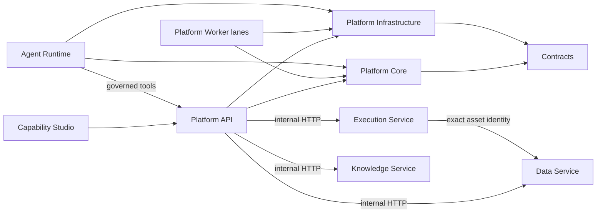

# Groundwater Platform V7 模块与接口地图

本文描述当前源码的物理模块、依赖方向、状态所有权和运行边界。部署事实必须由显式配置与当前
门禁确认，不能从版本号、目录名、旧报告或候选制品推断。

## 源码结构

```text
source/
├── apps/          # Platform API、Data、Execution、Knowledge、Agent、Capability Studio
├── packages/      # Contracts、Core、Infrastructure、Operator、Checker、Temporal
├── runtimes/      # 独立执行引擎声明
├── deploy/        # 当前镜像与 Compose 声明
├── scripts/       # build/check/configure/evaluation/maintenance/operations/release
├── tests/         # 按能力组织的行为与边界回归
├── examples/      # 可执行样例
├── experiments/   # 当前实验源码
├── benchmarks/    # 可重复运行的性能基准
├── evaluations/   # Agent 与模型评估
└── docs/          # 当前架构、契约、决策与运维说明
```

生成 bundle、测试结果、历史报告、发布指针、候选清单和运行实例均不属于源码结构。

## 依赖方向



- Contracts 只提供 DTO、身份和摘要协议，不访问数据库或服务。
- Core 持有领域规则与 application ports，不依赖 FastAPI、SQLAlchemy 或服务 adapter。
- Infrastructure 实现仓储、迁移和外部端口；API 与 Worker 在 composition root 注入实现。
- Data、Execution 与 Knowledge 各自拥有数据库和迁移，不直接读取其他服务的表。
- Studio 只通过 Platform API 读写业务状态，不拥有服务权威事实。

## 运行组件

| 组件 | 权威内容 | 允许的跨组件引用 |
| --- | --- | --- |
| Platform PostgreSQL | Principal、Project、Task、预算、Action、Authoring、Agent、Acceptance | 远端 execution、asset、knowledge 身份与 observation |
| Data PostgreSQL 与对象存储 | upload、不可变 asset version、representation、publication | Platform 的精确引用 |
| Execution PostgreSQL 与 workspace | Action/Workflow 阶段、节点、lease、trace、临时物化 | Platform Action 投影 |
| Knowledge PostgreSQL | document、evidence、import、lifecycle | Platform 的引用与 coverage 状态 |
| 浏览器 | 未提交表单、筛选与页面状态 | 不产生权威任务、执行或发布事实 |

Platform Worker 按 lane 启动，每个进程只构造本 lane 所需的 adapter。工作项租约与进程健康心跳
相互独立；health 不能替代 claim、renew 或 fenced finish。

Capability Studio 源码位于 `apps/capability-studio/`。前端 bundle 是可再生部署制品，构建时可以
暂存到被忽略的包目录或 `runtime/work/`，但不得进入 Git 或源码检索上下文。

## 部署与运行态

新的 P8 实例由 Direct Compose 的明确 artifact 目录、不可变镜像身份和 `DeploymentContext`
确定。项目只使用自己的 rootless Docker socket；宿主 socket、兄弟工程运行目录、共享可写卷和
隐式“最新版本”发现均被拒绝。

`runtime/` 位于源码根外：

- `runtime/toolchain/` 从锁文件重建；
- `runtime/work/` 保存可丢弃的构建、测试和基准输出；
- `runtime/active/` 保存显式激活的制品；
- `runtime/p8/` 保存明确配置的 Direct Compose 实例；
- `runtime/docker/` 是独立 rootless Docker 数据根。

当前没有配置好的 P8 实例。需要实例的门禁应返回 `BLOCKED`，不能借用旧指针或报告声称通过。

## 自动门禁

- `check_architecture_boundaries.py`：分层 import、模块 façade 与前端 feature 方向。
- `check_workspace_dependencies.py`：兄弟工程、宿主 Docker、共享资源和越界链接。
- `check_project_hygiene.py`：缓存、密钥、历史/候选材料和生成 bundle 的 Git 边界。
- `check_internal_layout.py`：项目布局、维护入口和文档链接。

这些门禁验证当前源码合同；动态网络、数据库、备份恢复和业务闭环仍必须在目标环境单独运行。
