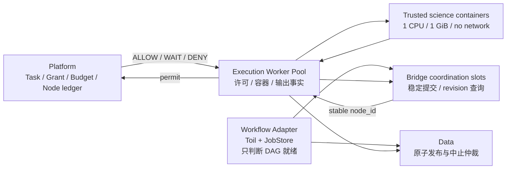

# P4.1 工作流性能与恢复问题详细解决方案

日期：2026-10-12。基线：V7 `0.3.0`。本文只设计 P4.1 的改造，不进入 P4.2，不改变科学算子，不以 rootless gVisor 为实施前提。

相关材料：

- [根因与开源方案分析](p4-workflow-root-cause-and-options.md)
- [长节点性能报告](../verification/p4-workflow-performance-report.md)
- [结构化性能证据](../verification/p4-workflow-performance-evidence.json)

## 1. 结论和解决原则

当前系统已经具备正确的任务授权、预算、稳定节点身份、单次执行、成果发布和故障恢复语义。问题集中在工作流协调层：Platform 和 Toil 对同一批节点分别限流，桥接任务被当作完整 CPU 任务调度，scatter 被编译成多层 CWL 作业，节点运行期间又反复走提交接口。这些开销叠加后，使 8 个固定 30 CPU 秒节点在任务并发上限为 4 时，实际峰值只有 2，计算窗口平均并行度只有 `1.412`。

改造遵循五条原则：

1. Platform 仍是实际计算准入、预算、授权和取消的唯一权威。
2. Toil 只负责依赖就绪、scatter/gather 和 JobStore 恢复；Toil 的资源槽只描述协调进程，不代表科学容器额度。
3. 任何响应丢失、进程重启或普通 404 都不能生成新的节点身份或触发隐式重算。
4. 性能结论只使用每节点至少 30 CPU 秒的长节点，不用短节点推断科学工作流性能。
5. 一轮只改一类机制。每轮通过功能、恢复和性能门槛后结束，下一轮再继续。

## 2. 已观测事实和性能缺口

标准 scatter 场景有 8 个计算节点，每个容器运行 `30.518–30.632` 秒。节点启动偏移为：

```text
0, 11.13, 39.41, 57.88, 85.68, 100.05, 134.95, 142.53 秒
```

当前结果：

| 指标 | 当前值 | 目标值 |
| --- | ---: | ---: |
| 任务 `max_in_flight` | 4 | 4 |
| 容器峰值并发 | 2 | 4 |
| 计算窗口 | 173.061 秒 | 不超过 76.5 秒 |
| 平均计算并行度 | 1.412 | 至少 3.2 |
| 计算槽利用率 | 35.3%（按 4 槽） | 至少 80% |
| 工作流总耗时 | 228.440 秒 | 不超过 100 秒 |
| 进程组回收警告 | 17 | 0 |
| 重复计算／重复扣账 | 0 | 必须保持 0 |

计算窗口目标按 `8 × 30.6 / 3.2 ≈ 76.5` 秒确定，不要求节点运行时间变短，而是减少节点之间的空档。

端到端时间拆分为：

```text
T_workflow = T_expand
           + T_ready_to_bridge
           + T_submit_or_reconcile
           + T_permit
           + T_execution_queue
           + T_container
           + T_output_handoff
           + T_gather
           + T_publish
```

现有证据只精确测量了容器区间和总时间，尚不能把 111 秒以上的额外计算窗口时间准确归因到某一个子阶段。因此第一轮必须先补全时间线，不能直接同时修改多个参数。

## 3. 根因树

### 3.1 双重并发控制

Platform 已用任务 `max_in_flight`、节点许可和预算账本限制实际科学容器。Toil 又固定使用：

```text
--maxCores 2
--maxJobs 8
--maxLocalJobs 8
```

生成的 bridge `CommandLineTool` 没有 `ResourceRequirement`，因此按 Toil 默认值申请 1 核。bridge 实际只提交 HTTP 请求、轮询状态和下载输出，却与真实 1 CPU 科学容器使用相同的资源单位。结果是 Platform 允许 4 个节点运行，Toil 最多只放出 2 个 bridge。

### 3.2 CWL 图膨胀

当前 scatter 路径会生成：

```text
ordinal ExpressionTool
  → scatter wrapper Workflow
    → 条件或业务子 Workflow
      → bridge CommandLineTool
        → Platform/Execution 中的真实科学容器
```

每一个实际计算节点前后都伴随多个 Toil 作业、进程和 JobStore 更新。稳定 scatter 序号是必要的，但每实例包装 Workflow 不是稳定身份的唯一实现方式。

### 3.3 引擎身份与平台身份耦合

平台节点身份实际由以下内容确定：

```text
workflow_execution_id + 完整调用路径 + 各层 scatter 序号
```

但 bridge 还会沿 `/proc` 父进程树寻找 `_toil_worker` Job ID，并且为了保证一个命令对应一个 Toil Worker，强制关闭 job chaining。这使诊断信息反过来限制了调度优化。

### 3.4 提交与查询没有分离

bridge 当前每轮轮询都执行同一个 `POST /nodes/{node_id}`。稳定 Action ID 和幂等创建保证它不会重复执行，但运行 30 秒的 8 个节点会反复进入创建/核对路径，增加 HTTP、数据库事务和日志负担。

正确协议应是：

1. `POST` 使用稳定节点身份提交；响应丢失时只允许同请求重放。
2. 收到接受结果后使用 `GET` 和 revision 查询。
3. 已接受节点暂时 404 时进入对账，不把 404 当作未执行，也不换身份重提。

### 3.5 Worker 数量可能放大排队

当前性能基准只启动一个 Execution Worker。数据库领取使用 `FOR UPDATE SKIP LOCKED`、租约代次和运行目录文件锁，具备多进程竞争基础。双节点只相隔 0.224 秒启动，说明单 Worker 不是绝对串行瓶颈；但 scatter 同时产生工作流父记录和多个计算子记录时，一个 Worker 可能增加排队。是否扩为 2 个或 4 个 Worker 必须由时间线 A/B 决定。

### 3.6 子进程回收不完整

Toil single-machine 后端产生 17 条进程组未回收警告。CWL 引擎容器没有 Docker init，容器 PID 1 是 Python supervisor。警告说明运行时生命周期不干净，但现有证据不能证明每条警告都造成固定 5 秒阻塞，因此要单独测量 `--init` 前后和退出时间线。

## 4. 不可破坏的系统约束

改造后必须继续满足：

- `node_id` 跨 API、Worker、Toil leader 和 Execution Worker 重启保持不变。
- 节点只有在 Platform 发出许可后才能创建科学容器。
- 条件跳过、确认未启动的取消不扣执行次数；开始后失败仍扣一次。
- 授权撤销、任务修订和暂停在节点许可前生效；许可后的竞争按在途事实处理。
- Toil `retryCount` 保持 `0`。计算中断不能由引擎悄悄重算。
- 未知状态保留预算和身份，不能解释成未执行。
- 旧租约、旧 Worker 和旧引擎 epoch 不能写入权威状态。
- 最终输出继续按父 Execution ID 原子发布，不公开半组成果。
- 已发布冻结包和已开始的执行不得被新编译器或新运行配置原地改变。
- 公开 API、CommandReceipt、任务页正常请求结构保持兼容。

## 5. 目标架构



两类资源必须分开：

| 资源 | 权威 | 含义 |
| --- | --- | --- |
| `compute_slot` | Platform | 一个实际科学容器的预算和并发名额 |
| `coordination_slot` | Toil adapter | 一个 bridge/tagger/gather 协调进程的本机容量 |

Toil 的 `maxCores` 不再等同于科学计算核数。科学容器继续由 Execution 以固定 `--cpus 1` 启动，Toil bridge 使用小数协调资源。

两类身份也必须分开：

| 身份 | 稳定性 | 用途 |
| --- | --- | --- |
| `node_id` | 跨恢复永久稳定 | 幂等、授权、预算、成果来源、取消和查询 |
| `engine_binding` | 可空、可追加、可随 epoch 变化 | Toil Job ID、Worker 链或未来 Pod UID，仅供诊断和定位 |

`engine_binding` 不得参与节点请求摘要、预算唯一键或发布来源身份。

## 6. 详细改造设计

### 6.1 可观测时间线

Execution 数据库新增只追加的 `workflow_trace_events`：

| 字段 | 规则 |
| --- | --- |
| `event_id` | 服务生成的唯一标识 |
| `workflow_execution_id` | 父工作流执行 |
| `node_id` | 可空；节点事件必须填写 |
| `engine_epoch` | 可空；引擎事件必须填写 |
| `worker_generation` | 可空；权威写入关联当前租约代次 |
| `source` | `ENGINE`、`BRIDGE`、`EXECUTION_API`、`EXECUTION_WORKER`、`PLATFORM_CLIENT`、`DATA_CLIENT` |
| `event_type` | 固定枚举 |
| `observed_at` | PostgreSQL `clock_timestamp()` |
| `duration_ms` | 已完成操作的耗时，可空 |
| `attributes` | 受白名单约束的小型 JSON，不保存令牌、原始输入、请求载荷或文件内容 |

事件至少覆盖：

```text
ENGINE_CREATED / ENGINE_STARTED / ENGINE_EXITED
NODE_SUBMIT_RECEIVED / NODE_SUBMIT_ACCEPTED
NODE_STATUS_QUERIED / NODE_TERMINAL_OBSERVED
PERMIT_REQUESTED / PERMIT_ALLOWED / PERMIT_WAIT / PERMIT_DENIED
EXECUTION_CLAIMED / CONTAINER_CREATED / CONTAINER_STARTED / CONTAINER_EXITED
OUTPUT_VERIFIED / BRIDGE_RETURNED / GATHER_FINISHED
PUBLICATION_PREPARED / PUBLICATION_COMMITTED / PUBLICATION_ABORTED
```

观测事件不参与业务状态机。写入失败只能产生结构化告警，不能改变计算事实；性能验收若缺少必要事件则判定证据不完整。

基准从事件计算：

- `ready_to_bridge_ms`：Toil 发出 bridge 到 Execution 接收提交。
- `submit_to_permit_ms`：节点接受到许可结果。
- `permit_to_container_start_ms`：许可通过到容器开始。
- `container_to_bridge_return_ms`：容器结束到 bridge 返回。
- `gather_publish_ms`：最后 bridge 返回到发布完成。
- `average_compute_concurrency = Σ container_duration / compute_window`。
- `slot_utilization = average_compute_concurrency / min(max_in_flight, node_count)`。

实现位置：

- Execution 新迁移 `0003_workflow_trace`，不修改 `0001`、`0002`。
- Repository 增加 `append_trace()`，使用数据库时间和 `ON CONFLICT DO NOTHING`。
- `WorkflowRunner`、普通 `Runner`、内部节点 API 和 HTTP 客户端只记录阶段边界。
- benchmark 直接读取测试数据库生成证据，不增加生产调试接口。
- Toil 使用独立日志文件 `toil-e{epoch}.log`，证据只摘取事件数量和警告类别。

### 6.2 bridge 提交、查询与恢复协议

新增内部接口，不进入公开 OpenAPI：

```text
POST /internal/workflows/{execution_id}/nodes/{node_id}
GET  /internal/workflows/{execution_id}/nodes/{node_id}?after_revision=N&wait_seconds=5
GET  /internal/workflows/{execution_id}/nodes/{node_id}/files/{representation_id}
```

`POST` 行为保持稳定创建和同内容重放；返回 `node_id`、`revision`、`state`、`retry_after_ms`。`GET` 只查询已知身份，可以最多等待 5 秒直到 revision 变化，降低重复事务和轮询空档。

bridge 状态机：

```text
SUBMIT_UNKNOWN
  ├─ POST成功 ───────────────→ TRACKING
  ├─ 响应丢失 ─ 同node_id重放POST
  └─ 明确冲突 ───────────────→ FAIL

TRACKING
  ├─ GET得到新revision ──────→ TRACKING
  ├─ GET得到SUCCEEDED ───────→ VERIFY_OUTPUTS → RETURN
  ├─ GET得到终态失败 ────────→ FAIL
  ├─ 暂时不可达/普通404 ─────→ RECONCILING
  └─ 超时 ───────────────────→ TRACKING

RECONCILING
  ├─ 同身份GET恢复 ──────────→ TRACKING
  └─ 必要时同内容POST对账 ───→ TRACKING
```

普通 404 不释放额度、不创建新身份；同内容 POST 只是恢复原节点记录。指数退避继续限制在 1、2、4……30 秒，服务返回有效 `retry_after_ms` 时取两者较大值，避免忙轮询。

### 6.3 协调资源模型

生成的 bridge、可信 tagger 和其他协调工具必须带固定 `ResourceRequirement`。初始候选不是最终承诺值：

```yaml
requirements:
  ResourceRequirement:
    coresMin: 0.25
    coresMax: 0.25
    ramMin: 128
    ramMax: 128
```

R1 先采集 bridge/tagger 的 RSS p95/p99，再按 `max(64 MiB, ceil(p99 × 1.5))` 选择 64、96 或 128 MiB 档位。引擎容器保持 2 CPU、1 GiB 时，为 leader 和 JobStore 操作保留至少 256 MiB，协调内存总额最多使用 768 MiB。

内部运行配置新增冻结的 `runtime_profile`：

```json
{
  "profile_id": "toil-single-host-v2",
  "engine_cpu": 2,
  "engine_memory_mib": 1024,
  "coordination_cores": 0.25,
  "coordination_memory_mib": 96,
  "max_coordination_jobs": 8,
  "toil_retry_count": 0,
  "chaining": false,
  "container_init": true
}
```

具体内存值由 R1 数据决定。配置由部署和登记实现选择，API 调用者不能覆盖。配置规范化摘要写入 Execution runtime；恢复必须使用原 profile、原引擎镜像和原编译器版本。

Toil 参数由 profile 生成：

```text
--maxCores 2
--maxMemory 768Mi
--maxJobs 8
--maxLocalJobs 8
--retryCount 0
```

2 个 Toil 核配合 `0.25` 核 bridge 可容纳 8 个协调任务，Platform 仍只允许任务额度内的科学容器开始。不能通过 API 把协调槽提升为任意值。

### 6.4 Execution Worker 池

先执行 1、2、4 个相同 Worker 进程的 A/B。选择规则：

- 如果 `NODE_SUBMIT_ACCEPTED → EXECUTION_CLAIMED` p95 不超过 500 ms，保持 1 个 Worker。
- 如果 2 个 Worker 使该 p95 至少下降 20%，并且数据库锁等待、重复 Docker 调用和租约失效均为 0，则默认使用 2 个。
- 只有 4 个 Worker 相对 2 个仍改善至少 10% 才使用 4 个。

现有 `SKIP LOCKED`、租约代次和 `runtime.lock` 保持不变。所有 Docker 操作前后继续核对 action、digest、attempt、container ID 和 generation。

如果增加 Worker 后仍出现父工作流轮询挤压计算子节点，再单独增加 `work_class`：

```text
COMPUTE_START  >  OUTPUT_HANDOFF  >  WORKFLOW_WATCH
```

该优化需要 Execution 迁移和带老化的优先队列，不能与简单增加 Worker 同轮实施。工作流监视记录即使低优先级，也必须在取消或租约到期前得到处理。

### 6.5 节点身份解耦

bridge 不再要求必须找到 `_toil_worker`：

- `node_id` 仍由父 Execution、完整调用路径和 scatter 序号计算。
- `engine_job_id()` 改为尽力采集；失败返回 `null`，不能终止节点。
- 内部请求新增可空 `engine_binding={kind, id, epoch}`。
- binding 作为 trace 或追加历史保存，不进入稳定请求摘要。
- 同一节点在 leader 恢复后允许出现新的 binding，但不允许改变 call path、scatter 序号、输入摘要或 Execution ID。

兼容期继续接受原 `engine_job_id` 字段，并转换成 binding。完成历史升级和恢复测试后再删除旧字段；公开接口不受影响。

### 6.6 编译图压平

编译器先形成受限内部 IR，再发射 CWL：

```text
Frozen source CWL
  → validate supported profile
  → normalized invocation IR
  → safe optimization passes
  → generated CWL + compiler manifest
```

IR 中每个调用保存：完整 `call_path`、输入绑定、输出绑定、条件、scatter 方法、父 scatter 上下文和目标实现。优化分两级：

1. **叶子 scatter 专用化**：生成能接收 `{ordinal, value}` envelope 的 bridge CLT，由可信 bridge 解包并扩展 `v7_context`，删除每实例 wrapper Workflow。
2. **安全的单步骤子流程内联**：子流程只有一个受信叶子调用、没有额外 fan-out/fan-in、输出只是直接转发时，将其内联，同时保留原完整调用路径。例如当前性能夹具的 `calculate/run` 仍是身份路径，不能缩短为 `calculate`。

复杂子流程、嵌套 scatter 或无法证明等价的图继续使用现有通用包装路径。优化失败不能静默改变语义。

编译结果新增：

```json
{
  "compiler_version": "p4-cwl-2",
  "source_step_count": 2,
  "emitted_document_count": 3,
  "coordination_jobs_per_leaf": 1,
  "optimizations": ["leaf-scatter-specialization", "single-step-inline"]
}
```

已登记包继续使用原 `compiled` 内容。新编译器只作用于新登记版本，不能重新编译已发布包。

必须逐项证明顺序、并行、条件 true/false、三种 scatter、重复值、嵌套 scatter、可空输出、File 来源和子流程输出与旧编译器一致。

### 6.7 恢复 Toil job chaining

只有身份解耦和图等价测试全部通过后，才建立两个 runtime profile 做 A/B：

```text
toil-single-host-v2-chaining-off
toil-single-host-v2-chaining-on
```

chaining profile 删除 `--disableChaining true`。`retryCount` 仍为 0，Platform 节点幂等和 Execution 单次尝试规则不变。

启用条件：

- 30 秒长节点的端到端时间改善至少 10%，或 `ready_to_bridge` p95 改善至少 20%。
- leader 重启、Worker 重启、响应丢失、重复值 scatter 和旧 epoch 回写全部通过。
- binding 改变不产生新 `node_id`、新容器、新预算结算或新成果。

若没有显著收益，保持 chaining 关闭，不为追求配置上的“优化”增加恢复风险。

### 6.8 进程回收

第一步给 CWL 引擎容器加入 Docker `--init`，让 init 负责回收孤儿子进程。第二步在 engine supervisor 中使用 `Popen`：接收 SIGTERM/SIGINT 后转发给 Toil 进程组，等待退出并持久写入 epoch 退出事实。不能把尚未退出的进程记录为已停止。

验证内容：

- 正常成功、节点失败、用户取消和强制终止 leader 四条路径。
- 容器退出后不存在属于该容器的遗留进程。
- Toil 进程组回收警告为 0。
- `--init` 不改变非 root 用户、只读根目录、能力删除和文件挂载限制。

如果警告仍存在，再单独评估 Toil 后续稳定版本；不能在同一轮同时升级 Toil、开启 chaining 和改编译图。

## 7. 分轮实施计划

### R1：时间线和长节点诊断

开发：

- 新增 trace 表、事件写入和 benchmark 汇总。
- 保持当前调度参数、编译图、Worker 数和 chaining 行为。
- 记录 bridge/tagger RSS、Toil 日志类别和容器时间。

测试：

- 所有性能节点固定执行 30 CPU 秒，并要求观测时长至少 25 秒。
- quick 筛选仍使用长节点：4 节点，比较 1/2/4 Worker、init 开关和直接/嵌套 scatter。
- standard 验证：当前基线和筛选出的前两种配置各运行 3 次，每次 8 节点。
- 功能结果、节点身份、预算和发布必须相同；trace 开销不超过总时间 1%。

交付：时间分解、瓶颈占比、RSS p99、推荐 Worker 数和 R2 参数。结束本轮，不同时修改生产资源模型。

### R2：提交/查询分离和协调资源

开发：

- 新增内部 revision 查询和长轮询。
- bridge 改成提交、跟踪、对账状态机。
- 编译器为可信协调工具写入固定资源。
- 引擎参数从冻结 runtime profile 生成并保存摘要。

门槛：

- 8 节点、并发 4 的平均计算并行度至少 `3.2`。
- 计算窗口不超过 `76.5` 秒，工作流总耗时不超过 `100` 秒。
- 相同响应丢失测试只有一个节点、一个容器和一次预算结算。
- 授权、暂停、取消和未知状态回归全部通过。

未通过时留在 R2，根据 trace 调整协调内存、协调槽或 Worker 数，不能提前压平图。

### R3：Worker 池与进程回收

开发：

- 根据 R1 结论配置 1、2 或 4 个 Execution Worker。
- CWL 容器加入 init 和信号转发。
- 只有证据显示父记录挤压子记录时才设计 `work_class` 迁移。

门槛：

- Execution 排队 p95 不超过 500 ms。
- 数据库死锁、重复容器操作、失效租约写入均为 0。
- Toil 进程组回收警告为 0。
- 取消清理事实和旧 Worker 隔离不退化。

### R4：身份解耦和编译图压平

开发：

- 将 engine binding 降为诊断关联。
- 增加 normalized IR、叶子 scatter 专用化和安全单步骤内联。
- 旧包继续使用原编译结果。

门槛：

- 三种 scatter、嵌套流程、条件和重复值身份全部一致。
- 每个叶子计算的协调作业数下降；当前性能 scatter 的发射 CWL 文档由 5 份降至不超过 3 份。
- direct scatter 和嵌套 scatter 均达到 R2 性能门槛。
- leader/Worker 重启后不重复计算、扣账或发布。

### R5：chaining A/B 和完整验收

开发：只增加 chaining-on profile，不改变 retry 规则。

测试：

- chaining on/off 各 3 次标准长节点运行。
- API、Execution Worker、Toil leader 分别终止和恢复。
- 响应丢失、JobStore 缺失、普通 404、旧 epoch、取消和发布竞争。
- P4.1 完整功能回归、P3 独立科学检查、真实浏览器和仓库外安装。

启用 chaining 必须满足第 6.7 节收益和恢复门槛。否则正式 profile 保持关闭。

### R6：替代引擎决策门

只有 R2–R5 全部完成后仍达不到性能门槛，才实施 Argo 探针：

- 同一个 normalized IR 编译为 Argo DAG。
- Pod 标签带稳定 `node_id`，Pod UID 只作为 engine binding。
- 每个 Pod 启动前仍申请 Platform permit。
- 使用相同 8 × 30 秒、16 × 30 秒长节点和相同故障矩阵。
- 比较性能、恢复正确性、Kubernetes 运维成本和升级复杂度。

Argo 只有在三方面均明显优于优化后的 Toil 时才成为第二后端。Temporal、Flyte、Nextflow 不用于替换当前 P2/P4 控制核心。

## 8. 测试矩阵

### 8.1 语义与恢复

| 类别 | 场景 | 必须结果 |
| --- | --- | --- |
| 身份 | 重复值 dotproduct | 每个 ordinal 有不同稳定节点 |
| 身份 | flat/nested crossproduct | 多维序号顺序稳定 |
| 条件 | true/false 混合 | false 不创建科学容器、不扣费 |
| 子流程 | 两层嵌套与相同步骤名 | 完整调用路径不冲突 |
| 响应丢失 | POST 接受后丢响应 | 原 node_id 对账，无第二容器 |
| 查询异常 | 已知节点暂时 404 | 保留身份和额度，恢复后继续 |
| Worker | 领取后终止 | 新代次接管，旧代次写入失败 |
| leader | Toil 容器终止 | 原 JobStore/节点恢复，不重算 |
| 取消 | 排队、运行、收集、发布 | 显示真实执行和发布仲裁事实 |
| 授权 | 排队期到期／撤销 | 未许可节点不启动，已许可节点按在途处理 |
| 发布 | 提交响应丢失 | 查询原发布键，不重复创建成果 |

### 8.2 长节点性能

| 档位 | 节点 | 每节点 CPU 时间 | 并发 | 用途 |
| --- | ---: | ---: | ---: | --- |
| quick | 4 | 30 秒 | 2/4 | 配置筛选，不使用短节点 |
| standard | 8 | 30 秒 | 4 | 每轮强制门槛，至少 3 次 |
| max | 16 | 30 秒 | 8 | 扩展性验收，不替代 standard |

每轮报告中位数和最差值，不用单次最好结果。标准门槛：

- 所有容器观测运行时间至少 25 秒。
- 平均计算并行度至少为配置并发的 80%。
- 容器启动间隔 p95 不超过 3 秒。
- permit 到容器开始 p95 不超过 2 秒。
- 最后容器结束到发布完成不超过 10 秒。
- 失败 Worker、重复容器、重复预算、重复成果和进程回收警告均为 0。

性能环境记录 CPU、内存、Docker、PostgreSQL、镜像 digest、Toil/cwltool 版本、运行 profile 摘要和主机负载。主机发生明显外部争用时，该轮标记为无效重跑，不能挑选更好的样本。

## 9. 版本、迁移和回退

建议修复发行版本为 `0.3.1`，不进入 P4.2：

- Execution migration：`0003_workflow_trace`；若后续确需 `work_class`，另建 `0004_execution_work_class`。
- Platform migration：R1–R3 不需要；如果 binding 历史最终进入 Platform，再单独增加迁移。
- 编译器版本：旧包 `p4-cwl-1`，新包 `p4-cwl-2`，两者并存。
- runtime profile：执行创建时冻结，恢复不得自动切换 profile。
- 老引擎镜像和编译器至少保留到所有旧执行终态并完成恢复窗口。

部署顺序：

```text
停止接收新的 P4 工作流
→ 等待或暂停现有执行
→ 停止 API/Worker
→ 安装 0.3.1
→ 显式执行各服务迁移
→ 校验 schema 和 runtime profile
→ 启动服务与 Worker
→ 先运行 standard 长节点验收
→ 恢复新提交
```

回退只影响新提交：把默认 runtime profile 和 compiler version 切回 v1；已经使用 v2 创建的执行继续由 v2 镜像和配置恢复，不能在执行中途降级。trace 表可保留，不影响旧代码读取业务表。

## 10. 开源方案的具体借鉴方式

- Toil 的 JobStore、scatter/gather 和 job chaining继续用于依赖调度与恢复；V7 修正 bridge 的资源声明和身份耦合，不重写引擎。[Toil 9.5 架构](https://toil.readthedocs.io/en/releases-9.5.0/appendices/architecture.html)
- CWL `ResourceRequirement` 用于明确协调任务的小数 CPU 和内存，而不是把科学容器额度交给 CWL。[CWL ResourceRequirement](https://www.commonwl.org/v1.2/CommandLineTool.html#ResourceRequirement)
- Argo 的 workflow parallelism 与数据库 semaphore 证明“图调度上限”和“全局业务额度”应分层；V7 保留 Platform 额度权威。[Argo synchronization](https://argo-workflows.readthedocs.io/en/latest/synchronization/)
- Temporal 的 workflow/activity slot 分离用于指导 V7 区分协调槽和计算槽，不引入 Temporal 取代现有控制核心。[Temporal Worker performance](https://docs.temporal.io/develop/worker-performance/)
- GA4GH WES/TES 的 submit/status/cancel 和稳定任务身份用于指导 bridge 及未来 P4.3 远程端口；它们不是本地调度器。[WES](https://ga4gh.github.io/workflow-execution-service-schemas/docs/)、[TES](https://ga4gh.github.io/task-execution-schemas/)

## 11. 明确不采用的处理

- 不只把 `--maxCores` 从 2 调大；bridge 仍按 1 核计费时只是扩大错误模型。
- 不删除 Platform 节点许可；否则预算、授权、暂停和任务修订失去权威控制点。
- 不开启 Toil 自动计算重试；这会违反“已开始且中断的科学计算不能偷偷重算”。
- 不把普通 404 当作未执行，也不换 node ID 重新提交。
- 不通过过滤日志隐藏进程组警告。
- 不同时修改资源、编译图、chaining、Toil 版本和 Worker 队列；否则无法判断收益和恢复风险来自哪里。
- 不立即迁移 Argo/Flyte/Temporal/Nextflow；当前证据首先指向 V7 的 Toil 适配方式。

## 12. 下一轮的严格范围

下一轮只实施 **R1：时间线和长节点诊断**。完成条件是能用同一套长节点证据回答：

1. 节点从 Toil bridge 出现到 Execution 领取分别等待多久；
2. 1、2、4 个 Worker 的收益是多少；
3. bridge/tagger 的真实 CPU 和内存需求是多少；
4. 进程回收警告是否贡献关键路径延迟；
5. 直接 scatter 与嵌套 scatter 各自增加多少协调作业和时间。

R1 报告给出 R2 的最终资源数值和 Worker 数量后结束，不在同一轮启用新资源模型或 chaining。
