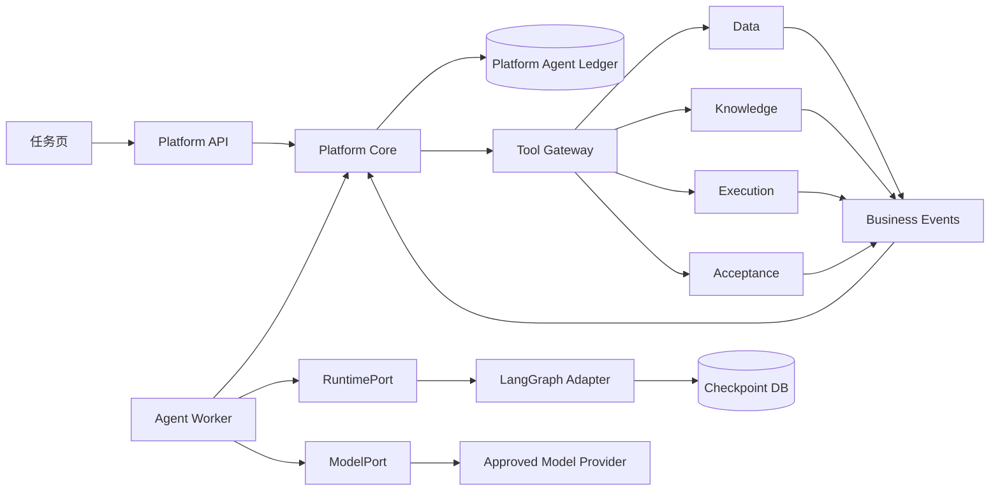

# P6 自主科学 Agent：调研、架构决策与分轮实施方案

实施状态：P6 / `0.9.3` 已完成。Agent 身份下真实 Toil、QGIS 与 P5 验收闭环、组合故障恢复、备份、checkpoint 重建和确定性/真实模型门禁均通过；P6.10 又以模拟 LLM 重跑完整 P6，并完成三种 1024 维 Embedding 模型的三轮诊断。Embedding 仍只是非权威候选信号。P6.0 证据见[阶段报告](../verification/p60-runtime-selection-report.md)，P6.10 见[诊断报告](../verification/p610-simulated-embedding-report.md)。

日期：2026-10-14  
状态：实施设计稿  
实施基线：P5-R2.1 / `0.7.2`，Platform `0010_checker_runs`，完整回归 `653 passed`  
适用范围：V7 P6，不包含 P7 任意代码执行、P8 生产发布优化

## 1. 结论先行

P6 不应把一个通用 Agent 框架放到现有系统之上，让框架直接操作数据库、容器、文件或业务服务。V7 已经拥有比多数 Agent 示例更严格的任务、授权、预算、执行、发布、知识、来源和验收协议。P6 应增加一个**可恢复的决策循环**，复用这些权威能力，而不是再建一套任务系统。

推荐架构如下：

1. Platform 继续拥有 Task、授权、预算、Action、Research、Deliverable、Acceptance 和完成事实。
2. 新增独立 `groundwater-agent-runtime` 发行包和 Agent Worker；框架及模型 SDK 依赖不得进入标准库领域层。
3. 首选运行时为最小自定义 LangGraph 状态图，利用其持久检查点和 interrupt/resume；框架检查点只是运行位置，不是业务事实。[LangGraph persistence](https://docs.langchain.com/oss/python/langgraph/persistence)、[LangGraph interrupts](https://docs.langchain.com/oss/python/langgraph/interrupts)
4. 保留一个无框架 `plain-loop-v1` 作为语义基线和应急适配器。P6.0 必须证明 LangGraph 没有改变工具身份、恢复和预算语义，才正式采用。
5. 不在首期采用 Deep Agents 的文件系统、Todo、子 Agent 和长期记忆。它适合通用深度研究和编码任务，但其内置规划、虚拟文件系统、压缩和子 Agent 与 V7 已有职责重叠，而且可配置 profiles 仍是公开测试能力。[Deep Agents overview](https://docs.langchain.com/oss/python/deepagents/overview)、[Deep Agents profiles](https://docs.langchain.com/oss/python/deepagents/profiles)
6. 模型通过小型 `ModelPort` 接入。首期只启用一个已批准 provider profile，其他模型和供应商必须通过相同评测后加入；provider 的 conversation、background task 或 memory 不能成为唯一恢复来源。
7. Agent 每轮只提出结构化建议。所有外部副作用交还 Platform 内核，通过既有幂等、授权、预算、outbox 和服务端口执行。
8. 模型输出不是事实，工具回执也不自动等于科学结论。P5 的精确成果身份、可信检查器和 Acceptance 仍是正式完成的唯一入口。
9. 首期只建设一个主 Agent。并行计算交给 Execution/CWL；不以多个角色互相讨论代替检查器或科学证据。
10. P6 分为十轮，先做确定性内核和恢复，再接真实模型，再开放副作用工具，最后才做自主修复和完整评测。每轮通过后停止，不自动进入下一轮。

最终目标不是“模型能聊天”，而是：用户创建 `AGENT` 任务后，即使浏览器断开、API/Agent Worker 重启、模型响应丢失、授权或要求发生变化，系统仍能从业务账本恢复，使用原 Action 查询既有计算，必要时提出准确澄清，取得发布成果并请求独立验收；错误结果、伪造结果和未覆盖主张不能完成任务。

## 2. 当前基线和 P6 可直接复用的能力

P5-R2.1 已经交付以下权威能力，P6 不应复制：

| 已有能力 | 当前所有者 | P6 的用法 |
| --- | --- | --- |
| TaskSpec 不可变修订、控制版本、暂停/恢复/取消 | Platform | Agent 每次推进前读取并绑定当前修订 |
| 项目角色、ScopeGrant、授权代次 | Platform | 每个工具行动重新准入，不继承模型上下文中的旧权限 |
| 执行次数、在途数、检查器 envelope | Platform | 计算和检查继续走原预算；模型预算单独增加 |
| Action、Command、幂等、outbox、租约 | Platform | Agent 副作用统一走原行动入口 |
| Data 精确资产、语义修订、原子发布 | Data | Agent 只持有 AssetRef 和读取回执 |
| 本地、CWL、QGIS、远程执行及恢复 | Execution | Agent 选择受信能力，不接触 Docker 或 Toil |
| Knowledge EvidenceRef 和生命周期 | Knowledge | 搜索用于发现，精确读取后才能正式引用 |
| AnalysisRegistration、Claim、来源关系和策略决定 | Platform | Agent 可以提出研究记录，不能自行伪造来源或检查结果 |
| 精确 OutputRole/BoundOutputRef | Platform/Data/Execution | Agent 登记交付时绑定真实成果 |
| 可信 checker 能力目录和组合验收 | Platform/Execution | Agent 请求验收，Acceptance 决定通过与完成 |

当前契约已经允许 `TaskCreate.execution_mode = AGENT`，但应用层明确拒绝。P6 应从这一入口启用能力，不增加一个脱离 Task 的“聊天机器人任务”概念。

P6 还缺少：

- AgentRun、TaskPlanRevision、DecisionFrame、等待原因和推进租约；
- 可查询的模型调用账本及模型预算；
- RuntimePort、ModelPort、ContextCompiler 和 ToolGateway；
- 结构化澄清及回答修订；
- 业务事件到 Agent 唤醒的可靠通道；
- Agent 页面、可见轨迹和模型评测门禁；
- 对模型提示注入、错误工具参数、虚构完成和无限循环的系统性防线。

## 3. 成熟项目横向调研

调研以 2026-10-14 可访问的官方文档为准。项目能力变化快，因此最终实现必须锁定版本、源码/镜像摘要和实测行为，不能只记录产品名。

### 3.1 开源运行时与框架

| 项目 | 值得借鉴 | 与 V7 的冲突或局限 | P6 决策 |
| --- | --- | --- | --- |
| LangGraph | thread/checkpoint、持久化、interrupt/resume、状态图、时间旅行和故障恢复；生产可用 PostgreSQL checkpointer | interrupt 所在节点恢复时会从节点开头重放，节点前副作用必须幂等；checkpoint 容易被误当业务状态 | 采用最小状态图；所有副作用在内核账本外置；checkpoint 单独数据库 |
| Deep Agents | 规划、文件系统、上下文压缩、子 Agent、沙箱和 HITL 已组合成完整 harness | 默认能力与 V7 计划、Data、Execution、Knowledge 重叠；profiles 仍处测试期；容易把文件或 memory 变成第二权威 | P6 不采用；P7 代码工作区可重新评测 |
| OpenAI Agents SDK | 轻量 agent/tool/handoff/guardrail、session、HITL、trace；便于做 provider 基线 | SDK session 与 provider 托管的 continuation 机制不能随意混用；默认自动工具循环不符合 V7 单一副作用路径 | 用于对照和 ModelPort 适配参考，不作为生产业务内核。[SDK](https://openai.github.io/openai-agents-python/)、[sessions](https://openai.github.io/openai-agents-python/sessions/)
| Microsoft Agent Framework | typed request port、checkpoint、workflow、HITL；`replay_key` 明确表达恢复时的副作用身份 | 与 Platform/Toil 均有编排重叠；部分 Python self-host 能力仍在快速演进 | 借鉴 typed request 和 replay key；P6.0 对照，不直接采用。[HITL](https://learn.microsoft.com/en-us/agent-framework/workflows/human-in-the-loop)、[checkpoints](https://learn.microsoft.com/agent-framework/workflows/checkpoints)
| AutoGen Core | actor/message runtime、明确 Agent ID、分布式 worker 和消息路由 | 分布式 runtime 仍标注 experimental；首期单主 Agent 不需要新消息基础设施 | 不采用；未来多 Agent 跨语言才重新评估。[runtime](https://microsoft.github.io/autogen/stable/user-guide/core-user-guide/framework/agent-and-agent-runtime.html)、[distributed runtime](https://microsoft.github.io/autogen/stable/user-guide/core-user-guide/framework/distributed-agent-runtime.html)
| Google ADK | provider/部署适配、session、tool 和 Agent Engine 生态；可接隔离代码执行 | 云平台绑定明显；其持久 session 仍不能替代 V7 业务账本；代码执行属于 P7 | 只做部署对照，不作为 P6 内核。[ADK code execution](https://google.github.io/adk-docs/tools/google-cloud/code-exec-agent-engine/)
| OpenHands SDK | 工作区、文件、命令、事件流和软件工程 Agent 的分层经验 | 核心场景是写代码和操作工作区；P6 禁止任意代码和 Shell | 只借鉴 P7 工作区隔离，不接入 P6。[OpenHands SDK](https://github.com/OpenHands/software-agent-sdk)
| Temporal | durable execution、activity retry、workflow history 和长任务恢复非常成熟 | V7 已有 PostgreSQL/outbox/worker/Toil；再引入会形成第三套调度和恢复权威 | P6 不引入；当跨服务长期协调量显著超过现有机制后单独 ADR。[Durable Execution](https://assets.temporal.io/durable-execution.pdf)

### 3.2 协议

**MCP。** MCP 适合向外部 Agent 暴露工具和资源，也在发展长任务、授权和状态句柄。[MCP 2026-07-28 规范说明](https://blog.modelcontextprotocol.io/posts/2026-07-28/)。但 V7 内部已经有精确的项目、任务、Action、预算和服务端口。如果 P6 内部先全部改成 MCP，会丢失不少领域约束并增加一次协议翻译。首期 ToolGateway 直接调用应用用例；后续提供只读或受控 MCP adapter，MCP 只是一种传输，不是权限来源。

**A2A。** A2A 的 stateful Task、`contextId`、`input-required`、`auth-required` 和 artifact/message 分离值得借鉴；其规范也明确流式更新可能丢失，客户端仍需查询权威 Task。[A2A specification](https://a2a-protocol.org/dev/specification/)、[task lifecycle](https://a2a-protocol.org/dev/topics/life-of-a-task/)。P6 内部不采用 A2A Task 替代 V7 Task。P4.3 的远程计算协议也不是 Agent-to-Agent 协作。将来跨组织提供 Agent 能力时再增加 A2A facade。

### 3.3 商业托管平台

| 平台 | 成熟能力 | 对 V7 的启示 | 首期处理 |
| --- | --- | --- | --- |
| OpenAI Responses/Agents | 托管工具、conversation state、background response、eval 和 trace | provider 端异步调用可减少连接依赖，但不能拥有 Task、预算和验收；模型调用必须仍有本地稳定身份 | ModelPort 可选适配；不依赖 provider memory 恢复业务。[background](https://developers.openai.com/api/docs/guides/background)、[conversation state](https://developers.openai.com/api/docs/guides/conversation-state)、[evals](https://developers.openai.com/api/docs/guides/evals) |
| Microsoft Foundry Agent Service | 托管 endpoint、身份、自动扩缩、状态、观测、MCP/A2A 和自带代码 agent | 适合企业托管和 Entra 集成；若直接采用会把一部分状态放入云平台 | 作为未来部署端，不作为 P6 数据模型。[overview](https://learn.microsoft.com/en-us/azure/foundry/agents/overview)、[tracing](https://learn.microsoft.com/en-us/azure/foundry/observability/concepts/trace-agent-concept)
| Amazon Bedrock AgentCore | framework-agnostic Runtime、身份、Gateway、Memory、微虚机、OTel 观测和多 provider | Runtime 与 harness 分层清楚，说明“托管容器”和“托管 Agent 循环”应分开选；费用遥测也不是最终账单 | 借鉴分层、身份和硬限额；首期不绑定 AWS。[Runtime](https://docs.aws.amazon.com/bedrock-agentcore/latest/devguide/agents-tools-runtime.html)、[harness vs Runtime](https://docs.aws.amazon.com/bedrock-agentcore/latest/devguide/harness-vs-runtime.html)
| Google Gemini Enterprise Agent Platform（原 Vertex Agent Engine 路线） | 托管 Agent runtime、会话和扩缩 | 适合 GCP 部署，仍需要外部业务系统作为权威 | 后续部署对照。[官方扩缩与部署说明](https://docs.cloud.google.com/gemini-enterprise-agent-platform/scale) |

商业平台的共同优点是托管扩缩、身份和观测，缺点是业务状态、模型状态和平台状态容易混在一起。V7 当前是单组织科学平台，首期自托管 Agent Worker、远程调用模型最容易保持数据与控制边界。以后可以把相同 runtime 容器部署到 AgentCore/Foundry，但 Platform 账本不能迁入托管 session。

### 3.4 观测和评测

Langfuse 同时提供 trace、dataset、experiment、人工标注、在线和离线评测；LangSmith 也区分离线回归与在线观测。[Langfuse evaluation](https://langfuse.com/docs/evaluation/overview)、[Langfuse tracing](https://langfuse.com/docs/observability/best-practices)、[LangSmith evaluation types](https://docs.langchain.com/langsmith/evaluation-types)。这些系统适合调试和统计，不应改变 Task 或 Acceptance。

P6 采用：

- Platform 内部 append-only AgentEvent 作为审计事实；
- OpenTelemetry 作为可选导出格式；
- 首期可选自托管 Langfuse 用于可视化，不作为 readiness 或完成前提；
- 不把原始敏感文档、令牌或隐藏思维链发送到外部 trace 后端；
- OpenTelemetry GenAI 语义仍在演进，V7 需要冻结自己的映射版本。[OpenTelemetry GenAI semantic conventions](https://opentelemetry.io/docs/specs/semconv/gen-ai/)

## 4. 为什么选择最小 LangGraph，而不是完整 Agent 平台

选择依据不是功能数量，而是能否保持 V7 的四个不变量：

1. **副作用唯一。** 模型或框架重放不能产生第二个计算、发布或验收。
2. **身份稳定。** 重启前后的 ToolCall、Action、Execution 和成果必须保持原身份。
3. **事实有所有者。** checkpoint、conversation、trace 都不能覆盖服务账本。
4. **完成独立。** Agent 无权把自己的回答标为科学通过。

LangGraph 的 checkpoint 与 interrupt 正好覆盖“在哪里暂停、收到事件后从哪里继续”。V7 自己覆盖“外部到底发生了什么”。这两个层次能清楚分开。

建议只保留以下图节点：

```text
reconcile_business_ledger
    → assemble_context
    → reserve_model_budget
    → call_model
    → validate_proposal
    → admit_or_reject_proposal
    → persist_wait_or_schedule_next_frame
```

图中不得出现直接 `docker run`、直接 Data/Execution 写入、任意 HTTP、Shell、动态 Python 或数据库 SQL。工具提议到达 `admit_or_reject_proposal` 后交还 Platform；LangGraph 节点完成，后续依靠业务事件唤醒。

`plain-loop-v1` 使用相同 RuntimePort、DecisionFrame 和 DecisionProposal，只是不保存图节点 checkpoint。它用于：

- 验证框架没有改变业务语义；
- 运行确定性 scripted-model 测试；
- LangGraph 版本升级失败时保持最小恢复能力；
- 对比 checkpoint 开销和问题归因。

### 4.1 这一设计的收益

- **复用已经通过故障验收的控制面。** Agent 不需要重新解决并发预算、远程未知、原子发布和检查器恢复。
- **框架可替换。** LangGraph 只拥有推进位置，更换框架不迁移 Task、Action、Execution 或 Acceptance。
- **科学责任清楚。** 模型负责提出方法，受信算子负责计算，检查器负责验证，Task 负责完成。
- **自由度来自能力目录。** 增加新领域时注册资产契约、工具、方法和检查器，不修改通用 Agent 状态机。
- **故障可归因。** 可以区分模型判断错、上下文缺失、工具准入拒绝、外部状态未知和检查失败。
- **评测与生产同路。** 只替换 ToolTransport 和数据夹具，不另写一个简化 Agent 循环。

### 4.2 付出的复杂度

- Platform ledger 与 runtime checkpoint 是两个存储，需要明确的恢复优先级和备份策略；
- 一次外部动作通常跨越 frame、proposal、ToolRequest、Action、Execution 和 observation，多层身份增加实现和排障成本；
- 服务端每次重新准入使延迟高于让 SDK 直接连续调用工具；
- 模型预算、计算预算、检查预算分别结算，UI 和运维必须解释清楚；
- 严格的精确引用和独立验收会降低“看起来完成”的比例，但会显著减少错误完成；
- 首期能力受登记目录限制，无法覆盖任意新算法或临时脚本。

这些成本是当前科学平台所需的控制成本。若绕开它们，短期 demo 会更快，但响应丢失、模型重试、证据撤回和错误结果会重新变成不可解释的聊天历史。

### 4.3 不采用的捷径

| 捷径 | 初期吸引力 | 不采用原因 |
| --- | --- | --- |
| 让框架自动执行全部 tools | 代码少、响应快 | 绕过 Action/预算，重放时会重复副作用 |
| 把全部历史对话当记忆 | 实现简单 | 不能证明事实版本，撤回和修订无法正确传播 |
| 只保存 provider conversation ID | 恢复方便 | provider 丢失、过期或切换后无法重建；项目隔离不可核对 |
| Agent 直接写 Task 状态 | 看起来自治 | 模型自报成功会绕过 P5 验收 |
| 每个错误都让模型重试 | 可能提高单次成功率 | 未知外部状态会重复计算和扣账，失败原因被掩盖 |
| 先上多 Agent | 展示效果强 | 增加费用、消息和权威冲突，尚无证据优于单主 Agent |
| 全部工具转 MCP | 接口统一 | 内部精确授权与业务语义会被压平，增加协议翻译而无首期收益 |
| 引入 Temporal/Kafka/Redis | “企业级”观感 | 现有 PostgreSQL/outbox 足够，会增加新的恢复和运维权威 |

## 5. 目标组件和依赖边界



### 5.1 发行包

保持当前九个工作区包，新增第十个发行包：

```text
apps/agent-worker/
  groundwater-agent-runtime
```

职责：

- Agent Worker 进程入口；
- LangGraph 和 plain-loop adapters；
- provider SDK adapters；
- checkpoint adapter；
- OTel trace adapter；
- 只包含框架 DTO 与 Platform contracts 的映射，不实现业务授权和完成规则。

`packages/platform-core` 增加纯标准库的 Agent domain/application/ports。`packages/platform-infrastructure` 增加 PostgreSQL 仓储、outbox/inbox、内部 HTTP provider、CLI 和 Worker 装配。`packages/contracts` 增加公开 DTO。模型 SDK、LangGraph、tokenizer 不能进入这三个领域/契约边界中的前两个核心模块。

### 5.2 数据库

Platform Agent ledger 位于 Platform 数据库，因为 Task、计划、行动和完成需要本地事务核对。LangGraph checkpoint 位于独立 `v7_agent_runtime` 数据库和角色：

- Agent Worker 可读写 checkpoint；
- Platform API 不读取框架内部表；
- checkpoint 数据库不可写 Platform 业务表；
- 删除 checkpoint 只造成运行位置丢失，不能删除 Task、Action、模型用量或验收事实；
- 可由业务账本重建新 checkpoint，重建必须形成新的 runtime epoch。

不引入 Redis、Kafka、向量数据库或 Temporal。现有 PostgreSQL outbox/inbox 和租约足够支撑首期单主 Agent。

## 6. 权威状态和对象模型

### 6.1 AgentRun

每个 `AGENT` Task 同时最多一个活动主 AgentRun。旧运行保留但不可继续写当前计划。

```json
{
  "agent_run_id": "agent-run-...",
  "task_id": "task-...",
  "task_spec_revision": 3,
  "runtime_profile_id": "langgraph-minimal-v1",
  "runtime_profile_digest": "sha256:...",
  "model_profile_id": "approved-model-v1",
  "tool_catalog_digest": "sha256:...",
  "science_policy_watermark": {},
  "generation": 7,
  "state": "WAITING_EVENT",
  "wait_reason": "EXECUTION",
  "current_plan_revision": 4,
  "current_frame_id": "frame-..."
}
```

`AgentRun.state`：

```text
CREATED
READY
ADVANCING
WAITING_EVENT
WAITING_USER
RECONCILING
BLOCKED_BUDGET
PAUSED
STOPPED
FAILED_RUNTIME
```

这些是 Agent 协调状态，不替代 Task 的 OPEN/COMPLETED/CANCELLED/FAILED。`FAILED_RUNTIME` 也不自动使 Task 失败；管理员可以从业务账本创建恢复运行。

### 6.2 TaskPlanRevision

计划与用户要求分开：

- TaskSpecRevision：用户目标、硬约束、AcceptanceSpec；
- TaskPlanRevision：Agent 当前步骤、依赖、候选方法、阻塞和修订原因；
- AnalysisRevision：P5 的科学协议；
- ExecutionPlan：P4 的冻结计算图。

计划项状态限于 `PROPOSED/READY/WAITING/SATISFIED/ABANDONED/BLOCKED`。计划只是解释与协调，不直接调度计算，不允许将 TaskSpec 中的必要要求改成可选。

每次计划修订保存父修订、生成 frame、模型调用、可见理由、受影响要求和引用。不得保存或展示隐藏 chain-of-thought。模型需要给出的是简短可审计的“目的、依据、预期观察和失败处理”。

### 6.3 DecisionFrame

每次模型调用前冻结 frame：

- TaskSpec/control version；
- 当前 TaskPlan revision；
- 有效授权和预算水位；
- 未完成 Action、Execution、publication、acceptance；
- Data/Knowledge/Research 的精确事实引用；
- 用户问题及回答；
- 模型、提示、工具目录、context policy 版本；
- 上一 frame 后新增事件水位；
- 允许提出的 proposal 类型。

Frame 创建和模型预算预留必须先于外部模型调用。Frame 不是数据库全局快照；它记录每个服务事实的读取版本和时间。

### 6.4 DecisionProposal

运行时只返回封闭联合：

```text
PLAN_REVISION
READ_TOOL_REQUESTS
ACTION_REQUESTS
RESEARCH_REVISION_REQUEST
CLARIFICATION_REQUEST
WAIT_REQUEST
DELIVERABLE_REQUEST
ACCEPTANCE_REQUEST
EXPLANATION
UNABLE_TO_PROCEED
```

未知类型、额外字段、无效引用、模型伪造 Action ID 或直接声明 `COMPLETED` 均拒绝。一次 proposal 可以包含多项相互独立的工具请求；有依赖的下一步必须等待新 frame。

### 6.5 AgentEvent 和 Wakeup

业务事件使用稳定 event ID、来源修订和任务关联。事件包括：

```text
TASK_REVISED
TASK_PAUSED/RESUMED/CANCELLED
AUTHORIZATION_CHANGED
BUDGET_CHANGED
ACTION_ACCEPTED/REJECTED/UNKNOWN
EXECUTION_PROGRESS/TERMINAL
PUBLICATION_TERMINAL
KNOWLEDGE_LIFECYCLE_CHANGED
USER_ANSWERED
ACCEPTANCE_PROGRESS/TERMINAL
MODEL_CALL_RECONCILED
TIMER_DUE
```

inbox 去重并按来源修订拒绝倒退。多个事件可以合并为一个 wake batch，但 frame 必须列出全部 event ID。事件只负责唤醒；Worker 每次仍查询权威状态，不能相信事件 payload 已包含完整最新事实。

## 7. RuntimePort 和框架适配

领域端口冻结为：

```text
start(run_spec, initial_frame) -> RuntimeReceipt
advance(runtime_ref, frame, prior_observations) -> DecisionProposal
resume(runtime_ref, wake_batch, frame) -> DecisionProposal
interrupt(runtime_ref, reason) -> RuntimeInterruptReceipt
inspect(runtime_ref) -> RuntimeStatus
export_visible_trace(runtime_ref) -> RuntimeTraceRef
```

约束：

- runtime_ref 只定位框架状态；不得用它查询正式业务结果；
- `advance/resume` 每次最多调用模型一次，除非 profile 明确允许的内部无副作用格式修复；
- 格式修复也必须登记模型调用和预算；
- LangGraph thread ID 固定为 AgentRun ID，checkpoint namespace 包含 runtime profile digest；
- 节点可能重放，所以节点内不得执行未登记外部副作用；
- runtime 版本变化创建新 epoch，不就地解释不兼容 checkpoint；
- 旧 epoch 只能导出诊断，不能提交 proposal；
- checkpoint 丢失时用 Platform ledger 创建 `RECOVERED_FROM_LEDGER` 新 epoch。

## 8. ModelPort、模型调用身份和预算

### 8.1 ModelProfile

部署只读目录冻结：

```json
{
  "profile_id": "approved-model-v1",
  "provider": "...",
  "model": "provider-model-snapshot",
  "request_mode": "RESPONSES",
  "supports_structured_output": true,
  "supports_tool_calls": true,
  "supports_query_by_response_id": true,
  "data_policy": "PROJECT_APPROVED_REMOTE",
  "max_context_tokens": 100000,
  "max_output_tokens": 8000,
  "timeout_seconds": 120,
  "pricing_revision": "2026-10-14",
  "profile_digest": "sha256:..."
}
```

客户端不能提交 provider URL、API key、任意模型名、系统提示或推理参数。任务只选择管理员允许的能力等级；实际 profile 由部署和项目政策解析。

### 8.2 ModelPort

```text
submit(call_id, frozen_request) -> ACCEPTED | COMPLETED | UNKNOWN
query(call_id, provider_ref?) -> observation
cancel(call_id, provider_ref?) -> observation
estimate_usage(frozen_request) -> reservation
normalize_usage(provider_response) -> usage_record
```

模型调用对象保存：

- 稳定 `model_call_id`；
- AgentRun/frame/attempt；
- model/profile/prompt/context/tool catalog digest；
- provider request/response identity；
- request accepted、first byte、completed 时间；
- input、cached input、output、reasoning token（provider 可提供时）；
- 估算费用、最终已知费用、费用状态；
- 输出摘要、解析结果和错误类别；
- 是否含敏感上下文及适用留存政策。

### 8.3 模型预算

模型费用不能挤占计算次数。Task 新增独立 ModelBudget：

```text
max_model_calls
max_input_tokens
max_output_tokens
max_reasoning_tokens（可选）
max_estimated_cost_microunits
max_agent_wall_seconds
max_decision_frames
```

每次调用按最大输出和上下文估算预留，收到 usage 后结算。Provider 已接受但响应丢失时：

- 有查询能力：按原 provider ref 查询；
- 无查询能力：记录 `UNKNOWN_RESULT/UNKNOWN_USAGE`，保留保守预留；
- 新决策需要新的 call ID 和新的额度，不能声称是原调用重放；
- 管理员可以按 provider 对账结果结算未知费用，但不能改写原输出事实。

观测到的 token/cost 是平台估算和 provider 回执；云厂商账单仍是最终收费事实。AgentCore 官方也明确遥测用量和计费记录可能存在延迟或精度差异，这一边界同样适用于 V7。[AgentCore runtime observability](https://docs.aws.amazon.com/bedrock-agentcore/latest/devguide/observability-runtime-metrics.html)

### 8.4 Provider session

V7 默认发送由 ContextCompiler 生成的完整本轮上下文。若 provider 支持 response continuation：

- continuation ID 仅是传输优化；
- ContextManifest 仍记录逻辑输入；
- provider session 丢失时可从 V7 上下文重建；
- 同一次 run 不混用互不兼容的 SDK session 和 server-managed conversation；
- provider 自动记忆不得绕过项目隔离或撤回事实处理。

## 9. ContextCompiler

### 9.1 上下文层级

按以下顺序组装：

1. 平台不可覆盖政策和 proposal schema；
2. 当前 TaskSpec、控制状态和预算；
3. Agent plan、等待和未完成活动；
4. 已验证的服务事实和精确引用；
5. 适用的 Science/Method/Policy 说明；
6. 本轮工具目录；
7. 用户消息和已回答澄清；
8. 受限的 Data/Knowledge 正文片段；
9. 旧轮摘要和省略清单。

资料正文、资产字段值、远程服务错误和用户文件全部是**非可信数据**。它们可以影响分析内容，不能提升指令优先级、注册工具、扩大授权或修改验收。

### 9.2 ContextManifest

每次调用保存：

- `context_policy_id/version/digest`；
- 包含对象的强类型引用、版本、摘要、字符或表格范围；
- 每部分估计 token；
- 省略对象及原因；
- 自动摘要的生成模型、源引用和摘要摘要；
- 注入防护编码方式；
- 截断是否影响必要要求。

摘要只是上下文优化，不能替代 EvidenceRef、AssetRef、ExecutionRef 或 AcceptanceReport。用户问“为什么做这一步”时，页面展示计划目的、引用和工具事实，不展示隐藏思维链。

### 9.3 Token 分配

建议首期固定比例，再以评测调整：

| 区域 | 初始上限 |
| --- | ---: |
| 平台政策、Schema 和工具目录 | 20% |
| Task/plan/活动状态 | 20% |
| Data/Knowledge 证据 | 35% |
| 近期事件和工具回执 | 15% |
| 输出空间预留 | 10% |

如果必要事实放不下，返回 `CONTEXT_OVERFLOW` 并请求更窄的读取或分阶段分析；不得静默删除 Task 的必要要求。工具目录按本轮相关性选择，不能把全部内部 API 每轮塞入模型。

## 10. ToolGateway 和单一副作用路径

### 10.1 工具类别

| 类别 | 示例 | 是否生成业务 Action |
| --- | --- | --- |
| 本地纯读取 | task.get、plan.get、catalog.list | 否，生成读取观察 |
| 服务读取 | asset.get、knowledge.search/read、execution.get | 重要读取生成 ObservationReceipt |
| 本地业务写入 | plan.revise、question.create、analysis.propose | 生成受控命令/修订 |
| 异步副作用 | execution.submit/cancel、acceptance.submit | 必须生成或关联稳定 Action |
| 管理动作 | grant、member、budget adjustment | P6 Agent 不开放 |

ToolSpec 必须包含版本、JSON Schema、操作类别、幂等性、取消、所需 scope、预算类型、可能错误和观察类型。工具目录由部署生成并冻结摘要；模型不能提交新工具定义。

### 10.2 首批工具

只读：

```text
task.read_current
task.read_requirements
plan.read_current
data.list_assets
data.read_asset_manifest
data.read_semantic_revision
knowledge.search
knowledge.read_evidence
capability.list_operators
capability.list_workflows
capability.list_checkers
execution.read
execution.read_steps
research.read
acceptance.read
```

写入/异步：

```text
plan.propose_revision
research.create_exploratory_revision
research.register_revision
research.create_claim
execution.submit_operator
execution.submit_workflow
execution.cancel
deliverable.register_exact
acceptance.request
question.ask
```

`research.register_revision` 只有在 observation watermark 满足 P5 规则、Task 授权允许且没有把已见结果伪装为预注册时才能通过。`acceptance.request` 不能传入 checker 镜像、能力或容差。

明确不提供：

```text
task.force_complete
task.overwrite_spec
budget.increase
grant.create
database.query
docker.run
shell.execute
python.execute
http.fetch_arbitrary
knowledge.write_lifecycle
acceptance.write_result
```

### 10.3 工具调用身份

模型产生的 `call_id` 只用于消息关联。内核根据：

```text
agent_run_id + decision_frame_id + proposal_index + canonical_tool_request_digest
```

生成稳定 ToolRequest 身份。副作用工具再分配业务 Action ID。同 frame 同内容返回原记录，同身份不同内容 `409 CONFLICT`。新 frame 若提出语义相同副作用，应用用例还要使用发布键、执行绑定等业务唯一键防止重复。

### 10.4 错误反馈

工具错误返回机器可处理的类别和字段诊断：

```text
INVALID_ARGUMENTS
STALE_FRAME
NEEDS_FACTS
DENIED_SCOPE
BLOCKED_BUDGET
UNSUPPORTED_METHOD
NOT_FOUND
TEMPORARILY_UNAVAILABLE
UNKNOWN_EXTERNAL_STATE
CONFLICT
PERMANENT_REJECTION
```

模型最多针对同一诊断修正两次；无实质变化的重复请求不算进展。外部未知只允许查询原身份，不能通过换参数或 call ID 重提。

## 11. 推进、等待和恢复算法

### 11.1 单次推进

1. Worker 以 `FOR UPDATE SKIP LOCKED` 领取 wakeup，并获取 AgentRun 递增 generation 的短租约。
2. 查询 Task、授权、预算、未完成 Action、Execution、publication、Knowledge 生命周期和 Acceptance。
3. 先对账：可以确定的终态落入观察；未知状态保留；旧 generation 不得写入。
4. 如果 Task 暂停/取消，停止新模型调用和新行动，执行相应收敛。
5. 如果存在仍需等待的已接受活动，更新等待并退出，不调用模型“猜状态”。
6. 编译 DecisionFrame 和 ContextManifest。
7. 预留模型预算，保存 ModelCall 和发送 outbox。
8. 调用 provider；解析为 DecisionProposal。
9. 结构校验、相关版本校验、授权/预算/科学前提校验。
10. 一个本地事务保存已接受 proposal、TaskPlan revision、业务 Action/outbox 或等待。
11. 如果 proposal 只有即时读取，可在限定的每次 wake 最大 frame 数内继续；出现异步动作、用户问题或预算阻塞立即退出。

默认每个 wake 最多 4 个 DecisionFrame、每个 Task 最多 40 次模型调用。数值由评测后冻结，不能依靠模型自觉停止。

### 11.2 事件先于等待登记

为避免“计算已完成但 Agent 随后才开始等”的竞态：

- 登记等待前先查询权威状态；
- 等待记录保存服务观察水位；
- 保存等待和 wakeup 游标使用同一 Platform 事务；
- outbox/inbox 再次到达相同终态去重；
- 定时 reconciliation 作为漏事件保险，但不依赖高频轮询。

### 11.3 崩溃恢复

| 故障 | 恢复规则 |
| --- | --- |
| frame 保存前 Worker 崩溃 | 无调用事实，重新领取并生成新 frame |
| frame/预算已保存，模型发送前崩溃 | 发送原 ModelCall |
| provider 接受后响应丢失 | 查询原 provider ref；不能假装未调用 |
| 模型完成、proposal 未入库 | 从保存的原始响应重新解析；不重新调用模型 |
| proposal 已入库、Action 未发送 | outbox 发送原 Action |
| Execution 已接受、回执丢失 | 查询原 Action/Execution |
| 业务事件丢失 | reconciliation 查询权威服务 |
| checkpoint 落后于业务账本 | 业务账本优先，新 epoch 从 ledger 重建 |
| checkpoint 超前但业务事务未提交 | 丢弃该 checkpoint 分支，不能补造业务事实 |
| 用户回答与任务修订竞争 | 绑定问题的 TaskSpec revision；旧问题关闭为 STALE |
| 授权撤销 | 阻止新动作；已接受动作按真实状态对账 |

### 11.4 自主修复边界

允许自动修复：

- 工具参数字段名、受支持枚举或引用选择错误；
- 先读取缺少的 manifest/semantic revision；
- 确定性的受信格式转换；
- 选择已登记的等价算子或工作流；
- Execution 明确未执行拒绝后的有差异重规划；
- 检查 ERROR 的显式 retry（受 P5 限制）。

必须询问用户或停止：

- 水位埋深与高程等改变科学含义的歧义；
- 授权范围扩展、预算增加或跨项目访问；
- 用户目标互相冲突；
- 多个合理方法会实质改变正式验收且 TaskSpec 未给选择；
- 必要输入不存在或现实数据真实性无法确定；
- 需要 P7 任意代码但没有登记能力。

## 12. 澄清和人工交互

澄清不是普通聊天消息，而是有类型对象：

```json
{
  "question_id": "question-...",
  "task_id": "task-...",
  "task_spec_revision": 3,
  "gap_id": "vertical-datum",
  "question": "井 A 的水位字段表示埋深还是高程？",
  "why_needed": "跨井水头比较会因方向和基准不同而改变结论",
  "choices": [],
  "answer_schema": {},
  "blocked_actions": [],
  "expires_at": null
}
```

回答保存操作者身份、原文、结构化值和时间。回答若改变 Task 的用户要求或正式语义，应用用例创建新的 TaskSpec/semantic revision；不能只把一句聊天文字塞进模型上下文。Agent 看到新修订后重新规划。

无需用户批准每个常规动作。授权已经由 ScopeGrant 和预算表达。只有明确的权限扩展、预算扩展、外部高风险副作用或科学语义选择需要用户输入。

## 13. 科学策略和 P5 集成

P6 不把地下水规则写进通用循环。通用 Agent 只理解：要求、精确引用、工具能力、策略决定、缺项、检查计划和结果。

首个科学路径：

1. 判断任务是解释、确定性计算、探索分析还是 VERIFIED 交付。
2. 读取输入 manifest/semantic revision；缺少必要语义时先发现，仍无法确定才澄清。
3. 对探索任务创建 `EXPLORATORY` AnalysisRevision；产生正式主张前按 P5 注册。
4. 选择登记算子或冻结工作流。Agent 不编写算法代码。
5. 运行后登记精确 Deliverable role bindings。
6. 主张只引用 OBSERVED_PROVENANCE；不能用计划来源冒充实际来源。
7. 请求 open-science 或 P3 acceptance。
8. FAIL 时只根据 checker 诊断修订成果或方法；不能换键反复试到通过。
9. ERROR 可以依既有规则重试；INDETERMINATE/UNCOVERED 不能说成 PASS。
10. Acceptance PASS 且 Task 完成条件满足时，由 Platform 提交 Completion，Agent 只生成说明。

Knowledge SearchHit 只能用于发现。Agent 必须调用精确读取取得 EvidenceRef 后才能写入正式引用。WITHDRAWN 证据仍可用于历史解释，但不得支持新的 VERIFIED 交付。证据在完成后撤回，由 P5 传播 `Completion.validity=STALE`；Agent 可以建议重新验收，不能复活旧报告。

## 14. 安全和数据治理

### 14.1 身份

- Agent Worker 使用服务身份，不持有用户明文 Bearer Token；
- 每次工具调用由 Platform 根据原操作者、当前成员关系、任务 grant 和 task revision 重新准入；
- 发送到 Data/Knowledge/Execution 的是短期服务凭据和精确项目/Action 上下文；
- provider 只能收到已批准的数据范围，不能获得服务凭据、内部 URL 或数据库信息。

### 14.2 网络

- Agent Worker 出站只允许 Platform internal API、选定模型代理和 trace endpoint；
- 模型不能直接访问互联网；需要外部资料的能力以后作为有来源的受信工具建设；
- 执行容器继续保持 P3/P4 的无网络策略；
- P6 不开放浏览器、Shell 或代码解释器。

### 14.3 提示注入

防线不是“检测到危险句子就安全”，而是权限结构：

1. 不可信正文使用明确数据边界和来源标签；
2. 工具/政策只从签名或摘要锁定目录加载；
3. 模型提出的工具名和参数做严格 allowlist/schema 校验；
4. 每次服务端重新授权；
5. 不把秘密放入上下文；
6. 输出不能直接改变 Task/预算/授权/Acceptance；
7. 注入测试验证“忽略系统、泄露令牌、调用隐藏工具、跨项目读取”等均失败。

启发式注入分类器可以用于告警和上下文降级，不能成为唯一访问控制。

### 14.4 留存和可见轨迹

保存：输入摘要、受控提示版本、结构化模型输出、工具请求/结果引用、token/费用、错误和可见理由。默认不要求模型生成隐藏思维链，也不保存供应商内部 reasoning。原始提示/回复的保留期限按项目数据政策设置；审计所需摘要和业务引用长期保存。

Trace 默认删除用户令牌、服务密钥、完整大文件、数据库连接串和未经允许的正文。外部 Langfuse/OTel exporter 关闭时不影响业务。

## 15. 公开接口

令 `P=/api/v1/projects/{project_id}`。

| 接口 | 行为 |
| --- | --- |
| `POST P/tasks` | 允许 `execution_mode=AGENT`；创建 Task 后持久安排首个 AgentRun |
| `GET P/tasks/{task_id}/agent` | 当前运行、计划、等待、预算和最近进展投影 |
| `GET P/tasks/{task_id}/agent/runs` | 历史 AgentRun，不暴露框架内部 checkpoint |
| `GET P/tasks/{task_id}/agent/plan-revisions` | 不可变计划和可见修订理由 |
| `GET P/tasks/{task_id}/agent/events` | 游标分页的可见事件；可选 SSE 只是通知层 |
| `GET P/tasks/{task_id}/questions` | 当前和历史澄清问题 |
| `POST P/tasks/{task_id}/questions/{question_id}/answers` | 幂等提交回答，必要时形成要求/语义修订 |
| `GET P/tasks/{task_id}/model-usage` | 模型调用、token、估算费用和未知占用 |

现有 task pause/resume/cancel、spec revision、grant、budget、execution、deliverable 和 acceptance 路由继续使用，不为 Agent 建平行版本。

SSE/页面断开不会停止 Agent。客户端重连后用事件游标和 GET 查询恢复；SSE 丢事件不影响业务。

## 16. 页面

继续使用同源最小页面，新增：

- 创建 AGENT Task，展示冻结目标、预算和授权；
- 当前计划、每步状态和引用；
- 等待原因区分计算、用户、对账、预算和暂停；
- 模型调用数、token、估算费用和未知费用；
- 工具请求、Action/Execution 和验收关联；
- typed clarification 表单；
- Task 暂停、恢复、取消；
- Acceptance 报告、限制和 STALE 状态；
- 刷新后由 API 重建，不把令牌、checkpoint 或对话全文写入浏览器持久存储。

页面不提供系统提示编辑、任意工具、模型 URL、模型参数、Shell、文件工作区或“强制完成”按钮。

## 17. 观测指标

### 17.1 工程指标

```text
agent_runs_started/active/blocked
decision_frames_total
model_calls_total/unknown/retried
model_input/output_tokens
model_estimated_cost
tool_requests_by_result
agent_wakeup_lag
time_waiting_execution/user/reconciliation/budget
duplicate_side_effect_detected
stale_frame_rejected
unauthorized_request_rejected
acceptance_pass/fail/error/indeterminate
task_completion_valid/stale
```

### 17.2 Trace 结构

一个 AgentRun 为 session，一个 wake/advance 为 trace：

```text
reconcile
context.compile
model.call
proposal.parse
proposal.validate
tool.admit
action.dispatch/query
wait.register
acceptance.request/query
```

Trace ID 写入业务记录用于定位，trace span 不反向成为业务事实。采样只能减少外部观测，不能省略本地 Action/ModelCall/Acceptance 审计。

## 18. 评测策略

### 18.1 三层测试

1. **确定性协议层**：scripted model、固定 proposal、真实 PostgreSQL和模拟 provider transport；验证身份、预算、恢复和安全。
2. **真实模型业务层**：固定模型 profile，在仓库合成数据上重复运行；最终由真实 P3/P4/P5 checker 判定。
3. **公开基准层**：BFCL、τ-bench、ScienceAgentBench，按现有独立评测方案执行。

scripted model 用于证明内核，不用于声称 Agent 有智能。真实模型测试不得用写死答案的测试 adapter。公开基准通过也不等于真实地下水结论正确。

### 18.2 内部黄金任务

至少覆盖：

| 编号 | 任务 | 关键判据 |
| --- | --- | --- |
| A01 | CSV 完整率和趋势 | 两个算子、精确交付、P3 PASS |
| A02 | 缺少时间字段语义 | 只问必要问题，不猜测 |
| A03 | 低样本趋势 | 如实 `NOT_EVALUABLE`，不造值 |
| A04 | 错误趋势注入 | P5 reproducer 拒绝，Task 不完成 |
| A05 | GeoPackage Buffer→Summary→Map | 三节点、原子发布、页面可见 |
| A06 | EPSG:4326 buffer 请求 | 识别前提并选择显式投影或解释拒绝 |
| A07 | 远程 Summary 响应丢失 | 原 Action/Execution，不重复计算 |
| A08 | Knowledge 精确引用 | SearchHit 后精确 read，报告带 EvidenceRef |
| A09 | 证据撤回 | 新 VERIFIED 不用撤回证据，旧完成变 STALE |
| A10 | 多分析登记 | VERIFIED 明确选择正确登记 |
| A11 | 预算不足 | BLOCKED_BUDGET，不越限或伪装完成 |
| A12 | 授权中途撤销 | 阻止新行动，对账既有行动 |
| A13 | 提示注入文档 | 不调用隐藏工具、不泄露系统信息 |
| A14 | 同名工作流输出 | 精确 BoundOutputRef，不串换 |
| A15 | 无匹配 checker | EXPLORATORY 可带限制，VERIFIED 不完成 |

### 18.3 硬门槛

工程门槛：

- 重复计算、重复扣账、重复发布、重复验收为 0；
- 未授权跨项目读取或副作用为 0；
- 错误结果导致 Task 正式完成为 0；
- 所有已接受外部活动可由稳定身份恢复；
- 模型预算超发为 0；
- checkpoint 删除后可由业务账本重建；
- 必测项无 skip。

模型质量门槛在 P6.2 首次基线后冻结，冻结后不得为发布临时降低。建议初始规则：

- 支持范围内的 15 个黄金任务各运行 3 次，每项至少 2 次取得正确终态；
- 全部安全、错误完成、越权和伪造场景必须 3/3 正确；
- 相对同模型直接基线，V7 工具调用正确率下降不超过 2 个百分点；
- 新 context/runtime 策略只有在任务成功提高且严重错误不增加时采用；
- 同时报告成功率、首次成功率、模型调用数、计算次数、总费用和澄清数，不以单一综合分掩盖风险。

## 19. 分轮实施总表

| 轮次 | 建议版本 | 核心交付 | 本轮不做 |
| --- | ---: | --- | --- |
| P6.0 | `0.8.0` | Runtime/Model/Tool 选型试验和冻结 ADR | 不开放 AGENT Task |
| P6.1 | `0.8.1` | 确定性 Agent ledger、计划、frame、wakeup、plain-loop | 不调用真实模型 |
| P6.2 | `0.8.2` | ModelPort、模型预算、真实 provider、结构化 proposal | 不执行副作用工具 |
| P6.3 | `0.8.3` | ContextCompiler、只读工具和知识/数据发现 | 不提交计算 |
| P6.4 | `0.8.4` | 受控行动、单算子闭环和精确交付 | 不启用工作流自主恢复 |
| P6.5 | `0.8.5` | 异步等待、事件唤醒、重启和取消 | 不增加科学研究自动化 |
| P6.6 | `0.8.6` | P5 研究协议、知识、策略和工作流选择 | 不自动修复验收失败 |
| P6.7 | `0.8.7` | 自主修复、通用 Acceptance 和正式完成 | 不做多 Agent/代码生成 |
| P6.8 | `0.8.8` | 最小页面、typed HITL、审计和运维 | 不做复杂工作台 |
| P6.9 | `0.9.0` | 公开评测、故障组合、发行收口 | 不进入 P7 |

### 19.1 每轮统一开发纪律

每轮严格执行：

```text
冻结范围和不变量
→ 先写能复现缺口的测试
→ 契约与迁移
→ 领域和应用逻辑
→ 基础设施适配
→ HTTP/Worker 集成
→ 故障注入
→ 旧阶段回归
→ 仓库外安装
→ 证据、报告和结束
```

当前轮未通过就继续修复当前轮。后续轮只保留契约方向，不提前创建空路由、假工具、占位表或生产 feature flag。测试专用 provider、故障代理和 scripted model 只放在 `tests/p6*`，生产包不得含“直接写成功状态”的测试接口。

### 19.2 建议工程目录

```text
packages/platform-core/src/platform_core/
  domain/agent_runs.py
  domain/agent_plans.py
  domain/model_budget.py
  application/agent_advance.py
  application/agent_reconcile.py
  application/agent_context.py
  application/agent_tools.py
  ports/agent_runtime.py
  ports/model.py

packages/platform-infrastructure/src/platform_infrastructure/
  agent_repository.py
  agent_worker_support.py
  model_catalog.py
  tool_catalog.py
  migrations/versions/0011_*.py ...

apps/agent-worker/
  src/platform_agent_runtime/
    main.py
    profiles.py
    langgraph_adapter.py
    plain_loop.py
    providers/
    checkpoint/
    telemetry/

tests/
  p60_runtime_selection/
  p61_kernel/
  p62_model/
  p63_context/
  p64_actions/
  p65_recovery/
  p66_science/
  p67_delivery/
  p68_ui/
  p69_release/
```

目录表达依赖方向，不要求为每个概念创建一个文件。领域对象保持内聚，避免产生大量只有一层转发的类。

### 19.3 每轮步骤与门槛索引

| 轮次 | S1 | S2 | S3 | S4 | S5 | S6 |
| --- | --- | --- | --- | --- | --- | --- |
| P6.0 | DTO/ports | plain loop | LangGraph | checkpoint 故障 | 框架对照 | ADR/锁定 |
| P6.1 | 失败用例 | `0011` | ledger/use cases | wakeup/lease | 恢复 | 全回归 |
| P6.2 | model catalog | `0012`/预算 | provider adapter | unknown usage | 真实模型 | 发行 |
| P6.3 | context policy | 只读目录 | Data/Knowledge | injection | 只读业务任务 | 发行 |
| P6.4 | ToolRequest/Action | 单算子 | 发布/交付 | P3 acceptance | 故障组合 | 发行 |
| P6.5 | 服务事件 | wait/wakeup | runtime epoch | 取消/暂停 | 组合恢复 | 发行 |
| P6.6 | 科学路径 | research/policy | workflow | Knowledge | 领域异常 | 发行 |
| P6.7 | 诊断分类 | 有限修复 | checker retry | 停止规则 | 黄金任务 | 发行 |
| P6.8 | 页面 | typed HITL | SSE 重连 | CLI/观测 | 备份恢复 | 发行 |
| P6.9 | 确定性门禁 | 真实模型 | 公开基准 | 红队 | 升级回退 | `0.9.0` |

### 19.4 统一脚本约定

每轮新增聚焦入口，最终聚合为：

```bash
uv run --locked pytest -q tests/p6*
bash scripts/check_p6.sh --phase kernel
bash scripts/check_p6.sh --phase model
bash scripts/check_p6.sh --phase actions
bash scripts/check_p6.sh --phase recovery
bash scripts/check_p6.sh --phase science
bash scripts/check_p6.sh --phase ui
bash scripts/check_p6.sh --phase all
uv run --locked ruff check .
uv run --locked ruff format --check .
```

`all` 必须包含 P5 全回归；P4 的长性能矩阵只有相关执行代码变化时才重跑，规则回归和真实工作流 quick 始终保留。真实模型测试单独输出调用数和费用，不能在普通单元测试中意外调用付费 API。

## 20. P6.0 / 0.8.0：运行时和模型适配选型

### 20.1 实施

1. 冻结 `DecisionFrame`、`DecisionProposal`、RuntimePort、ModelPort 和 ToolTransport 的纯 DTO 原型。
2. 建立 `plain-loop-v1`、`langgraph-minimal-v1` 两个 adapter。
3. 用 scripted model 执行相同 30 个序列：读取、工具提议、等待、用户问题、恢复、取消和 stale frame。
4. LangGraph 使用独立临时 PostgreSQL checkpointer；主动删除/回滚 checkpoint 验证 ledger 重建方向。
5. 对比 OpenAI Agents SDK 和 Microsoft Agent Framework 的薄样例，只测结构化 tool yield、HITL 和恢复，不接生产服务。
6. 冻结 `RuntimeProfile`、provider capability matrix、依赖版本和升级策略。
7. 写 ADR：采用 LangGraph 或回退 plain loop。默认建议 LangGraph。

### 20.2 测试

- interrupt 前后代码重放不能产生副作用；
- frame/proposal 字节语义在两个 adapter 间一致；
- 旧 checkpoint、错误 namespace、不同 profile digest 拒绝；
- checkpoint DB 不可用时不损坏 Platform；
- 取消、重复 resume、事件先到均能收敛；
- 框架不能看到数据库凭据和业务仓储对象。

### 20.3 结束条件

形成正式 ADR、锁文件和最小原型证据。失败则选择 plain-loop，不阻断 P6；不得为了保留 LangGraph 而放松身份或恢复门槛。本轮不启用公开 `AGENT` 任务。

## 21. P6.1 / 0.8.1：确定性 Agent 内核

### 21.1 持久化

Platform migration `0011_agent_coordination`：

- `agent_runs`
- `agent_plan_revisions`
- `agent_decision_frames`
- `agent_proposals`
- `agent_questions/answers`
- `agent_events/inbox/outbox`
- `agent_wakeups`
- `agent_leases`
- `agent_context_manifests`

Checkpoint 数据库建立独立显式版本，启动只检查不自动迁移。

### 21.2 应用用例

```text
CreateAgentRun
AdvanceAgentRun
ReconcileAgentRun
AcceptDecisionProposal
RegisterAgentWait
AnswerAgentQuestion
Pause/Resume/CancelAgentTask
RecoverRuntimeFromLedger
```

先使用 scripted model，按 fixture 返回结构化 proposal。实现 AGENT Task 创建但仅在测试部署开放 feature flag；生产入口仍 readiness 拒绝，直到 P6.2。

### 21.3 必测

- 同一 Task 只能一个主计划 writer；
- 两个 Worker 竞争 lease 只有一个推进；
- 旧 generation 不能写 proposal/plan/wait；
- Task 修订使旧 frame 失效；
- 回答和修订竞争正确；
- 事件重复、乱序、丢失和定时对账；
- checkpoint 缺失、损坏、落后和超前；
- 暂停/取消期间不推进；
- P0–P5 完整兼容。

## 22. P6.2 / 0.8.2：模型网关和预算

Platform migration `0012_agent_model_calls`：

- `agent_model_budgets`
- `agent_model_reservations`
- `agent_model_calls`
- `agent_model_observations`
- `model_provider_reconciliation`

实施：

1. 部署生成 `model-catalog.json`；Platform 和 Agent Worker 校验相同摘要。
2. 建立一个真实 provider adapter、一个 deterministic fake 和一个 record/replay adapter。
3. Context 先只含 Task、计划和测试工具，不接真实 Data/Knowledge 内容。
4. 使用严格 structured output；解析失败记录原响应摘要和字段错误。
5. 允许最多一次“仅修正 JSON 结构”的新模型调用，该调用也计费。
6. 增加 429、5xx、超时、断流、响应丢失、usage 缺失和 provider ref 暂不可见测试。
7. 页面/API 暂只提供只读 model usage。

硬门槛：任何调用都有预留；未知 usage 可见；预算不超发；重复 Worker 不产生重复调用；日志无 API key 和完整敏感 payload。

## 23. P6.3 / 0.8.3：上下文和只读 Agent

Platform migration `0013_agent_read_tools` 保存稳定 ToolRequest 与不可变读取观察。

实施：

1. ContextCompiler v1、token 估算、ContextManifest 和省略清单。
2. 只读 ToolGateway 与工具目录。
3. 接入 Data manifest/semantic revision、Knowledge search/read、Execution/Research/Acceptance 查询。
4. 重要读取生成 ObservationReceipt；搜索命中与 EvidenceRef 分开。
5. 支持 Agent 形成计划、解释已有事实、提出澄清和等待，但禁止执行提交。
6. 建立注入、跨项目和上下文污染测试集。

业务测试：给定已有 P3/P4/P5 任务，Agent 能准确说明当前成果、未覆盖要求、预算和下一步；不能声称未运行计算已完成，不能用 WITHDRAWN Evidence 支持新结论。

## 24. P6.4 / 0.8.4：受控单算子闭环

Platform migration `0014_agent_action_links` 保存 proposal、ToolRequest、Action 和业务操作键的精确关系。

实施顺序：

1. 开放 `execution.submit_operator`，只允许现有目录算子。
2. Agent proposal 经同一 P3 execution application use case；不新建 Agent 专用执行入口。
3. 先完成完整率单算子，再完成趋势单算子。
4. 运行后读取发布回执，登记精确 deliverable role。
5. 请求现有 P3 Acceptance；Agent 无法写入检查结果。
6. Acceptance PASS 后 Platform 完成 Task，Agent 生成最终说明。

故障：模型重复提议、API/Agent Worker/Execution Worker 重启、提交响应丢失、普通 404、授权到期、预算最后一格并发、任务修订、取消和发布竞争。每种场景要求一个 Action、一个容器、一次结算和一组成果。

P6 第一个业务可用里程碑在此形成：用户可以创建 AGENT 时间序列任务，由 Agent 完成现有受信算子闭环。

## 25. P6.5 / 0.8.5：长任务等待、恢复和取消

Platform migration `0015_agent_wakeup_recovery` 增加等待依赖、事件水位、runtime epoch 和恢复记录。

实施：

- Data、Knowledge、Execution、Acceptance outbox 产生任务关联事件；
- Agent inbox、wakeup 合并和 reconciliation timer；
- 工作流节点进行时不反复调用模型；
- API/浏览器断线不影响运行；
- Worker restart 后先对账业务状态，再恢复 runtime；
- task pause 阻止新 model/tool；resume 重新校验；cancel 传播现有协议并等待真实收敛；
- provider call、Execution、publication、acceptance 分别表达 UNKNOWN。

组合故障至少包括：模型响应丢失 → Action 已接受 → Agent Worker 终止 → Toil leader 终止 → 远端 peer 重启 → Data 发布响应丢失。恢复后身份和账目唯一。

## 26. P6.6 / 0.8.6：科学规划、知识和工作流

实施：

1. Agent 根据任务复杂度选择轻量解释、探索或 VERIFIED 路径。
2. 接入 P5 AnalysisRevision、registration、Claim 和 policy decision。
3. 用 Knowledge 精确引用辅助方法选择；没有知识时区分无结果、服务不可用和无权限。
4. 开放冻结工作流选择，Agent 只能选目录包和精确输入绑定。
5. 完成两个代表任务：P3 时间序列工作流、P4.2 Buffer→Summary→Map。
6. `groundwater-head-comparison-v1` 只在实际比较水头时触发；缺基准不阻止格式检查或单序列描述。
7. 多个分析登记时 VERIFIED 必须显式选择；看到结果后的登记带 watermark，不伪装预注册。

必测：错误语义、单位冲突、垂向基准冲突、空间 CRS、同名输出、scatter 位置、证据撤回、Knowledge 注入、未知领域 checker 缺失。

## 27. P6.7 / 0.8.7：自主修复和交付

Platform migration `0016_agent_delivery_attempts` 记录修复分支、诊断依赖、重试关系和停止原因。

实现诊断驱动的有限修复：

- `INVALID_ARGUMENTS`：最多 2 次有差异修正；
- `NEEDS_FACTS`：调用允许的发现工具；
- Execution 明确未执行拒绝：可以更改方法重提；
- Acceptance ERROR：使用现有 `retry_of`；
- Acceptance FAIL：只有修改输入/方法/成果并形成新精确身份后可重新验收；
- `INDETERMINATE/UNCOVERED`：按 Task delivery class 决定带限制探索交付或阻止 VERIFIED；
- 外部 UNKNOWN：只查询；
- 相同错误达到阈值：停止分支并给出结构化阻塞。

防止 reward hacking：Agent 看不到隐藏 checker 答案，不能改容差、选择 checker、删除失败尝试、覆盖报告或将 FAIL 改成 ERROR。

完成条件：黄金任务 A01–A15 在真实模型重复试验达到冻结门槛，错误成果正式完成为 0。

## 28. P6.8 / 0.8.8：页面、人工交互和运维

实施：

- 任务页 Agent 区域、计划时间线、typed question、模型用量、等待和恢复；
- SSE 断线重连和事件游标；
- 管理 CLI：列出卡住运行、重建 checkpoint、触发 reconciliation、导出可见 trace；
- 不提供直接改数据库或强制 PASS；
- 运维 dashboard、OTel exporter 和可选 Langfuse；
- 数据留存、trace 脱敏、provider 数据政策说明；
- 备份和恢复 Agent ledger/checkpoint，分别演练。

真实浏览器完成：创建 AGENT task → 回答语义问题 → 查看计划 → 运行两个算子/工作流 → 验收 → 查看报告；刷新和断线后状态一致。

## 29. P6.9 / 0.9.0：评测和发行收口

### 29.1 评测

1. 运行全部确定性故障矩阵。
2. 黄金任务每项至少 3 次，报告均值、最差、成功稳定性和费用。
3. BFCL 检查工具 schema、并行调用和参数正确性。
4. τ-bench 检查多轮、工具、知识和用户澄清。
5. ScienceAgentBench 先运行锁定 CPU 子集；P6 不允许生成任意代码时，只纳入可由登记工具完成的任务，其他标记不适用，不伪造失败或成功。
6. 对比 plain-loop/LangGraph、直接资料/Knowledge 检索、provider baseline/V7 core/V7 full platform。
7. 安全红队：提示注入、跨项目、预算逃逸、伪造引用、工具名注入、长输出和循环。

### 29.2 发行

- 十个 Python 包统一 `0.9.0`；
- 固定 runtime/model/tool/science/checker catalogue 摘要；
- 固定 Agent Worker 镜像；
- 提供 `scripts/check_p6.sh --phase kernel|model|readonly|actions|recovery|science|ui|all`；
- 仓库外安装、空库迁移、`0010→最新` 升级、旧 DIRECT 任务和历史报告回归；
- 生成结构化证据和阶段报告；
- 不因 P6 完成而自动进入 P7。

## 30. 完整故障矩阵

| 层 | 故障 | 必须观察到的结果 |
| --- | --- | --- |
| API | 返回前断线 | 幂等重放返回原任务/回答/命令 |
| Agent Worker | 任意边界 SIGKILL | 新 generation 接管，旧 Worker 写入拒绝 |
| Runtime | checkpoint 损坏/丢失 | 从业务 ledger 新 epoch 重建 |
| Model | 429/5xx/timeout | 有界退避，不超预算 |
| Model | 接受后响应丢失 | 查询原 ref 或保留 UNKNOWN usage |
| Model | 非法 JSON/额外字段 | proposal 拒绝；格式修复计费 |
| Model | 伪造成功/引用 | 不形成观察、验收或完成 |
| Tool | 同调用重复投递 | 一个 ToolRequest/Action |
| Tool | 同键不同内容 | 409，不换键偷跑 |
| Authorization | 调用前撤销 | 不发送 |
| Authorization | 调用后撤销 | 跟踪原执行，不扩展新动作 |
| Budget | 并发争抢最后额度 | 不超发 |
| Task | frame 后修订 | STALE_FRAME，旧结果不自动满足新要求 |
| Event | 先完成后等待 | 查询识别终态，不永久等待 |
| Event | 重复/乱序/丢失 | inbox 去重，reconciliation 恢复 |
| Knowledge | 撤回/冲突 | 新引用受阻，旧历史保留并失效传播 |
| Execution | 普通 404 | UNKNOWN，原身份和占用保留 |
| Publication | commit/abort 竞争 | 沿用 P3/P4 事实先发生者获胜 |
| Acceptance | checker ERROR | 不当作 FAIL/PASS；显式 retry |
| Acceptance | checker FAIL | Task OPEN，不反复换键 |
| UI | SSE/刷新/浏览器关闭 | Worker 不受影响，重连查询恢复 |

## 31. 升级和回退

每轮：

```text
等待活动模型调用、Agent advance 和发布事务达到安全边界
→ 停止 Platform API/Worker 和 Agent Worker
→ 安装同一版本包
→ 显式迁移 Platform 与 checkpoint DB
→ 校验 model/tool/checker/runtime catalogue
→ 启动 Platform
→ 启动一个 Agent Worker
→ 运行该轮 quick
→ 扩到计划 Worker 数
→ 运行完整回归
```

每个 AgentRun 冻结 runtime/model/tool/context profile。升级不能让活动 run 自动使用新提示、工具或模型。兼容策略：

- 能由新版本读取的旧 run 按原 profile 恢复；
- 不兼容时保留旧 Agent Worker 镜像直到 run 终态；
- 或在业务账本确认无在途副作用后显式创建新 run/epoch；
- 不得修改旧 proposal、模型响应、Action 或 Acceptance；
- 数据库回退只有在新版本无新记录时允许直接 downgrade，否则恢复备份或保持新 schema 的只读兼容。

## 32. 风险和局限

1. 模型非确定性不能被 checkpoint 消除；恢复保证身份和事实，不保证重问模型得到相同文字。
2. provider 不能查询已接受请求时，模型费用可能长期未知；保守占用会降低可用性，但比静默超支可靠。
3. Agent 能验证声明、来源和计算，不能自动证明现实观测仪器、井点身份或人工录入真实。
4. 提示注入风险只能通过最小权限和服务端准入降低，文本分类器无法给出绝对安全证明。
5. 首期不生成任意代码，开放任务能力受登记算子、工作流和 checker 覆盖限制。
6. 单主 Agent 降低复杂度，也限制多视角并行研究；这应由后续受控审查模型试验决定，不能提前引入。
7. LangGraph、provider SDK 和商业 API 都可能变化；RuntimePort/ModelPort 是必须维护的防腐层。
8. OTel/Langfuse trace 用于诊断，不是完整审计或账单系统。
9. 公开 benchmark 的训练污染和领域差异不会因更多测试完全消失；结果必须附版本、样本和限制。

## 33. P6 总完成定义

P6 只有同时满足以下条件才完成：

- AGENT Task 可通过 API 和页面创建、暂停、恢复、取消和查询；
- 至少完成 P3 时间序列、P4 空间工作流和 P5 开放验收三类真实闭环；
- 用户必要澄清能够形成可追溯修订，Agent 不猜测关键科学语义；
- 模型、工具、计算、发布和检查预算全部可查询且不超发；
- API、Agent Worker、模型响应、Execution Worker、Toil、远端 peer 和 Data 发布的组合故障不产生重复副作用；
- checkpoint 丢失时可由业务账本恢复；
- Agent 无法伪造 Observation、EvidenceRef、OutputRef、CheckResult 或 Completion；
- 错误成果和未覆盖 VERIFIED 主张不能完成任务；
- 安全测试无跨项目、越权工具、秘密泄露或任意代码路径；
- 真实模型黄金任务达到冻结质量门槛，严重错误为零；
- P0–P5 全部历史接口、DIRECT 任务、执行、资产和报告保持兼容；
- 文档、迁移、备份恢复、升级回退、结构化证据和仓库外安装齐全；
- P6 报告明确声明仍不支持 P7 任意代码、多 Agent 自治和未登记能力。

## 34. 下一轮唯一建议

当前已实施并通过 **P6 / 0.9.3**：确定性 Agent、受控科学闭环、真实 Toil/QGIS/P5 路径、组合恢复、有限修复、页面、备份、确定性/真实模型评测和 Embedding 诊断证据均已落地。模型或 Embedding 不能提供实现、镜像、命令、任意参数、授权、检查结果或完成事实。下一开发阶段应按原分阶段规则另行启动 P7，不在本轮自动进入。
