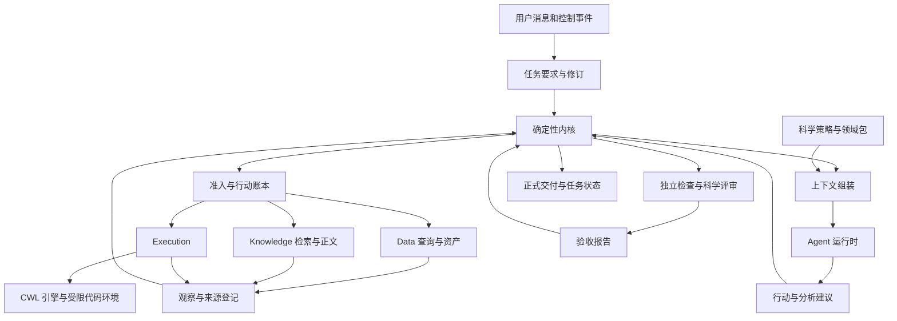

# V7 科学 Agent 内核架构

日期：2026-10-11。状态：架构设计提案。源码核对基线：V6 `839c4f5aa8edb69bcd180bf24b45ead7dd20421b`。

推荐采用小型确定性内核、可替换的 Agent 运行时、可配置的科学分析策略，以及独立的工具执行与验证能力。内核负责任务要求、行动准入、事实登记、恢复和交付判定；模型提出方法与下一步行动；Data、Knowledge 和 Execution 分别拥有数据、知识及计算事实。科学能力通过领域包和检查器提供，避免把地下水术语写入通用循环。

现有 [混合架构方案](v7-hybrid-architecture-plan.md) 的状态所有权、执行隔离与恢复方向可以保留，需要补齐科学问题、假设、实验与结论的协议，并放宽不必要的固定操作顺序。[评测平台方案](agent-evaluation-platform-plan.md) 用于验证这些调整的效果，不能代替生产内核。

这里的“科学”有两层含义：工程上可解释、可恢复、可检验；研究上能够区分观察、假设、分析结果和结论。普通问答和格式转换不需要走完整研究流程。

本文件进一步约定研究对象、科学策略、独立检查、缺项处理及完成提交的协议。[P5 开放式科学策略与知识方案](p5-open-science-and-knowledge-plan.md) 对领域规范的可选性、知识来源和按要求/主张组合检查作出后续实施约束；与本文较早的固定 profile 示例不一致时，以该 P5 方案为准。文中的类型、接口、检查器名称和示例标识均属于拟建契约，尚无对应运行实现；不把文档校验视为运行时验证。

内核是 Platform 控制核心中的模块集合，API 进程和 Agent Worker 共用应用用例。模块唯一写入者、编译依赖方向和对外路由以 [内部架构与接口设计](v7-architecture-and-interface-contracts.md) 为准；工具网关是接入适配器，不是另一套行动服务。

## 1 架构合理性评审

| 设计点 | 判断 | 影响及处理 |
| --- | --- | --- |
| Data、Knowledge、Execution 各有唯一权威状态 | 保留 | 避免模型消息和框架检查点覆盖真实结果 |
| Agent 规划与 CWL 计算调度分离 | 保留 | Agent 调整研究方法，CWL 执行已冻结计算图 |
| 任务要求修订与计划修订分离 | 保留并细化 | 方法变化不应改变用户目标或悄悄降低验收条件 |
| 原子发布、取消仲裁和远程未知状态 | 保留 | 长任务必须可以恢复，不能靠对话推断是否执行 |
| 证据正文读取与引用登记 | 必要但不充分 | 可证明读过资料，不能单独证明结论受资料支持 |
| 资产、算子、工作流、代码的固定选择顺序 | 调整 | 改成按目标、适配成本、可靠性和预算选择，不强制绕远路 |
| 每轮重新读取全部旧证据 | 调整 | 不可变内容可受控复用，权限和有效性单独重检 |
| 缺少语义就进入用户等待 | 细分 | 先自动发现和修复；只询问无法可靠消解且影响当前行动的缺项 |
| 所有科学条件必须先于任何计算冻结 | 限定范围 | 允许先做探索和数据剖析，正式验证前冻结相应协议 |
| 任务完成与正向科学结论接近 | 明确分开 | 可交付反证或不确定结论，但不能将未达到的用户目标标为完成 |
| 多 Agent、记忆和 Shell 的框架默认能力 | 按需采用 | 每项独立评测，不靠增加角色数证明架构先进 |
| 仅依靠最终回复和成功状态评分 | 补强 | 增加方法适用性、数值、证据支持和失败记录检查 |

这是结构性评审，不是已测得的性能结论。V6 中有可以保留的基础：独立于 SDK 的 [ContextPolicy](../../../groundwater-platform_v6/kernel/src/platform_kernel/agent_runtime/context_policy.py)、有用户来源的 [Task 声明](../../../groundwater-platform_v6/kernel/src/platform_kernel/tasks/models.py)。这些链接指向 V7 仓库之外的并列 V6 工作区。

具体耦合点也很明确：当时的 [证据收集](../../../groundwater-platform_v6/kernel/src/platform_kernel/agent_runtime/evidence.py) 从 SDK 消息和固定工具名推导证据；[草稿验证](../../../groundwater-platform_v6/kernel/src/platform_kernel/agent_runtime/workflow_draft.py) 直接调用 SDK 结果转换；结果类验收绑定旧 `model_id`。V7 应在这些边界解耦，复用已存在的纯策略和可靠性逻辑。V6 路径属于历史对照，不是 V7 运行依赖。

## 2 内核的责任和不变量

内核只承担六件事：解释并保存用户要求；选择本轮可见上下文；校验和提交行动；登记可信来源的观察回执；处理等待与恢复；根据检查结果接受交付。

模型承担方法建议、候选解释、代码生成、结果解读和下一步建议。内核不会因为模型说“通过”“已运行”或“证据充分”就改变正式状态。

必须保持以下不变量：

1. 每个影响外部状态的行动先登记，再执行；重放保持原行动身份。
2. 用户要求、行动、观察、执行和交付具有精确版本关联。
3. 引用可靠来源与科学结论正确是不同检查。
4. 旧运行不能写入新任务修订；同一任务同一时刻只有一个主计划写入者。
5. 正式完成只能由确定的验收逻辑提交；模型只能请求检查或完成。
6. 阶段性未知不强制解释为失败，模型自信也不把未知变成事实。
7. 基准答案、隐藏检查器和业务密钥不可进入被测模型上下文。
8. 框架、Provider 和领域知识可以替换，持久业务语义保持一致。

首期使用一个主 Agent。批量科学计算可以并行；额外审查模型只返回建议，不拥有计划、授权或完成状态。未来如引入子 Agent，其结果同样作为有来源的建议处理，不能直接合并进事实表。

## 3 分层架构



其中内核、任务、上下文、行动账本、来源登记和验收先作为 Platform 内的模块实现，不拆成六个微服务。Data、Knowledge、Execution 继续通过明确接口接入。检查器可以在受限 Worker 中运行，检查结果回到内核。

科学策略不控制网络、不直接写数据库、不启动容器。它为决策提供方法约束、检查模板和领域解释。Agent 运行时不管理正式资产，CWL 引擎不决定科学问题是否已经回答。

## 4 状态所有权

| 状态 | 所有者 | 允许其他组件保存的内容 |
| --- | --- | --- |
| TaskSpec、要求来源、控制状态和完成记录 | Task 模块 | 精确引用及上下文投影 |
| TaskPlan、frame、推进租约和等待 | Agent Coordination | 只读投影和恢复身份 |
| 行动准入、发送意图和服务关联 | Action 模块 | 稳定 action ID 和接受回执 |
| 分析、假设、结论和缺项 | Research 模块 | 结构化研究投影 |
| 模型消息循环位置 | Agent runtime | 检查点，不作为业务完成证据 |
| 授权和预算 | Authorization 与 Task Budget | 许可、预留和结算回执 |
| 观察回执及其来源关系 | Kernel Evidence 模块 | 引用及授权范围内内容 |
| 文件、语义修订和质量报告 | Data | AssetRef 与查询回执 |
| 文档正文和生命周期 | Knowledge | EvidenceRef 与有效性状态 |
| 执行、尝试、远程提交 | Execution | 执行引用、事件和输出引用 |
| 计算图中的节点依赖 | CWL 引擎 | 状态查询，不复制调度器 |
| 检查计划、结果和验收报告 | Acceptance 模块 | 报告引用；不直接写 Task 完成 |

Kernel 的行动账本记录“请求了什么、对方是否接受”，Execution 的账本记录“实际运行和发布了什么”。二者通过 action ID 与 execution ID 关联，各自拥有不同事实，不相互镜像覆盖。

业务数据库使用显式事务、不可变修订和 outbox；不要求引入全系统事件溯源。事件用于观测和恢复，关键当前状态仍有清晰的数据库归属。

完成由 EvaluateDelivery 应用用例协调 Acceptance 与 Task。两个模块可以在 Platform 本地事务内核对报告及提交条件，只有 Task 仓储写完成记录；Data、Knowledge、Execution 的事实依旧通过端口核对，不进入本地事务锁。

## 5 任务复杂度决定协议深度

| 请求类型 | 必要协议 | 可以省略的步骤 |
| --- | --- | --- |
| 一般解释和方法讨论 | 当前消息、必要资料、回答范围 | 不必建研究协议或执行计算 |
| 文件整理和确定性计算 | 目标、输入、行动及结果检查 | 不必提出科学假设 |
| 描述或探索性分析 | 数据语义、质量、方法记录、结果和限制 | 不要求把每次尝试称为正式验证 |
| 假设检验或模型比较 | 问题、验证协议、全部尝试、独立检查 | 不能省略选择和比较规则 |
| 可复用生产工作流 | 冻结工作流、数据绑定、环境和验收 | 探索结束后无需每次重新研究方法 |

请求类型是策略选择，允许随着用户目标和观察变化而修订；它不建立五套互不相通的状态机。普通问答进入轻量路径，持久工作进入同一 Task 协议。

任务验收首先表达交付要求，例如“给出指定井群的趋势估计、适用范围及无法评估的原因”。不能默认为“必须发现显著下降”。若用户要求证明一个既定结论，而资料不支持，应说明边界并取得必要的目标澄清，不能修改结果迎合目标。

## 6 最小研究对象

继续复用 TaskSpecRevision、TaskPlanRevision、Execution、AssetRef 和 AcceptanceReport。只增加能解决具体科学问题的少量记录，不引入独立图数据库或通用本体平台。

| 对象 | 核心内容 | 作用 |
| --- | --- | --- |
| AnalysisRevision | 问题、研究对象、时空范围、分析模式、目标量和协议引用 | 把研究问题与聊天轮次分开 |
| AssumptionRecord | 假设或暂定选择、来源、适用范围、是否可撤回 | 防止模型猜测变成项目事实 |
| ObservationReceipt | 来源身份、版本、工具和调用、范围、内容摘要、读取时点 | 证明实际观察过什么 |
| ClaimRevision | 命题、类型、适用范围、结果和证据引用、限制 | 让报告结论可以追查和复核 |
| CheckResult | 检查器身份、输入、判据、结果和诊断 | 将“已生成”与“已验证”分开 |

`AnalysisRevision` 可包含候选假设和研究计划，不要求额外建立一个假设管理服务。主要假设多到需要比较时才使用明确的 hypothesis ID。

`AssumptionRecord` 的来源分为资料声明、用户选择、确定性推导和模型提出。模型提出的假设默认是待检验项。可逆的技术选择，例如图表色板、输出文件名，不作为阻塞项；水位是埋深还是高程则属于影响结论的语义，不能自动选一个当真。

`ClaimRevision` 区分描述、关联、预测和因果等结论类型。证据只能支持其实际覆盖的范围，不能从区域样本推广到全部井群，也不能从预测相关性直接升级为因果解释。结论的核验状态由检查和评审产生，不接受模型自报的单一可信度分数。

内部关系可以参考 W3C PROV 的实体、活动和参与者概念，使用关系表表达 `derived_from`、`used_by`、`generated_by` 和 `assessed_by`。PROV 支持来源描述，不证明推理本身成立。[PROV 数据模型](https://www.w3.org/TR/prov-dm/)。

### 6.1 精确引用和事实来源

内部依赖索引将跨模块引用规范为 `owner`、`project_id`、`object_id`、`revision` 和对象类型；对有字节表示的内容增加 `content_digest`。公开接口保留 AssetRef、EvidenceRef 等明确类型，不要求客户端使用通用索引格式。摘要算法、规范化方式随契约版本登记，不能拿两个不同序列化结果的摘要直接比较。请求中的项目字段仍须与可信身份核对，不因模型填入而获得访问权。

观察内容与其解释分别保存。例如 Data 回执可以说明“字段 f2 的语义修订声明单位为米”，但不能据此证明现场测量确实使用了米。`source_kind`、声明者、原始位置及适用范围必须保留。互相冲突的语义声明同时存在，解决冲突产生新记录，不覆盖原始回执。

每个正式计算绑定完整的 `InputManifest`：资产字节版本、物理字段映射、语义修订、筛选范围和所用规则版本。只固定 CSV 的摘要而不固定字段含义，仍不足以重现分析。

### 6.2 验收要求与科学协议分开保存

`AcceptanceSpec` 是 TaskSpecRevision 内的严格结构，不另设一个任务服务。每项要求至少含 `requirement_id`、来源、交付角色、覆盖范围、必要性和允许的结果类型。来源标明用户明确要求、平台强制政策或系统解释；解释性默认值对用户可见。无法从请求可靠确定、且会改变验收结果的口径才进入澄清。

| 内容 | 决定什么 | 谁可以改变 |
| --- | --- | --- |
| AcceptanceSpec | 交付哪些成果、覆盖哪些对象、是否接受无法评估 | 用户要求修订；平台政策按其版本生效 |
| AnalysisRevision | 如何估计、如何处理数据、怎样比较方法 | Agent 可提出；内核按要求和策略准入 |
| CheckPlanRevision | 哪些条件已由什么检查器或评审覆盖，哪些仍未验证 | 受控编译器从要求、实际方法、适用领域规范及拟交付主张生成 |
| AcceptanceReport | 对某组确定成果实际检查得到什么 | 检查结果汇总产生，不能由 Agent 自报 |

接受部分对象无法评估必须写进交付契约，包括原因记录、是否要求最小有效覆盖，以及“全部无法评估”是否可接受。没有这一约定时，Agent 不能把“完成所有井的趋势估计”自行降为“返回所有井的数据不足提示”。

### 6.3 分析修订的冻结规则

分析采用不可变修订链。草案更新生成新修订，冻结记录固定某个修订的摘要、输入范围、方法及检查计划。已冻结内容不再编辑；后续改变以新修订及 `supersedes` 关系表达，历史执行仍指向原冻结版本。

修改时间范围、目标量、单位解释、排除规则、主要指标或数值容差，均视为实质修订。只改变报告配色不需要重算，但报告字节改变后必须重新检查对应报告版本。实质修订是否还符合用户目标单独判定；方法修订不自动生成用户授权。

看到结果后可以改进方法，但必须记录已看过的数据与结果、修订原因及新的结论范围。一次事后冻结不能把既有探索结果变成事前约定的独立确认。已有成果可用于描述和探索，正式确认是否需要新数据由方法协议决定。

## 7 工具和运行时接口

### 7.1 工具契约

每个 ToolSpec 至少声明输入输出 Schema、版本、动作类别、资源需求、读取范围、幂等能力、取消能力、观察类型和可能错误。动作类别固定为只读、项目内派生、外部副作用和管理操作。

语义契约声明必要的物理量、单位、坐标、采样粒度、缺测规则和适用前提。通用内核只检查契约结构和所需事实是否满足；具体科学规则由版本化领域包和检查器解释。

工具回包统一为以下结果之一：即时结果、已接受的异步句柄、明确可重试错误、不可重试错误、提交结果未知。未知结果不能被普通重试逻辑当作失败后重发。

观察回执由可信工具适配器在校验原始响应后登记，先持久化再提供给 Agent。正式验收直接读回执，不从 SDK 对话字符串重新解析。Agent 可以提出引用，不能自己制造 ObservationReceipt。

回执证明服务返回过相应观察，ContextManifest 说明哪些内容实际进入相关模型调用；两者都不证明模型理解正确。引用检查需要可解析的来源和对应内容范围，科学支持关系另行验证。工具描述和科学规则只能由登记契约提供，资料正文不能提升权限或改变执行政策。

### 7.2 运行时接口

拟定接口如下，具体 Python 类型在实现阶段冻结：

```text
advance(frame, observations, checkpoint_ref) -> DecisionProposal
resume(frame, observations, checkpoint_ref) -> DecisionProposal
cancel(runtime_ref, reason) -> RuntimeCancellation
export_visible_trace(runtime_ref) -> TraceManifest
```

`DecisionProposal` 是封闭类型：行动建议、计划修改、研究记录修改、澄清请求、等待建议、候选交付或说明无法继续。研究记录修改包括提出分析协议、假设和结论；冻结仍须通过内核校验。运行时不能直接写 Task、签发授权或提交完成。

SDK 的自动工具循环必须使用内核提供的受控工具代理；代理在每次实际调用前走同一行动准入，不能把业务客户端或宿主机 Shell 直接注册给框架。需要把工具调用交给外部 orchestrator 时，运行时在调用边界交出控制权，由对方执行后回传结果。运行时内部的每次模型调用也经过统一预算端口，不能用一次 `advance` 包住不受计量的无限循环。

生产工具传输把行动送往 Platform 服务；τ-bench 工具传输把调用交回其 orchestrator。外部副作用执行者每条路径只有一个。评测使用相同的 `advance` 循环和上下文策略，不另写一个简化 Agent 冒充生产内核。

### 7.3 行动建议示例

下面是结构示例，引用为说明性标识，不是已经存在的任务数据。正式 action ID、预算预留和服务句柄由内核分配。

```json
{
  "kind": "action_proposal",
  "expected_task_revision": 3,
  "decision_frame_id": "frame-example-7",
  "purpose": "检查指定时间范围内各井的缺测和重复观测",
  "tool": {"id": "data.profile", "version": "1"},
  "arguments": {
    "asset_ref": "asset-version-example",
    "group_field": "well_id",
    "time_field": "observed_at",
    "value_field": "water_level_m",
    "scope": "FULL_BOUNDED_SCAN"
  },
  "evidence_refs": ["observation-schema-example"],
  "expected_observation": "取得完整率、重复键及非法数值的分组检查结果"
}
```

`expected_observation` 说明行动要解决的问题，不提前写入观察结果或科学答案。参数必须符合被选工具的实际 Schema，示例不意味着已有该 API。

### 7.4 单一工具执行路径

首期运行时采用“提出工具调用后交还控制权”的方式：一个 DecisionProposal 可以包含多项相互独立的行动，由内核逐项准入；需要前一项结果的行动留到下一轮提出。模型内部生成的调用 ID 仅用于消息关联，正式 action ID 由内核分配。

既有 SDK 如必须运行自动工具循环，只能注册内核代理。同一调用不能既由代理执行，又作为待执行建议返回。适配器声明 `YIELD_TO_KERNEL` 或 `CONTROLLED_PROXY`，作为运行配置固定；基准 orchestrator 路径使用前者。两种路径都经过相同账本、授权、预算与回执入口。

多项独立行动不构成新的 DAG 语言。它们各自接受或拒绝，返回逐项结果；有原子要求的业务操作由一个专用服务契约承担。多步计算依赖仍封装为 Execution 接受的 CWL 或计算包。

## 8 决策循环和提交顺序

内核执行短而可恢复的循环，不将长计算放在一次模型调用或一个数据库事务中：

1. 读取当前任务、相关行动、授权、预算、等待和证据状态，形成带水位的 DecisionFrame。
2. 选择本轮需要的资料和工具说明，调用运行时产生建议。
3. 对建议做结构、身份、权限、预算和必要科学前提检查，失败返回具体诊断。
4. 事务性接受建议，分配稳定 action ID，保存预留引用和发送意图。
5. 按对应端口执行或登记异步等待，保存真实观察和结果。
6. 检查事实是否有进展，继续决策、等待、请求必要输入或评估候选交付。

模型调用前先持久化 frame 身份。动作唯一键采用任务修订、frame 与动作序号；执行者代次只参与写入权限检查，不纳入可变化的幂等身份。否则 Worker 接管后更换代次会意外产生第二个副作用。框架重放读取原动作，同键不同内容冲突。模型返回但尚未被接受时崩溃，可重新请求模型，但重新请求的用量仍计费，不能宣称外部模型调用恰好一次。

直接执行 API 使用来源为客户端命令的 frame，无需调用模型；入口幂等键映射到原 frame 和行动。DIRECT 与 AGENT 共用准入规则，模型调用记录只存在于实际调用模型的路径。

只有内核接受后才允许产生副作用。数据库提交后发送前崩溃，由 outbox 发送原行动；远程接受但回执丢失，按原幂等键查询。无法查询则进入待对账，不能让 Agent 通过换个调用 ID 重复提交。

任务修订、授权变更或相关证据失效会触发重新校验。无关观察到达不必废弃所有建议，避免活跃系统因频繁更新而永远不能提交。校验记录自身版本及相关服务读取水位，不假设存在跨服务原子快照。

### 8.1 准入结果必须可操作

| 准入结果 | 含义 | 后续处理 |
| --- | --- | --- |
| ACCEPTED | 结构、权限、预算和适用前提满足 | 保存行动与发送意图 |
| NEEDS_FACTS | 缺少当前行动必需的事实 | 返回 gap ID、可用发现工具及受阻范围 |
| INVALID_ARGUMENTS | 参数不符合固定工具契约 | 返回字段级诊断，允许有差异的修正 |
| STALE_FRAME | 相关要求、策略或事实发生变化 | 返回变化引用，重新形成决策 |
| UNSUPPORTED_METHOD | 方法尚无满足当前要求的检查路径 | 可继续探索，正式交付需补齐验证能力 |
| DENIED_SCOPE | 行动超出已授予范围 | 在现有范围内调整或提出明确扩展请求 |
| BLOCKED_BUDGET | 没有足够可用预算 | 保留任务和已有结果，等待预算决定 |
| CONFLICT | 稳定身份对应不同内容或已有互斥操作 | 查询原记录，不能自动换键重发 |

只读发现不要求先满足它要发现的科学前提。例如获取字段元数据不以“单位已知”为条件；正式执行单位换算则必须有已确认的输入单位。准入规则按工具操作和声明目的应用，避免形成“没有资料所以不准读取资料”的死锁。

### 8.2 提交事务与预算边界

任务库事务中检查要求修订、有效租约代次、当前策略绑定及相关失效标记，再写入行动、预算预留关联和 outbox。预算模块若共享同一事务可原子预留；若使用远程预留，必须先取得可查询的预留回执，提交失败后经对账确认没有已接受的发送意图或远程提交，才按稳定身份释放。不能仅因超时释放未知运行的额度。没有有效预留不得发送，不能把跨服务调用写成一个假想的全局事务。

预算所有权仍归 Task 模块。计算预留以同一业务 action ID 幂等处理；Kernel 与 Execution 查询或承接该预留，不分别扣除两份计算额度。模型调用和检查计算也各自有预算身份，均计入任务总额。

同一 frame 的已接受结果持久化后，Worker 接管只重放该结果。新的模型决策必须使用新 frame，并带入尚未完成的行动。对不可重复的业务命令，服务端还需使用逻辑操作键，例如同一发布组提交；action ID 本身无法识别模型用新 frame 再次提出的语义重复操作。

无关事件可以更新任务投影而不废弃建议；相关性由登记的依赖引用和政策规则判定，不能只相信模型自报的 `evidence_refs`。正式执行至少绑定全部输入与语义修订，正式交付绑定全部必要检查及成果。

## 9 Data 和 Knowledge 的可替换接入

所有分析必须有足够的任务事实，但不要求这些事实一定来自知识库。有效来源可以是文件自描述元数据、数据字典、用户明确说明、版本化方法说明、确定性查询或可信计算结果。

通用知识解释也不强制伪造项目引用。任务资料完整时允许直接分析；缺少专业依据时再检索。不能为了满足一个“引用不能为空”的形式条件引用无关文档。

Data 应提供四类能力：文件和字段身份检查、有界全量剖析、过滤聚合查询、可追溯转换。剖析报告至少带扫描范围、完成程度、行数、缺测、重复、非法值和检查条件；头部样本不能显示为全量质量结论。

字段绑定使用物理列身份、语义声明及其来源。规范化为 `f0/f1/...` 后必须保留明确映射；对外显示名和算法物理取值名分开。GeoTIFF 的 CRS 等实际元数据可以作为来源，文件名或数值范围只能形成候选解释，不能直接确定未知 CRS。

Knowledge 支持搜索、目录、正文读取和生命周期查询。召回结果保持发现用途；用于正式结论的正文经过读取登记。检索无结果、文档不存在、权限不足、版本失效和服务不可用分别返回，不统一成“没有知识”。

需要作为正式证据的可变外部响应先保存内容快照及来源时点，文件字节由 Data 保管，回执引用该快照。仅有 URL 或未来无法重读的临时工具输出不足以支持可复核交付。短期预览可有较短留存期，但提升成正式结论依据时必须确认内容仍可取得且覆盖所述范围。

检索策略、分块和上下文组装单独版本化。没有证据证明某个检索框架更好之前，保留相同语料下的直接提供和基础检索对照。

## 10 科学分析循环

科学策略采用“形成问题—获取观察—提出方法—执行—核验—修订或交付”的循环。这是可跳过和回退的策略，不是每个任务都必须逐格完成的状态机。

### 10.1 探索与验证

探索允许试图理解数据、比较候选方法、编写临时代码以及得到失败结果。每次计算仍须有输入、代码和环境身份，但不要求在第一次剖析前知道最终模型和全部统计检查。

准备进行正式比较或支持结论时，冻结 `AnalysisRevision` 内的验证协议：研究对象、目标量、数据划分、主要指标、基线、允许的预处理、停止规则及检查器版本。数据支持不了预定方法时修订协议并保留原因，不能看过结果后无痕调整成功标准。

纯描述任务只需要与目标相称的范围和检查，不强行使用训练测试划分。预测、假设检验或多方案选择按各自领域策略记录验证条件；内核不内置一种通用统计方法。

### 10.2 防止分析选择造成假结论

对模型比较保留所有计划内尝试、参数、失败和选择依据，报告不能只留下最好的一个。训练预处理只在规定训练范围拟合，时间或空间留出方式由领域协议确定。

留出数据使用情况登记到分析协议，不能无限重复查看结果后仍声称它是未使用的独立验证。探索后提出的新假设标为探索所得；需要独立确认时采用未参与选择的数据或适当验证设计。

多次比较、季节性、自相关和测量误差等前提由相应方法策略检查。没有满足的前提必须影响结论范围或判为无法评估，而不只是放进报告末尾的通用免责声明。

### 10.3 进展与停止

进展包括取得相关新证据、排除候选假设、解决一个必要缺项、完成检查或产生有效成果。新建待办、重复相同搜索、同类失败重试不自动算进展。

无进展时先更换具体策略或解释限制；相同错误达到上限后停止该分支。预算限制、外部未知、必要用户决定和任务确实无法继续分别有对应状态，不能全部表现为模型沉默或“已完成”。

### 10.4 科学策略的具体组成

科学策略拆成三个可分别审查的部分：给模型参考的方法说明、内核执行的前提与约束、独立检查器引用。只写提示词不能形成硬约束；增加规则也不能代替模型对新问题提出方法。通用内核不要求每个任务绑定预制领域 profile；先从所选行动、输入能力及拟交付主张判断哪些约束适用。

| 契约 | 必填内容 | 明确不承担 |
| --- | --- | --- |
| ScienceProfile（可选） | 身份和修订、明确适用范围、领域语义、建议方法、受信判定器/检查器引用 | 全平台必选任务类型、授权、网络访问、容器调度 |
| MethodSpec | 目标量、输入条件、参数定义、输出角色、可支持的结论类型、检查器引用 | 宣布该方法对任意数据都正确 |
| PreconditionRule | 规则 ID、作用阶段、事实依赖、受控判定器、缺项说明 | 执行知识文档中的任意表达式 |
| ProfileBinding（采用时） | 实际采用的策略版本、触发依据、覆盖范围及编译器版本 | 自动跟随目录最新版或覆盖未采用该策略的任务 |

策略按平台底线、实际适用的领域规则及所选方法规则局部组合；不适用的领域规则不强加给其他数据类型。平台必要约束不可由低层策略取消；兼容规则合并，冲突规则必须显式解决。单位解释冲突不能按“最后加载者优先”，也不能把互不兼容的科学要求简单取一个更严格数值。

首期使用有限的结构化条件和登记判定器，不开发通用规则语言。配置中的判定器名称必须能解析到受信实现；Knowledge 文本、Agent 生成文件均不能自行登记判定器。增加新的可执行规则走正常代码评审和回归发布，不要求普通用户每次使用都批准。

拟定策略端口如下，输入为已取得的事实，策略本身不进行 I/O：

```text
select_applicable_profiles(task_spec, action, semantic_facts) -> list[ProfileBinding]
evaluate_preconditions(action, required_capabilities, facts, profile_bindings) -> GateResult
compile_check_plan(acceptance_spec, claims, analysis_revision, method_contracts, facts, profile_bindings) -> CheckPlanRevision
```

任务分类可以参考模型建议，但硬性规则还根据实际操作、输入语义及拟交付结论触发。把预测任务标为“普通描述”不能绕过与预测主张相称的验证要求；把因果判断藏入报告正文也不因未填写 ClaimRevision 就获得许可。无法可靠判定的自定义要求应登记未覆盖条件，不能静默编译成空检查计划。仅要求探索性成果的任务可以交付明确标注为未验证的结果；必要条件要求科学验证时不能以该标注代替通过。

### 10.5 前提分阶段执行

| 阶段 | 必须知道的内容 | 可以继续做的工作 |
| --- | --- | --- |
| 发现和剖析 | 授权输入、格式和资源上界 | 查字段、缺测、重复及候选语义 |
| 探索计算 | 所用计算必需的语义、输入和方法记录 | 比较候选、检查敏感性，标为探索 |
| 正式分析冻结 | 用户要求、目标量、范围、处理规则、方法及检查计划 | 启动符合该协议的正式计算 |
| 结果检查 | 确切输出、协议及输入版本 | 运行检查、生成诊断或补充证据 |
| 正式交付 | 适用的必要检查、成果、结论范围及允许的缺项处理 | 提交验收或返回具体阻塞项 |

以水位分析为例：发现阶段允许读取单位未知的表格并统计行数；水位方向解释前需要区分埋深和高程；跨井比较还需判断基准面是否可比。某条规则只约束其实际涉及的行动，不阻止其他独立工作。

方法选择先筛除不满足目标、授权或必要前提的候选，再比较可验证性、成本与适配工作量。缺少成熟检查器的新方法可做探索，但其结果不能自动升级为通过正式验证；若用户任务本来只要求研究建议，应按研究建议的交付契约验收。

### 10.6 策略变化的影响范围

正式运行固定实际使用的规则和判定器版本；采用可选领域 profile 时另固定 ProfileBinding。策略目录普通升级不改变已接受计算；新修订任务可选用新版，并记录差异。发现严重错误而撤销某方法或检查器时，撤销事件使相关交付检查失效，触发复核，而不是修改历史 PASS 记录。

每次实质修订建立影响清单：哪些输入解释、执行、结论、检查和交付依赖旧条件。首期用引用关系表查询直接及传递依赖；这用于判定复用与失效，不另建计算调度器。缺少足够依赖记录时按不能证明可复用处理，重新检查或重新计算。

## 11 验证和科学结论

验证分成五个层次，分别记录，不能互相替代：

| 层次 | 检查内容 | 示例 |
| --- | --- | --- |
| 运行完整性 | 文件、执行状态、输出协议和来源 | 输出确实由登记执行产生 |
| 数据与语义 | 范围、字段、单位、坐标和缺测 | 使用的是水位高程而不是误标的埋深 |
| 数值与性质 | 独立参考、边界、不变量和容差 | 单位换算后结果保持相应等价关系 |
| 方法适用性 | 抽样、假设、数据划分和比较规则 | 时间验证没有使用未来观测拟合预处理 |
| 结论支持 | 命题是否由结果和证据支持 | 没有把相关性写成因果解释 |

确定性检查器来自登记的版本化实现或受控的声明式规则。Agent 新生成的测试可以揭示问题，但不能由同一个 Agent 自动提升成唯一可信的验收标准。建立可重复测试和明确预期符合研究软件验证的基本方向。[The Turing Way 测试指南](https://book.the-turing-way.org/reproducible-research/testing/)。

模型审查适合辅助检查报告与来源是否一致，不提供形式化的科学正确性证明。重要领域判断使用事先规定的人工评审或专用检查器，评审人和范围进入报告。换一个模型反复同意也不能自动视为独立证据。

每项完成的 CheckResult 为 PASS、FAIL 或 INDETERMINATE，带被检查对象、版本、判据、适用范围和限制。检查器运行错误、尚未运行和规则不适用分别表达，不能编码成 PASS。数值容差事先按算子或研究协议设定，不能在看到误差后只为通过而扩大。

正式完成需要所有必要交付条件通过。若任务约定允许交付“不确定、无法识别或不支持假设”的结论，则该科学结论可以是 INCONCLUSIVE，而“如实报告不确定性并给出依据”的交付条件为 PASS。不能把未通过的必要数值检查改写成“不确定”来逃避验收。

候选完成由内核读取最新 TaskSpec、AcceptanceReport、成果发布状态和相关未对账行动，在任务事务内提交。跨服务事实记录核对时点；后续证据撤回产生复核标记，不改写过去发生的验收事实。

### 11.1 谁决定必须检查什么

内核使用受控编译器，把 AcceptanceSpec、拟交付主张、方法契约、输入语义和实际适用的可选策略组合成 CheckPlanRevision。计划逐项列出已覆盖、需评审、未验证或有依据地不适用的要求；无可用检查器不等于自动通过。Agent 可以增加检查建议，但不能删除必要项、改变容差或自行判定“不适用”。有预定检查模板时在正式分析冻结时固定；输出产生后，检查调用再绑定实际的不可变输出引用。

不涉及研究协议的任务只编译相应交付检查，`analysis_revision` 可以为空。例如格式转换检查字节、Schema 和内容保持关系，无须创建假设记录；一般解释仍采用第 5 节的轻量路径。后续流程仅核对该任务实际要求的引用，不为填满字段而制造研究对象。

每项检查包含 `check_id`、对应要求、检查器版本与实现摘要、输入角色、适用条件、范围、参数、容差、必要性、允许的证据来源和运行资源上限。一个要求可以由多项检查共同覆盖；完全没有可执行判据或评审路径的必要要求保持未覆盖，不因检查列表为空而通过。

正式检查计划及通过规则对 Agent 可见，有助于提前修复结果。用于评测的隐藏答案、保留测试数据和评分私有材料保持隔离。“独立”要求判据与事实不受被评对象随意修改，不要求生产环境把所有规则都保密。

### 11.2 独立检查的证据强度

| 检查方式 | 可以发现什么 | 剩余局限 |
| --- | --- | --- |
| 结构和来源检查 | 输出缺失、字段错误、版本串用 | 不验证算法结论 |
| 单独实现的参考计算 | 符号、聚合、索引和部分算法错误 | 两个实现仍可能共享错误假设或底层库 |
| 性质和输入变换检查 | 换单位、排列、边界等性质被破坏 | 满足若干性质不等于算法全对 |
| 未参与选择的数据验证 | 限定设计下的泛化或确认表现 | 留出污染、分布变化和样本不足仍影响结论 |
| 有来源的领域评审 | 方法前提、解释范围和领域合理性 | 有人员成本和主观差异 |

每个检查器声明 `independence_basis`：与被检查实现共享了什么、采用哪个参考或性质、检查覆盖什么。生产算法自己重新运行一次主要证明可重复；它不能单独证明数值正确。模型提出的测试代码先按普通计算产物处理，不能在同一任务中自行取得可信检查器身份。

检查执行可复用 Execution 的受限 Worker，但使用单独登记的代码与权限。计算产物只读挂载，检查器不能替换被检文件，生成代码也不能写检查结果表。结果经验证端口校验执行来源后登记；Agent 返回同样格式的 JSON 不会被当作正式 CheckResult。

### 11.3 检查状态、科学结果与交付结果

检查调用分别记录三类状态：`run_status` 为 PENDING、RUNNING、COMPLETED、ERROR 或 CANCELLED；`applicability` 为 APPLIES、NOT_APPLICABLE 或 UNKNOWN；只有完成且适用的检查才产生 PASS、FAIL、INDETERMINATE。超时记为 ERROR 并带原因，不把超时解释为科学上无法确定。

| 情况 | 对验收的影响 |
| --- | --- |
| 必要且适用的检查 PASS | 满足该检查项 |
| 必要且适用的检查 FAIL | 返回缺陷，当前候选不能完成 |
| 必要检查 INDETERMINATE 或适用性 UNKNOWN | 保持未判定，需补足依据或按要求修订处理 |
| 必要检查尚未运行、ERROR 或 CANCELLED | 当前候选不能完成，允许按运行策略恢复 |
| 预定规则证明 NOT_APPLICABLE | 记录依据；对应要求仍须由其他适用检查或明确替代交付覆盖 |
| 非必要的补充检查失败 | 记录限制；若揭示实质冲突，触发必要检查复核 |

“某井观测不足，无法估计趋势”是对象层面的科学结果 INCONCLUSIVE。可以由一个通过的“可评估性判定”检查证明其原因；该井的趋势数值检查按预定规则不适用，同时范围检查必须确认它仍出现在报告中。这样能够交付真实的资料不足，而不会把坏算法的数值失败改名为资料不足。

同一结果再次检查要保留原检查和重试原因。基础设施失败可按固定策略重试；真实 FAIL 应通过新成果、修正输入或有来源的协议修订解决。随机检查或模型审查若需要多次运行，聚合规则事先固定，禁止重复运行直到抽到 PASS。

### 11.4 正式完成的确定性门槛

拟定验收流程如下，`requirement_coverage` 表示要求与检查或替代交付的明确映射：

```text
load current TaskSpecRevision and candidate manifest
verify exact input, analysis, policy, output and claim references
verify publication, permissions, relevant lifecycle states and reconciliation
resolve frozen check plan against candidate outputs
reject uncovered requirements and unknown applicability
require PASS for every mandatory applicable check
verify allowed partial or inconclusive outcomes and required coverage
persist immutable AcceptanceReport
commit completion only if task revision and dependency markers still match
```

完成记录绑定报告摘要、要求修订、候选成果清单、检查计划、检查结果清单和服务核对水位。检查报告生成后任务又被修订，则保留旧报告但拒绝用它完成新要求。外部状态在核对之后发生变化仍可能稍后才得知，应明确记录这个时间边界。

依赖某次未对账执行的成果不能交付；未完成的无关探索分支须按既定任务结束策略取消或转入独立跟踪，并保留清理状态。不能为了交付掩盖未知副作用，也不应无限等待与交付无关、已明确退出的探索。

### 11.5 报告正文如何受约束

正式报告的数值、对象范围、单位及主要结论优先由已检查的结果表和 ClaimRevision 渲染，保留从文本段落到结果行或证据范围的映射。内核能检查引用存在、数值一致、范围和结论类型是否越界，不能仅凭字符串匹配证明任意自然语言推理正确。

自由文本解释采用与任务风险相称的复核。确定的数值矛盾直接失败；不能自动判断的关键科学主张进入限定范围的专门评审，或在任务允许时删除该主张并保留支持得住的交付。普通描述任务不因此一律要求人工审批。若系统无法证明报告中的全部科学断言受支持，验收报告必须如实声明已检查范围。

## 12 上下文和记忆

保留 V6 纯 ContextPolicy 的方向，输入是版本化事实快照，输出是给运行时的消息和上下文清单。Provider SDK 消息类型只能出现在适配层。

上下文按目的组织：当前目标与约束、真实行动状态、必要证据、相关方法契约、最近决定和失败诊断。资料很长时先选择对应范围，不能只把更多文档塞进模型窗口。

| 内容 | 保存方式 | 使用规则 |
| --- | --- | --- |
| 用户目标、约束和验收 | Task 精确修订 | 不能被摘要覆盖 |
| 正式数据和知识证据 | 来源服务的不可变内容或授权缓存 | 校验身份、内容范围和有效性 |
| 研究决定与假设 | 结构化研究记录 | 保留来源、范围及待验证状态 |
| 失败经验 | 任务内记录 | 只作为建议，不能代替当前契约 |
| 对话摘要 | 非权威记忆 | 用于衔接表达，不能补造事实 |

改变 V6 的强制跨轮重读策略：同一任务范围内，可复用精确版本的已读取内容和回执，但使用前确认权限仍有效、来源生命周期仍适用。正文摘要相同不表示授权永久有效。过期、撤回、权限变更或语义修订触发相关缓存失效；状态不可核实时，阻止依赖“当前有效”这一条件的正式结论。

生命周期重检可以是轻量状态查询，不必重复下载完整正文。关键提交前强制校验，后台事件用于尽早发现变化；对账负责补偿事件遗漏。历史报告可保留当时使用的版本，当前任务不得静默替换为新正文。

每次模型调用记录上下文条目、摘要、版本、token 估计、纳入或省略原因。只记录可观察输入输出，不要求或暴露隐藏思维链。被撤回资料已进入过模型上下文时，后续隔离依赖和重建上下文，不宣称能够抹去已经发生的读取。

上下文预算优先保留当前约束、未完成行动及支持当前决定的资料，并为模型输出保留空间。无法完整放入必要资料时使用分段取证或更小的子任务；不能截断关键字段后继续声称上下文完整。

## 13 自主行动和澄清边界

工具选择使用相关性、契约满足程度、适配工作量、可信度和费用进行比较。已有算子通常更易验证，但对于简单自定义分析，受限代码可能是更短的路径；不强制依次试遍资产、算子、模板和 CWL 才能写代码。

缺项按照可处理方式分类：

| 缺项 | 默认行动 | 何时需要用户 |
| --- | --- | --- |
| 文件格式不同但转换含义明确 | 调用转换工具并登记派生资产 | 转换涉及未声明的业务口径 |
| 已有明确的字段别名表 | 自动生成映射并校验 | 多个映射同等可能且影响结果 |
| 缺少排序或筛选规则文件 | 根据已知要求生成，Schema 校验后登记 | 排序或筛选条件尚未决定 |
| 数据质量未知 | 做有界全量剖析，报告覆盖范围 | 超出预算或需要额外来源 |
| 单位或 CRS 不明确 | 查实际元数据和权威说明 | 证据仍不足且下一步依赖它 |
| 缺少现成算子 | 在代码授权内生成 CodePackage | 新依赖、网络或副作用超出授权 |
| 方法选择属于研究探索 | 在预算内比较候选并保存协议 | 涉及用户价值取舍或目标变更 |
| 证据真正冲突 | 保留冲突，做不依赖该冲突的工作 | 需要不可替代的事实确认 |

ScopeGrant 可以覆盖既定输入上的纯计算、规则生成和项目内派生发布；该授权范围内不逐次请求许可。外部写入、新费用范围或访问新的受限资料继续遵守授权边界。

语义问题只阻塞依赖它的分支。例如 CRS 未确认时可先检查时间序列重复键，但不能计算以米为单位的距离。等待用户时保存问题对应的 gap ID，用户回答后只失效受影响计划和检查。

澄清问题应说明缺少什么、影响哪个判断、已有依据及可选择的解释。一次询问合并相关缺项，不能把可以由工具查明的事实转交用户。

### 13.1 缺项是可恢复记录

`GapRecord` 至少保存 gap ID、任务修订、缺项类型、受影响范围、阻塞的行动或要求、已有依据、允许的解决路径及状态。缺项类型限定为事实未知、事实冲突、用户取舍、权限不足、能力缺失和环境故障；“缺资料”不能作为所有失败的统一分类。

状态先采用 OPEN、RESOLVED 和 SUPERSEDED。自动查询或用户回答形成 `ResolutionRecord`，携带来源、范围和依赖版本；校验满足后才关闭缺项。版本变化导致依据不再适用时产生后继缺项，保留原解决记录。模型说“已解决”不直接改变状态。

用户回答按语义处理：补充单位进入有来源的语义声明，改变时间范围进入 TaskSpec 新修订，选择方法进入分析记录。每次提交带消息身份、gap ID 和预期版本；重复消息幂等，迟到回答不能绑定到同名的新问题。影响资产语义的回答通过 Data 接口形成语义修订，不由 Kernel 覆盖 Data 内部字段。

### 13.2 阻塞只传播到依赖分支

内核先尝试已授权的发现、明确转换或规则生成；达到该缺项的尝试与预算上限后给出诊断，不反复执行相同查询。只要还有不依赖该缺项的有用工作，任务仍可运行。确实需要用户输入且没有可推进分支时，才将任务投影为 WAITING_USER。

环境故障先按基础设施恢复策略处理；缺少检查器属于能力缺口，不应让用户回答单位问题来“解除”。如果部分对象无法评估的报告已被接受为合法交付，则可进入这一交付路径；否则保留未满足要求，不自行降级。

界面显示具体原因，例如“W3 的单位没有可靠来源，无法计算以米计的变化；W1 和 W2 继续检查”。同时允许用户看到已经完成的成果，但不把部分成果展示为整个任务完成。

## 14 计算路径与 CWL 的位置

短小只读查询由 Data 或 Knowledge 自身执行，计入读取和计算预算，不为每次检索创建 CWL。产生分析成果、代码执行或多步骤计算走 Execution，以统一持久身份和发布语义。

Execution 接受三种可冻结的计算包：单算子、CWL 工作流、CodePackage。首期仍只有一个正式 CWL 调度后端；单算子和代码可包装为简单 CWL 工具，也可采用经验证的直接运行适配器，但不能复制一套 DAG 调度。

多次实验的研究顺序由 Agent 根据结果决定；每个实验内部的可并行计算交给执行引擎。例如对三个候选模型的冻结训练与评估可以并行，但是否增加第四种方法是下一轮研究决定。

代码探索工作区保留版本化文件清单。正式计算前冻结源码、依赖、输入、种子和环境；最终交付要求能在干净环境重建，不能依赖交互 Notebook 未记录的内存变量。

正式验收只认可 Data 中已发布资产及其检查结果。引擎临时文件用于恢复，跨运行复用需提升成有来源的资产。不同中间文件是否长期保留由研究协议和留存策略决定，不要求每个调试文件永久发布。

CWL 的价值在于表达和执行明确的输入输出计算关系，开放式科学方法选择仍由外层 Agent 完成。[CWL 工作流规范](https://www.commonwl.org/v1.2/Workflow.html)。

## 15 运行时选择和采用门槛

| 方案 | 定位 | 采用条件 |
| --- | --- | --- |
| V6 已有 SDK 加薄适配 | 对照实现和解耦起点 | 能接入统一 frame、行动及回执接口 |
| LangGraph 加最少策略 | V7 默认验证候选 | 支持恢复、外部工具传输、预算及相同持久语义 |
| Deep Agents 中间件 | 条件性复用 | 文件和上下文能力带来实际收益，默认权限可以裁剪 |
| 多 Agent 研究系统 | 后续实验 | 在同预算和相同任务上比单主 Agent 有可重复收益 |

LangGraph 的中断恢复会重新执行中断所在节点前部逻辑，因此副作用仍要经过业务行动账本。其 checkpoint 保存执行位置，不代替 Task、Evidence 或 Execution 状态。[中断恢复语义](https://docs.langchain.com/oss/python/langgraph/interrupts)。

Deep Agents 的文件后端和执行环境是不同边界。接入文件工具不自动获得受限代码执行能力，实际隔离由 Execution 环境提供。[后端说明](https://docs.langchain.com/oss/python/deepagents/backends)。

研究系统关于候选假设、比较和证据关联的设计值得参考，但不能据此直接采用多个角色长期对话作为内核。AI co-scientist 的目标包含假设和研究建议，证据链研究强调可核查来源；这些方向都不能替代实际计算、领域验证和成本评测。[AI co-scientist](https://research.google/blog/accelerating-scientific-breakthroughs-with-an-ai-co-scientist/)、[Science One](https://research.google/blog/science-one-framework-a-verifiable-autonomous-research-framework-via-chain-of-evidence/)。

框架试验保持同一个模型、任务、工具、预算和检查器。比较正确交付、无必要澄清、恢复行为、成本和适配工作量；框架名称或自带组件数量不作为选型标准。无法在公开扩展接口下保持所有权边界时，优先保留更薄的实现。

## 16 异步状态和故障恢复

沿用 Task lifecycle 的 OPEN、COMPLETED、CANCELLED、FAILED；OPEN 下有 READY、RUNNING、WAITING_EXECUTION、WAITING_USER、WAITING_RECONCILIATION、BLOCKED_BUDGET 和 PAUSED。研究进度单独通过计划及 AnalysisRevision 表达，不再加入一套与生命周期竞争的“科学阶段状态”。

同一任务允许多个独立执行在途，但主计划写入采用租约和版本比较。结果到达可以并发登记；主 Agent 在稳定快照上决定是否采用。迟到结果不直接替换当前结论。

| 故障位置 | 恢复动作 | 禁止行为 |
| --- | --- | --- |
| 模型响应前后中断 | 查询调用记录，保留用量不确定性，必要时重新决策 | 把重新请求的模型输出当作完全相同的运行 |
| 行动已登记但尚未发送 | 发送原行动及幂等键 | 分配新的副作用身份 |
| 远程接受后响应丢失 | 按稳定身份查询，未知则等待对账 | 由 Agent 盲目重试 |
| 结果已发布但 Agent 未收到 | 查询发布回执并重新投影 | 重算并重复公开结果 |
| 完成早于等待登记 | 登记后再次查询，事件加周期对账 | 仅等待未来事件 |
| 用户修订后旧结果到达 | 保留来源并检查新要求适用性 | 自动计入新修订的验收 |
| 授权撤销 | 拒绝新准入，对在途操作执行取消策略 | 承诺所有远程计算瞬间停止 |
| 框架检查点落后 | 以业务账本重建待办与观察 | 从聊天记录猜测执行状态 |

用户暂停默认停止新推进，已在途计算按既定策略处理。取消任务与计算已停止分开表达，cleanup 状态继续对账。发布与取消的最终仲裁继续由 Data 的发布记录负责。

## 17 工程组织和持久化

建议的模块结构如下，位于拟建 `packages/platform-core`，由 Platform API 和 Agent Worker 共用，不表示当前已有实现：

```text
kernel/
  domain/
    tasks.py
    actions.py
    observations.py
    research_records.py
    acceptance.py
    authorization.py
    budget.py
    coordination.py
  application/
    advance.py
    assemble_context.py
    accept_proposal.py
    reconcile.py
    evaluate_delivery.py
  ports/
    runtime.py
    authorization.py
    budget.py
    data.py
    knowledge.py
    execution.py
    validation.py
    persistence.py
  adapters/
    runtime_langgraph/
    runtime_baseline/
    service_clients/
    postgres/
  api/
science_profiles/
  general_analysis/
  groundwater/
  benchmark/
```

依赖只能由 adapters 和 application 指向 domain 与 ports；domain 不导入框架、HTTP、SQL、QGIS 或模型 SDK。Application 通过端口异步访问服务，避免将 V6 的同步客户端直接放入异步 Agent 循环。

科学 profile 包含任务分类规则、方法描述、工具筛选、语义要求、报告模板和已登记检查器引用。配置与可执行检查器分别固定身份；Knowledge 中的普通文档不能作为自动加载代码或修改权限的插件。

最小数据库增量包括决策 frame、行动、观察回执、研究记录修订及检查结果。复用 Task、预算、outbox 和完成记录，不新建相同意义的表。研究记录可先存严格 Schema 的 JSON 加引用关系表，出现真实查询瓶颈后再调整存储。

必须建立以下约束：同一任务修订、frame、动作序号唯一且不随 Worker 代次变化；同一服务回执不可变；任务修订只能由期望版本推进；旧代次不能提交；完成记录绑定确切验收报告；每个引用带所属项目和访问范围。

公开 API 延续 Platform 的任务和资产入口。新增内核能力通过创建任务、继续任务、提交用户回答、查询研究记录和请求验收暴露；`force_complete`、任意 `set_fact` 或绕过网关执行不属于 Agent 工具。

### 17.1 逻辑存储与关键约束

以下是逻辑记录，实施时优先复用已有表，不要求每项独立建库：

| 记录 | 关键身份或约束 | 恢复用途 |
| --- | --- | --- |
| decision_frames / accepted_decisions | frame ID、任务修订、上下文清单、已接受建议摘要 | 区分重新决策与原决定重放 |
| action_ledger / outbox | 稳定动作键、参数摘要、发送意图、原服务句柄 | 只发送原意图，查询未知提交 |
| observation_receipts | 来源服务与回执 ID 联合唯一，内容摘要不可变 | 重复事件不重复登记事实 |
| analysis_revisions / profile_bindings | 不可变修订、冻结摘要、策略与检查计划引用 | 精确复用方法及输入解释 |
| gaps / resolutions | 缺项版本、消息去重键、解决依据 | 重启后恢复问题，拒绝迟到误绑定 |
| check_plans / check_invocations / check_results | 计划修订、逻辑检查身份、尝试号、只追加结果 | 区分重复请求、运行重试与结果改写 |
| reference_edges / invalidation_marks | 同项目的带类型引用、失效来源与水位 | 判断哪些结果与检查需要复核 |
| acceptance_reports / completion_records | 分别由 Acceptance 与 Task 写入，精确关联候选、报告和要求 | 防止旧报告完成新要求 |

一次逻辑检查的身份绑定计划项、输入与输出摘要、参数及检查器实现，重复传输返回原调用；合法重试增加尝试记录。若复用历史检查计算，必须新建当前验收下的适用性绑定，重新检查权限、生命周期、范围及要求覆盖，不能只因数值相同就复制历史 PASS。

### 17.2 API 与内部命令的映射

公开接口统一采用项目范围路径，具体路由只在 [接口设计](v7-architecture-and-interface-contracts.md) 第 9 节维护。回答缺项、查询研究记录、登记候选交付和请求验收分别映射到相应应用命令；Agent 工具复用这些命令，不反向调用自己的公开 HTTP 接口，也不拥有可信字段写入口。

分析草案和冻结由内核 `propose_analysis`、`freeze_analysis` 应用命令处理；冻结同时绑定已编译的检查计划及策略引用，禁止只有“已冻结”标签而无实际内容。首期不需要把全部内部命令直接公开为 HTTP API。

已接受的异步命令返回接受回执；版本或幂等冲突返回可定位的冲突，不自动改成“使用最新版本”。事件流携带事件 ID、任务修订、对象版本与关联 ID；前端断线后通过查询恢复，不以漏收事件判断命令失败。

## 18 地下水完整样例

任务示例：“分析指定井群 2023 至 2025 年水位变化，说明资料质量、趋势和不能判断的井，交付结果表与报告。”此处不预设实际井数、缺测数量或结论。

1. 建立 TaskSpec，保存用户范围与交付，明确可接受的结果包括趋势不明显和无法评估，并保留必要的方法限制。
2. 读取数据结构和已有语义，确认水位高程或埋深、单位、时间口径和站点身份。能由元数据确认的内容直接使用，冲突项单独登记。
3. 做有界全量剖析，发现重复观测、缺测、异常及时间范围。必要的规则文件由 Agent 根据已知要求生成并校验。
4. 形成探索性结果，决定需要的聚合、候选趋势方法和适用检查。单位未知的井不混入需要统一单位的比较。
5. 在正式趋势计算前冻结分析范围、缺测处理、方法、相关前提和检查器。需要多重比较或时间依赖处理时记录具体方法，不能把一个默认显著性参数当作全部科学依据。
6. 通过现有算子或 CodePackage 形成冻结计算。独立井组可并行；所有执行记录绑定相同分析协议和各自输入。
7. 检查数值、覆盖和方法适用性，保留成功与失败的井。数据不足的井报告 INCONCLUSIVE，不生成虚假有效趋势。
8. 生成 ClaimRevision，例如某井在指定口径下的趋势估计，并关联结果表、质量报告、方法及限制。无法从该分析判断变化成因时，不输出因果结论。
9. 发布结果表与报告。Acceptance 确认范围、必要检查、来源和交付条件，完成任务或返回具体缺项。

用户随后要求改变时间范围时，创建新要求和计划修订，检查可复用的输入及中间资产，再决定哪些计算必须重做。已发布历史报告保留，不把其结论静默更新成新范围。

### 18.1 可手算的协议样例

先用人工构造的数据验证协议，不以真实观测或真实科学结论呈现。样例任务只要求描述性年际线性变化，不要求显著性、未来预测或成因解释。输入值被明确定义为各年的合成年度代表值，字段依次映射为井号、年份、数值和单位。

| 井 | 年份及数值 | 语义 | 预期处理 |
| --- | --- | --- | --- |
| W1 | 2023: 10；2024: 11；2025: 12 | 同一基准下的水位高程，米 | 描述性斜率为 +1 米/年 |
| W2 | 2023: 8；2024: 9 | 水位高程，米 | 未满足本样例预定的 3 年覆盖 |
| W3 | 2023: 100；2024: 110；2025: 120 | 高程数值，单位未知 | 发现或询问单位，不能直接标为米 |

样例协议明确采用带截距的最小二乘直线、年份作为自变量、不插补缺年、不做跨井基准比较；覆盖要求为完整的 2023 至 2025 年。这是为协议测试选定的条件，不是“所有地下水趋势至少三点即可成立”的科学规则。W1 的独立参考可用中心化公式 `sum((year - mean(year)) * (value - mean(value))) / sum((year - mean(year))^2)` 手算得到 1。

交付契约预先允许 W2 和 W3 无法评估，要求每口井都有结果或明确原因，并至少有 1 口井能够估计。W1 需要语义、覆盖、数值和报告一致性检查；W2 需要缺年原因及完整报告检查；W3 需要缺项依据与报告检查。若所有井都无法评估，则不满足该样例的最小覆盖要求。

假设生产计算错误地返回 W1 斜率 -1，正式检查应产生如下摘要。这里只展示结果投影，完整记录还包含精确引用、实现摘要、执行身份及核对时点：

```json
{
  "check_id": "w1-slope-reference-example",
  "requirement_id": "valid-estimates-example",
  "run_status": "COMPLETED",
  "applicability": "APPLIES",
  "outcome": "FAIL",
  "reason_code": "NUMERIC_MISMATCH",
  "diagnostics": {
    "well_id": "W1",
    "expected": 1.0,
    "observed": -1.0,
    "unit": "m/year",
    "absolute_tolerance": 1e-9
  }
}
```

这个容差仅用于小型合成样例，实际算子需单独确定容差。Agent 可以修正代码并生成新的计算包与结果；不能把容差改到 2、把 W1 改为资料不足，或删除必要检查来完成当前协议。

如果 W3 的可靠后续说明给出单位为厘米，则形成语义新修订，转换后按新分析修订计算，预期描述性斜率为 +0.1 米/年。W1 的计算可在证明输入和方法依赖未变后复用，但覆盖和报告仍要针对新候选重新验收。旧报告保留原先的“单位未知”结论。

## 19 实施顺序和验收

| 阶段 | 最小交付 | 必须证明 |
| --- | --- | --- |
| C0 端口与基线 | RuntimePort、ToolPort、typed observation 和 V6 对照适配 | 证据不再依赖 SDK 消息解析 |
| C1 小内核 | Task、frame、行动准入、回执、等待和重放 | 一个任务在重启后不重复副作用 |
| C2 可用数据路径 | 精确字段映射、全量有界剖析、规则生成、查询 | 不需要预置地下水知识也能完成明确计算 |
| C3 科学协议 | AnalysisRevision、假设、结论和独立检查 | 探索、验证、未知和正式完成被正确区分 |
| C4 长任务闭环 | Execution、CWL、发布、取消和验收 | 浏览器离线、服务重启及用户修订可收敛 |
| C5 框架与效果评测 | 相同接口的候选运行时、公开基准和业务评测 | 改动收益可归因，未靠放宽判分取得高分 |

C0、C1 只需少量通用工具和固定测试服务，不能等到全部 95 个算子迁移完才验证。C2、C3 优先用能独立计算预期值的小型任务，随后接 ScienceAgentBench 的可支持任务和 τ-bench 知识场景。完整工程验收与真实模型质量分开进行。

首个可运行闭环限定为：上传带明确语义的表格，自动剖析，生成并校验一个必要规则，执行一项分析，运行独立检查，发布结果；过程中注入一次响应丢失或 Worker 重启，证明能够恢复。

关键测试覆盖：模型伪造结果不完成；相同调用重放不重复执行；旧修订迟到不污染新要求；不同版本证据不混用；缺失规则可自动生成；缺关键事实能正确澄清；无关知识不会强制阻塞；正式检查失败不会被报告文本掩盖；探索失败和反证不会从研究记录消失。

### 19.1 首期实现边界

首期先做一套通用表格策略、一个地下水描述性分析策略、一个沿用 V6 所用 SDK 的 V7 运行时适配器和一组受信检查器。适配器在 V7 内独立构建，不在运行时导入 V6 目录或调用其部署。受信检查器至少覆盖结构与字段、范围与缺项原因、手算数值参考及报告数值一致性。预测模型、因果判断、自动登记任意新方法和额外审查 Agent 后续按评测证据加入。

C0/C1 先以确定的模拟运行时重放协议，证明系统行为；再替换为真实模型，测量策略选择与工具使用能力。检查器开发与算法迁移分别验收：V6 输出一致性属于兼容检查，不能代替独立参考。

### 19.2 行为验收矩阵

以下是待实现的测试规格，尚未执行。它们测试外部可观察结果，避免仅验证函数内部调用顺序。

| 编号 | 注入条件 | 必须观察到的结果 |
| --- | --- | --- |
| K01 | 合成样例 W1 正常，W2/W3 原因明确 | 在约定允许部分无法评估时完成，三口井均出现在报告 |
| K02 | W1 输出斜率 -1 | 独立参考 FAIL，当前候选不能完成 |
| K03 | W1 数值错误后试图改容差或删除检查 | 原协议检查保留，新建议不能无痕覆盖 |
| K04 | 检查器进程超时 | ERROR 与诊断可见，不写 PASS 或科学 INCONCLUSIVE |
| K05 | 所有井都缺少可评估条件 | 样例最小覆盖失败，不以全部缺项报告宣告完成 |
| K06 | W3 单位未知，但 W1 可计算 | 受影响分支受阻，W1 继续；不猜单位 |
| K07 | 用户答案重复或在任务改范围后迟到 | 回答幂等或产生版本冲突，不误改当前语义 |
| K08 | 接受行动后、发送前重启并更换 Worker 代次 | 重放同一 action ID，原发送意图只对应一个逻辑操作 |
| K09 | 远程已接受但本地回执丢失 | 保持原键及预留并对账，不重新提交新操作 |
| K10 | 旧检查通过后修改输入语义或报告字节 | 旧检查不能直接用于新候选，执行影响分析 |
| K11 | Agent 伪造 CheckResult 或把因果结论混入正式报告 | 伪造结果不入可信表；越界结论不能按描述性协议验收 |
| K12 | 必要规则在编译器中没有实现 | 返回未覆盖要求，不生成空计划后通过 |
| K13 | 预算不足但计算与检查已排队 | 统一计费与准入，暂停待处理动作，不重复预留 |
| K14 | 不相关的资产更新与正式交付并发 | 不废弃无关结果；相关版本变化仍阻止错误完成 |

恢复测试分别覆盖发送前、远程接受后、结果发布后、检查完成后及完成事务提交后这些持久边界。判据检查副作用数量、资产和报告身份、费用记录及最后状态；不能只验证进程重新启动。

### 19.3 效果和成本的采用门槛

质量评测使用 [评测平台方案](agent-evaluation-platform-plan.md) 的三条路径及 K1/K2/K3 对照，再增加四项内核对照：固定工具顺序与按需选择、强制重复读取与版本化复用、全部缺项询问与可修复缺项自主处理、仅最终结果评分与分层科学检查。

成功率、无必要澄清、事实错误、恢复正确性、费用和时间共同报告。架构变更若只提高任务完成率却增加无依据科学结论，应判为退步。门槛在正式保留集运行前冻结，不根据结果挑选有利口径。

## 20 局限和架构决策

可靠内核能够约束行动、保留事实和执行检查，不能自动弥补错误测量、缺失业务知识或未解决的科学问题。高质量数据也不能保证模型选对方法；更强模型也不能保证运行环境和检查器正确。

证据关联提供可审查性，仍需要方法规则和领域评审判断是否支持结论。公开科学任务基准自身也有范围限制，不能从代码任务成绩推出端到端科学发现能力。[ScienceAgentBench 论文](https://arxiv.org/abs/2410.05080)。

正式协议会限制随意试错，但探索路径应保持轻量。若每次数据预览都需要建立完整研究协议，或所有回复都必须引用项目知识，说明实现过度约束；若所有规则都仅写在提示词中，则缺少可靠执行边界。

本方案选择的架构方向为：单主 Agent、小型确定性内核、异步行动账本、框架无关证据、可替换工具传输、科学策略分层、独立验证、版本化上下文复用。CWL 仍承担冻结计算图，Data 和 Knowledge 保留权威所有权。

需要实测再决定的是具体运行时、自动代码与现有算子的选择策略、检索方案、上下文缓存粒度和额外审查 Agent。它们都应能在不改写任务与验收协议的条件下替换。

首期不引入独立认知图数据库、全能多 Agent 组织、第二套计算调度器或跨服务分布式事务。优先把“明确任务能够自主完成，信息不足能够正确停下，执行中断能够继续，结论能够被检查”这四件事做成可验证的内核行为。

细化后的主要取舍如下：

| 设计代价 | 具体局限 | 控制范围 |
| --- | --- | --- |
| 策略与方法登记 | 新方法可能只能探索，不能立刻自动通过正式验收 | 先覆盖少量高频方法，显式显示未覆盖条件 |
| 独立数值与科学检查 | 增加计算成本，也可能与生产实现共享错误 | 记录独立性依据，检查器使用正反例和变换测试 |
| 精确修订和影响分析 | 引用漏记会造成错误复用；保守失效会增加重算 | 收紧正式运行清单，无法证明复用时重新检查 |
| 自由文本科学解释 | 无法完全自动证明每一句话的科学正确性 | 关键结果结构化渲染，明确额外评审的范围 |
| 跨服务事实核对 | 无全局原子快照，撤回可能晚于完成被发现 | 保留核对水位和历史事实，持续登记失效与复核 |
| 小型合成样例 | 能证明协议和特定算例，不能证明真实地下水研究有效 | 后续以开放数据、扰动任务和领域评审补齐证据 |
