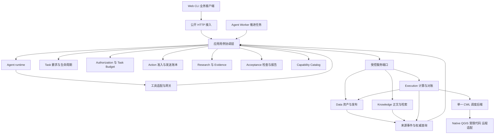
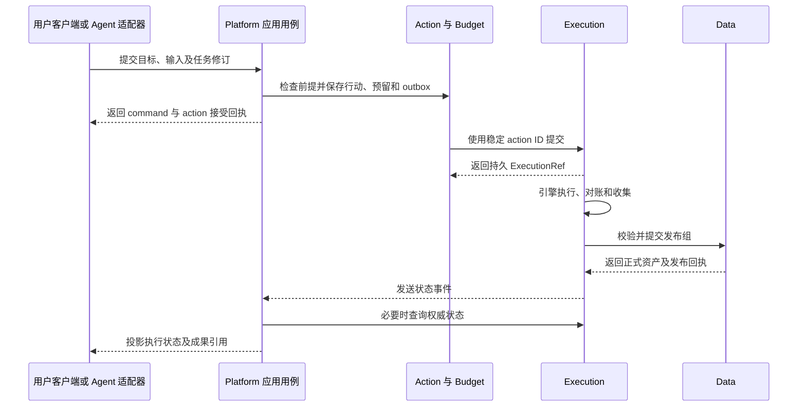

# V7 内部架构与对外接口设计

日期：2026-10-11，实施标注更新于 2026-10-12。状态：目标架构与接口契约。首批类型见 [P0 契约](../contracts/p0-contracts.md)，本轮已实现的控制核心和实际路由见 [P2 契约](../contracts/p2-control-contracts.md)。本文其余业务模块与路由仍为目标设计，实施范围按 [分阶段方案](../implementation-plan.md) 推进。

V7 采用模块化 Platform 控制核心，连接 Data、Knowledge 和 Execution 三个有独立状态所有权的服务。Agent 是提出行动的运行时；所有入口共用应用命令、授权、预算和行动登记。CWL 负责已冻结计算图，Acceptance 形成验收报告，Task 提交任务完成。

本设计是模块归属、内部调用方向和公开接口的统一约定。[主方案](v7-hybrid-architecture-plan.md) 保留迁移、组件选择、执行与发布协议；[科学内核方案](scientific-agent-kernel-architecture.md) 定义通用研究对象，[P5 开放式方案](p5-open-science-and-knowledge-plan.md) 进一步限定可选领域规范、资料接入和检查覆盖；[评测方案](agent-evaluation-platform-plan.md) 定义外部评价。公开路由集中在本文维护，其他文档引用其语义。

## 1 架构决策

1. Platform 是一个模块化控制核心，可由 API 与 Worker 两类进程承载；模块数量不等于微服务数量。
2. 用户 API、Agent 工具和内部服务接口分开定义，转换成共用的应用命令，避免维护多套执行规则。
3. 工具网关只做契约适配和可信上下文传递，行动状态属于 Action 模块。
4. 模型运行、持久任务、科学计算和资产发布拥有不同生命周期，通过明确引用关联。
5. 直接计算使用无模型参与的 DIRECT 任务，沿用授权、预算、恢复与验收路径。
6. Task 拥有要求和完成记录；Acceptance 拥有检查计划、检查结果和验收报告。
7. 外部 API 返回平台资源与接受回执，不暴露 LangGraph checkpoint、CWL JobStore 或容器路径。
8. 跨服务依赖采用精确引用、幂等命令、事件和对账；本地事务只覆盖同一权威数据库内的状态。

## 2 逻辑架构和部署边界



图中的箭头表示调用和信息流，不表示代码可以互相导入。Agent runtime 的模型建议由 Worker 驱动产生；服务事件唤醒应用用例，不直接调用模型。

初期部署边界为 Platform API、Agent Worker、Execution Worker、Data、Knowledge 及存储。Acceptance 编排保留在 Platform，检查计算复用 Execution 的受限运行环境。无需额外建设独立的规划服务、验收微服务或事件集群。

API 与 Agent Worker 使用同一个应用包和相同命令处理器。持久化、租约及 outbox 协调两个进程，不能依赖 API 进程的后台协程保存长任务。

## 3 模块归属和唯一写入者

| 模块或服务 | 独占写入的事实 | 对其他模块提供 |
| --- | --- | --- |
| Project 与 Session | 项目、消息、会话与任务关联 | 用户来源消息及访问上下文 |
| Task | TaskSpecRevision、控制状态、完成与取消记录 | 要求快照、控制命令、完成提交 |
| Authorization | ScopeGrant、授权代次、许可 | 当前授权判定及短期许可 |
| Task Budget | 任务额度、预留、结算 | 稳定身份的预留与对账接口 |
| Agent Coordination | TaskPlanRevision、DecisionFrame、推进租约、等待 | 当前计划、待执行决定与唤醒条件 |
| Action | 行动准入、原请求、发送意图、服务回执关联 | 可重放行动及查询结果 |
| Research 与 Evidence | 分析、假设、结论、缺项、观察回执和依赖关系 | 结构化研究投影与失效范围 |
| Acceptance | CheckPlanRevision、检查调用与结果、AcceptanceReport | 确切候选交付的验收判定 |
| Capability Catalog | ToolSpec、算子与实现、绑定、冻结计算包 | 已登记能力及精确契约 |
| Data | 资产字节、表示、语义修订、质量报告、发布仲裁 | AssetRef、访问内容、发布与查询回执 |
| Knowledge | 文档解析正文、证据单元、索引、生命周期 | EvidenceRef、正文、生命周期查询 |
| Execution | 逻辑执行、尝试、节点身份、远程提交与对账 | ExecutionRef、进度、取消与输出事实 |
| Runtime 与 CWL 后端 | 各自执行位置、检查点、内部临时状态 | 恢复句柄，不拥有任务或最终资产 |

上述控制模块位于 Platform 内，Data、Knowledge 和 Execution 保持独立服务。表由所属模块的仓储维护；应用层通过各模块接口协调一个 UnitOfWork，不直接访问其他模块的表。跨服务只经端口和事件访问。API 层、工具适配器和页面聚合层不拥有以上业务事实。

TaskPlan 表达任务行动及研究安排；CWL 表达一次计算内部的依赖。Action 表达已经接受的调用；Execution 表达被服务接受后的真实运行。三者不可用一个不断扩大的通用 Job 表代替。

Acceptance 不能直接把任务改为 COMPLETED。`EvaluateDelivery` 用例取得报告后调用 Task 的受限完成命令，检查当前要求、控制版本、依赖失效标记及正式成果引用；Task 保存完成记录。模型和公开 API 均不拥有这个内部命令。

## 4 内部依赖方向

```text
HTTP handlers / Agent tool adapters / event consumers
                         ↓
application use cases
                         ↓
domain modules + port interfaces
                         ↑
PostgreSQL / service clients / model SDK / runner adapters

composition root 负责装配实现，不参与领域决策
```

Domain 只使用自身模型、纯规则及少量共享值类型。Ports 声明契约；Adapters 实现契约；Application 负责跨模块顺序。任何领域模块都不导入模型 SDK、HTTP 客户端、数据库会话或 CWL 引擎类型。

`packages/contracts` 保存经过版本化的跨边界 DTO 与错误枚举，不放 ORM、领域服务或所有内部类。共享代码越界会把独立服务重新耦合为一个必须同时升级的程序。

| 用例 | 调用的核心模块或端口 | 事务边界 |
| --- | --- | --- |
| CreateTask | Project、Task、Authorization、Task Budget | Platform 本地事务，保存用户来源与初始范围 |
| AdvanceTask | Task、Coordination、Context、RuntimePort | 先登记 frame，模型调用在事务外，之后校验并接受建议 |
| SubmitAction | Task、Authorization、Budget、Policy、Action | 本地保存行动与发送意图，服务执行在事务外 |
| RecordObservation | 服务适配器、Evidence、Coordination | 去重保存回执与唤醒意图 |
| ReviseTask | Task、Research、Action、Acceptance | 登记新要求与影响标记；跨服务取消异步发出 |
| EvaluateDelivery | Task、Evidence、DataPort、ValidationPort、Acceptance | 长检查异步；报告和最终任务提交分阶段处理 |
| CancelTask | Task、Authorization、Action、ExecutionPort、DataPort | 先禁止新推进，再跟踪取消及发布仲裁 |

领域模块不通过回调调用上层 Application。Execution 所需的许可检查属于服务协议：节点启动入口请求 Platform 的内部 Permit API；Platform 提交执行后不持有数据库锁等待这个回调，因此不形成同步循环等待。

## 5 三类入口如何统一

| 入口 | 可以提出什么 | 进入核心前的处理 |
| --- | --- | --- |
| 用户 REST API | 创建任务、指定计算、控制任务、提交成果候选 | 认证、项目访问检查、请求契约校验、命令去重 |
| Agent 工具 | 查询、行动建议、研究修改、验收请求 | 由服务端注入任务、frame、授权及预算上下文 |
| 内部服务接口 | 执行与发布回执、许可请求、状态事件 | 服务认证、对象关联和来源版本验证 |

Agent 不调用任意公开 URL，也不持有操作者令牌。工具描述中的 `project_id`、`grant_epoch` 或 `checker_identity` 不能让模型自行获得身份；这些字段由可信适配层取得或核对。

### 5.1 无模型的直接执行

调用者先创建 `execution_mode = DIRECT` 的任务，明确目标、输入范围、交付和预算，再提交精确的 Operator、WorkflowPackage 或 CodePackage。过程不调用模型，用户可以用普通客户端完成全部操作。

DIRECT 与 AGENT 共用 SubmitAction、Execution 和 Acceptance。DIRECT 模式不自动补齐未知科学含义；前提不满足时返回可处理的缺项。调用者可修改输入或要求后再次提交。执行成功与任务交付通过仍分别返回。

DIRECT 请求同样生成由服务器建立的 DecisionFrame，来源为客户端命令；幂等重放复用原 frame 和 action ID，不伪造模型调用。相同内容使用新的合法请求键表示新的意图，业务禁止重复的操作仍由逻辑操作键限制。

### 5.2 普通问答和持久任务

普通问答可以只使用当前消息和已提供上下文，不建立完整任务。需要调用项目工具、形成持久计算或正式交付时，入口依据用户目标建立或绑定任务。项目资料读取可以采用轻量任务，不因此要求科学假设或完整分析协议。

用户在页面手动浏览已授权资产、搜索知识或查看能力目录，使用有请求资源上限的查询接口，不强制建立 Task。Agent 的项目工具调用则进入任务范围，保留预算和观察关联。无任务问答的模型请求使用会话级调用额度，属于调用计量范围，不另建业务任务账本。

创建任务和初始授权采用已有身份与明确输入范围；不能因用户发了一条消息就授予全部项目资产或任意外部写入。需要扩展时使用现有授权协议。

## 6 关键调用链

### 6.1 从计算请求到正式资产



返回命令接受回执时，远端 Execution 可能尚未创建。客户端先查询 command，取得 ExecutionRef 后查询执行；不能编造一个尚未由所属服务登记的 execution ID。一个已接受但响应丢失的请求始终用原 action ID 查询。

### 6.2 从候选成果到任务完成

已发布资产先组成 CandidateDelivery，Acceptance 绑定检查计划并运行必要检查。检查输出经 ValidationPort 登记，形成不可变报告。Task 仅在报告仍适用于当前要求、成果和依赖状态时完成。报告失败可产生新的修复行动，但 Acceptance 自己不调用模型、不重写成果。

Data 的“发布”表示成为可引用的项目资产，不等于通过科学验收，也不等于对互联网公开。报告生成、任务验收与外部分享是不同操作。

### 6.3 修订和取消

Task 修订先固定新的要求及控制版本，失效受影响的计划和检查。既有计算输入不变；继续、取消或保留为历史结果由明确策略处理。用户取消某个 Execution 后，系统不能把同一意图作为普通错误自动重试。

任务取消先拒绝新行动和旧代次提交，再请求取消执行并由 Data 仲裁发布。对外同时显示任务取消、计算停止、发布是否已发生及 cleanup 状态。无法联系远端时返回对账状态，不把收到取消请求解释成计算已停止。

## 7 对象身份和数据契约

公开 DTO 按对象使用明确类型：TaskRef、AssetRef、EvidenceRef、ExecutionRef、PackageRef。内部血缘索引可以映射为通用引用，但不能要求调用者用一个无约束的 `type + payload` 传递所有对象。

| 身份或版本 | 含义 | 不应混用 |
| --- | --- | --- |
| project_id | 访问和资源归属 | 不是权限证明 |
| task_id / spec_revision | 持久目标及其不可变要求版本 | 不是聊天轮次 |
| control_version | 暂停、修订、取消、完成等任务控制的比较版本 | 不随每个进度事件增长 |
| frame_id / action_id | 一次决策快照与已接受行动 | 不是 SDK tool call ID |
| execution_id / attempt_id | 逻辑计算与真实尝试 | 重放不是新尝试 |
| asset_id / version_id / representation_id | 业务资产、版本及读取表示 | 文件名不是稳定字段或资产身份 |
| semantic_revision | 单位、字段含义等解释 | 字节未变不代表语义未变 |
| event_id / source_revision | 事件身份及其来源对象顺序 | 时间戳不证明跨服务先后 |

计算目标采用封闭联合：`OPERATOR`、`WORKFLOW`、`CODE_PACKAGE`，分别要求已经登记的契约、实现或包引用。OperatorTarget 同时固定执行绑定：LOCAL 使用 implementation ID，REMOTE 使用 service binding ID 及 binding revision，两者不能混填。模型输出的路径、镜像名称、服务地址不能直接成为计算目标。算子选择绑定正式版本，禁止提交时使用可漂移的 `latest`。

InputBinding 沿用主方案第 6 节：同时固定资产版本、表示摘要、语义修订和物理字段映射。JSON 小值也须符合所选工具 Schema；大表格、栅格、源码与报告通过资产或冻结包传输。

协议层区分 `request_id`、`correlation_id`、`command_id` 和 `idempotency_key`。前两者用于追踪，后两者用于查询命令与识别同一意图；重复 HTTP 请求可以有不同 request ID，但不能因此触发新副作用。

## 8 公开 API 通用约定

公开根路径为 `/api/v1`。项目内资源统一使用 `/api/v1/projects/{project_id}`，下文简写为 `P`。每个资源都核对实际项目归属；URL 中填入另一个项目不能扩大权限。外部访问经过 Platform，Data 和 Knowledge 的内部 API 不直接暴露给业务客户端。

### 8.1 命令和查询

GET 返回资源或投影，列表使用有上限的 `limit` 与不透明 cursor。查询响应标明来源版本及必要的 `as_of`、`projection_watermark`；权威版本读取与最终一致的页面聚合必须可区分。POST 搜索和有界查询属于只读语义，不因 HTTP 方法为 POST 就建立副作用账本。

改变状态的 POST 要求 `Idempotency-Key`。去重范围为调用者、项目、操作及请求键，并保存规范化请求摘要。同键同内容返回原关联，同键不同内容返回冲突；每次重放仍检查当前访问权。完整回执至少覆盖任务存续及恢复保留窗口；回执内容清理后，在项目有效期间保留紧凑的键摘要及去重墓碑，返回已过期而不重新执行。不能删除去重依据后仍承诺识别旧请求。

本地已创建资源返回 201 及资源引用；持久接受但尚未完成的命令返回 202、command ID、已知关联和 `status_url`。202 只表示发送意图或异步工作已被保存。接受回执不能被呈现为计算成功、验收通过或取消已完成。

CommandReceipt 是已登记应用命令或 Action 的公开投影，用于确认传输和目标服务接受情况，不另建一个调度计算的 Operation 服务。命令状态为 RECORDED、DISPATCHING、RESOLVED、REJECTED 或 RECONCILING；RESOLVED 表示目标命令结果已知，计算完成另查 Execution。

控制命令带 `expected_control_version`；计算、交付和验收带 `expected_spec_revision`；用户回答另带 `expected_gap_revision`。只核对操作相关的版本，不能因无关进度变化拒绝所有写入。冲突后由调用者读取新状态再决定，服务不静默改成最新版执行。

### 8.2 错误和重试

| HTTP 状态 | 稳定业务码示例 | 客户端处理 |
| --- | --- | --- |
| 400 | MALFORMED_REQUEST | 修正传输或基本结构 |
| 401 / 403 | AUTHENTICATION_REQUIRED / SCOPE_DENIED | 获取有效身份或按规则申请范围 |
| 404 | RESOURCE_NOT_FOUND | 检查引用；不泄露无权资源是否存在 |
| 409 | REVISION_CONFLICT / IDEMPOTENCY_CONFLICT / PRECONDITION_UNRESOLVED | 读取现状，依据具体冲突处理 |
| 422 | INVALID_BINDING / UNSUPPORTED_TARGET | 修正字段、输入或选用受支持目标 |
| 429 | RATE_LIMITED | 按返回等待时间重试 |
| 503 | DEPENDENCY_UNAVAILABLE | 查询原命令，或按原请求键恢复 |

任务预算不足返回 409 与 `BUDGET_BLOCKED`，不混同请求限流；正式检查 FAIL 保存在可成功读取的验收报告中，不编码成 HTTP 500。服务返回 `retry_mode = NONE / SAME_KEY / AFTER_STATE_CHANGE`，不能用一个 `retryable=true` 掩盖远程提交未知。

错误封套包含 code、可读消息、request ID、字段或对象位置、可公开的相关引用，以及重试方式；不包含密钥、数据库异常堆栈和宿主机路径。接收响应超时的调用者始终先以原键恢复，不能为“重试”自动生成新键。

## 9 公开资源和路由

以下是首期接口边界，路径中的花括号表示资源身份，不接受任意服务地址。接口文档与客户端生成物后续从同一 OpenAPI 源生成，避免手写多份 Schema。

### 9.1 项目和任务

| 路由 | 作用 | 关键边界 |
| --- | --- | --- |
| GET /api/v1/projects 与 POST /api/v1/projects | 项目发现与创建 | 不自动创建跨项目授权 |
| GET P 与 GET P/tasks | 项目详情与任务列表 | 列表为分页投影 |
| POST P/sessions 与 POST P/sessions/{session_id}/messages | 会话及消息 | 消息可关联任务，来源消息不可被模型改写 |
| GET P/sessions/{session_id}/messages/{message_id} | 获取消息结果 | 正式回复与任务完成分开 |
| POST P/tasks 与 GET P/tasks/{task_id} | 建立与查询持久目标 | 创建时声明 DIRECT 或 AGENT 及授权输入范围 |
| POST P/tasks/{task_id}/spec-revisions | 修订要求 | 预期控制版本、旧要求修订和来源必需 |
| POST P/tasks/{task_id}/pause、resume、cancel | 控制任务 | 三个独立命令；不可用任意 PATCH state 代替 |
| POST P/tasks/{task_id}/answers | 回答缺项 | 绑定 gap ID、任务及缺项版本 |
| GET P/tasks/{task_id}/research | 研究、缺项和来源投影 | 不提供任意写事实入口 |
| GET P/tasks/{task_id}/events | 任务持久事件流 | 游标恢复、重复去重，过期后重新获取快照 |

`execution_mode` 在一个活跃任务修订中固定。DIRECT 与 AGENT 切换需要显式控制决定和新修订，并处理在途动作；不能因工具失败自动启用模型，或把 Agent 任务悄悄改为人工操作。

### 9.2 数据与知识

| 路由 | 作用 | 关键边界 |
| --- | --- | --- |
| POST P/uploads | 创建上传会话 | 返回 Data 所有的上传身份与允许大小 |
| PUT P/uploads/{upload_id}/content | 传输字节 | 首期固定完整对象重传语义，按相同身份及摘要处理；分块恢复另设协议 |
| POST P/uploads/{upload_id}/finalize | 请求校验与导入 | 异步得到正式 AssetRef，不以字节上传完成代替资产发布 |
| GET P/assets 与 GET P/assets/{asset_id}/versions/{version_id} | 发现及读取精确资产元数据 | 版本和表示不可漂移 |
| GET P/assets/{asset_id}/versions/{version_id}/representations/{representation_id}/content | 下载表示 | 流式访问、范围校验，不暴露存储目录 |
| POST P/assets/{asset_id}/versions/{version_id}/queries | 有界筛选、聚合、剖析 | 按已登记查询契约限制字段、扫描及返回规模 |
| POST P/assets/{asset_id}/semantic-revisions | 登记有来源的语义修改 | 带预期语义版本及适用资产版本，不修改字节 |
| POST P/knowledge/imports | 从 AssetRef 导入知识 | 解析和索引属于 Knowledge，原文件仍属于 Data |
| POST P/knowledge/search | 检索 | 命中是发现结果，正式引用另取正文 |
| GET P/knowledge/documents/{document_id}/versions/{version_id} | 精确正文与生命周期 | 返回定位及有效性，不静默切到最新正文 |

查询请求默认使用结构化过滤和已支持聚合，复杂 SQL 或代码不直接透传数据库。超出请求级资源上界的分析进入任务化计算路径；Data 的原生剖析仍由 Data 拥有结果，不因任务化而转移数据所有权。

P5 的通用资产引用不增加地下水时间序列专属必填项。语义修订保留声明、来源及核验范围；领域条件由所选算子或可选规范按行动判断。知识搜索只供发现，精确正文及生命周期读取才可登记正式引用；没有相关资料时任务不因缺少 Knowledge 引用而自动阻塞。

大文件经过流式代理传输至 Data，Platform 不把完整字节载入内存或业务库。以后若增加短期直传凭据，只授权指定对象和上传会话，不开放 Data 管理 API。

### 9.3 能力、执行和交付

| 路由 | 作用 | 关键边界 |
| --- | --- | --- |
| GET P/operators 与 GET P/operators/{operator_id}/versions/{version_id} | 发现及读取算子契约 | 返回调用范围内可用实现与绑定 |
| POST P/workflow-packages 与 GET P/workflow-packages/{package_id} | 校验并登记冻结 CWL 包 | 来源资产、依赖锁与 profile 完整，成功不等于科学正确 |
| POST P/code-packages 与 GET P/code-packages/{package_id} | 登记冻结代码包 | 使用已允许环境，不接受任意镜像或任意安装指令 |
| POST P/executions 与 GET P/executions/{execution_id} | 提交和查询计算 | 必须关联任务修订，共用行动准入 |
| POST P/executions/{execution_id}/cancel | 请求取消计算 | 返回真实取消及发布仲裁状态 |
| POST P/tasks/{task_id}/deliverables | 登记候选成果 | 仅接收已发布资产及结论引用 |
| POST P/tasks/{task_id}/acceptance | 请求交付验收 | 关联候选和要求修订，不能指定任意检查器代码 |
| GET P/tasks/{task_id}/acceptance/{acceptance_id} | 查询检查与报告 | PASS 不替代最终 Task 完成记录 |
| POST P/tasks/{task_id}/acceptance/{acceptance_id}/reviews | 提交规定范围的人工评审 | 验证评审者身份，不允许模型冒充 |
| GET P/commands/{command_id} | 查询接受回执与服务引用 | 不替代执行或验收状态查询 |
| POST P/tasks/{task_id}/grant-requests | 请求授权扩展 | 提出请求不等于授予 |
| GET P/grants、POST P/grants 与 POST P/grants/{grant_id}/revoke | 查看、授予和撤销 | 写入口限具备相应权限的操作者，不进入 Agent 工具目录 |

公开 API 不提供 `force_complete`、`set_fact`、任意工具执行、任意宿主机命令或内部检查结果写入。新增能力通过登记契约和应用命令扩展，不靠开放一个通用脚本入口解决。

## 10 提交计算的请求和响应

下面的值为说明性标识；摘要由真实资产与包登记时产生。POST P/executions 的请求形状如下，`Idempotency-Key` 放在请求头，不与内容摘要混用：

```json
{
  "task_id": "task-example",
  "expected_spec_revision": 3,
  "target": {
    "kind": "OPERATOR",
    "operator_id": "operator-example",
    "version_id": "operator-version-example",
    "execution_binding": {
      "kind": "LOCAL",
      "implementation_id": "implementation-example"
    }
  },
  "inputs": {
    "observations": {
      "asset_id": "asset-example",
      "version_id": "asset-version-example",
      "representation_id": "parquet-example",
      "semantic_revision": "semantics-example",
      "field_bindings": {"groupField": "f0", "timeField": "f1", "valueField": "f2"}
    }
  },
  "parameters": {"missing_value_policy": "REPORT"}
}
```

入口根据这些精确身份读取并校验不可变 manifest，生成包含摘要的完整 InputBinding；它只能补齐已有版本的描述，不能替用户换输入、猜字段或选最新版。`parameters` 由目标算子的 Schema 校验。服务器从任务与身份中取得有效 grant 和预算，客户端不能填写“已获授权”。

持久接受后可返回：

```json
{
  "command_id": "command-example",
  "status": "RECORDED",
  "action_id": "action-example",
  "task_ref": {"task_id": "task-example", "spec_revision": 3},
  "result": null,
  "status_url": "/api/v1/projects/project-example/commands/command-example",
  "request_id": "request-example"
}
```

目标服务接受后，command 的 `result` 填入 ExecutionRef；执行进度、输出与远程对账继续从 Execution 资源读取。目标拒绝时保存 REJECTED 及来源错误；是否重新规划取决于 DIRECT 或 AGENT 模式，不靠 HTTP 重试实现。

## 11 Agent 工具和内部端口

Agent 工具是经过裁剪的能力接口，参数只包含模型需要决定的业务内容。其名称不必与 REST 路径一致，但必须映射到同一应用用例和契约版本。

| 端口或工具族 | 请求关键内容 | 返回契约 |
| --- | --- | --- |
| RuntimePort | DecisionFrame、ContextManifest、工具目录、已登记观察 | 封闭类型 DecisionProposal |
| DataPort | 精确资产与范围、投影或查询、可信调用上下文 | typed result、真实扫描范围、资产或查询回执 |
| KnowledgePort | 检索条件或精确正文引用 | 检索结果、正文回执、生命周期及缺失原因 |
| ExecutionPort | 稳定 action ID、计算包或算子绑定、InputManifest、预算预留 | ExecutionRef 或提交未知，不返回假定成功 |
| ValidationPort | CheckPlan 项、精确目标、检查器身份 | 检查句柄或受信 CheckResult |
| PermitPort | 服务身份、任务修订、grant epoch、逻辑节点与资源申请 | 有范围和期限的许可或明确拒绝 |
| PublicationPort | Execution、尝试代次、固定 manifest、逻辑发布键 | Data 的提交或中止回执 |

生产工具网关只将请求送入这些应用用例。评测可替换工具传输适配器，但不能因此建立第二套计划、任务完成或行动准入规则。

内部网络请求采用受控封套：协议版本、调用者服务身份、项目与任务引用、action 或逻辑操作 ID、相关修订、有效许可引用、请求摘要和追踪关联。认证上下文由服务通道建立，正文中的服务名称不作为身份依据。

内部 Execution 提交接口只接受 Platform 已登记行动；公开用户只能经 P/executions 提交。可信检查 Worker 返回的结果由 ValidationPort 校验后写 Acceptance；用户或 Agent 的同形 JSON 不进入这个入口。

跨服务状态查询尽量返回资源事实及 source revision。事件可以加快投影，正式提交所依赖的当前授权、发布、生命周期仍按契约查询核对。

### 11.1 对外连接的适配边界

| 外部依赖 | 平台保留的适配契约 | 外部差异如何处理 |
| --- | --- | --- |
| 模型 Provider | 输入消息、工具定义、结构化输出、用量及调用身份 | SDK 和响应格式在适配层转换，用量未知单列 |
| CWL 后端 | 提交或定位、查询、取消、收集输出、恢复能力 | 原生 job ID 只存 Execution，平台执行身份不变 |
| 远程算子服务 | 按登记绑定提交、查询、取消、取得输出 | 幂等、关联查询、取消和保留期限作为能力声明 |
| Native 与 QGIS | 固定输入输出、环境、退出码、manifest | 算法环境差异留在各自镜像和运行适配 |

远程服务若支持回调，回调先经服务认证与调用关联验证，作为待核对观察登记；它不直接修改 Task。没有回调使用轮询，没有可靠幂等或关联查询则明确限制自动重试。结果下载地址同样受 ServiceBinding 的域和下载策略约束。

新增 Provider 或远程算子适配器只实现已定义端口，不获得访问 Task 仓储或改变验收规则的能力。声明的能力不支持某项恢复保证时，返回明确不支持，不能通过日志猜测实现兼容。

## 12 事务和恢复逻辑

| 提交点 | 同一事务保存 | 事务外及失败恢复 |
| --- | --- | --- |
| Platform 接受行动 | 要求关联、action、预算预留关联、发送 outbox | 未发送重放原意图；未知响应查询原键 |
| Execution 接受提交 | execution、attempt 准备信息、预留引用、引擎提交意图 | 启动或查询既有引擎实例 |
| Data 发布 | manifest 校验后的整组资产可见性及发布回执 | 响应丢失查询原发布键 |
| Platform 接收观察 | 来源回执去重、依赖关联、必要唤醒 outbox | 重复到达不重复事实和唤醒效果 |
| Acceptance 报告 | 检查结果关联、候选清单、不可变报告 | 报告保留，任务变化后重新评估适用性 |
| Task 完成 | 当前控制版本与依赖标记比较、完成记录、事件 | 响应丢失查询完成记录，不重跑分析 |

首期 Authorization、Task Budget、Action、Acceptance 和 Task 均在 Platform 的同一业务数据库内。跨模块本地事务通过应用 UnitOfWork 协调各自仓储；独立 Data、Knowledge 和 Execution 不加入这个事务。

Execution 使用 action ID 领取或承接同一预留，不与 Platform 重复扣款。模型调用、计算和检查分别计量，未知费用及未知远程活动保留在账本中。发送待处理行动及签发节点许可时重新核对任务取消、授权和相关修订；权限撤销后不再签发新许可。既有许可和在途活动按主方案的取消边界处理。

完成只能保证核对时点下的外部事实。之后到达的撤回事件产生复核标记，历史完成记录仍保留；不能用跨服务事务锁的措辞掩盖这个限制。

## 13 事件和前端状态

内部事件包含 event ID、事件类型与版本、source service、对象身份与 source revision、项目、发生时间、关联请求及内容摘要或引用。产生关键状态的事务同时写 outbox；消费者按来源和 event ID 去重，乱序事件不覆盖较新的对象投影。

事件用于通知事实变化，不携带任意待执行指令。事件丢失或消费失败由权威查询及周期对账补偿；首期可以使用数据库 outbox 和内部投递，不要求建立通用消息中间件。

对外 SSE 由 Platform 将已保存事件映射到任务流，使用该流自己的可恢复游标。游标只表示投影顺序，不证明各服务事件的全局因果顺序。快照返回其事件水位，客户端从该水位续接；保留窗口过期返回 410 与 `EVENT_CURSOR_EXPIRED` 及快照查询位置，不能静默丢掉历史后接着显示完整进度。

模型 token 流属于临时交互内容，断线后查询最终消息；它与任务持久事件流分开。界面至少区分命令已接受、计算进行中、成果已发布、验收处理中、任务已完成及清理未结束。

只读页面聚合可以短暂滞后，需显示来源时点。写命令总是回到权威模块检查，不能把浏览器缓存状态作为授权、预算或完成的依据。

## 14 兼容和架构检查

公开 API 主版本、跨服务契约版本、ToolSpec 版本、科学策略版本及算法实现身份分别管理。更换 LangGraph 或 CWL 后端不能改变 Task、Execution、AssetRef 的公开语义。

对外请求拒绝未知业务字段，动态算子参数按其已选版本 Schema 检查。响应的兼容新增必须定义客户端忽略未知可选字段的规则；删除字段、改变含义或增加必需行为需要明确版本迁移。未知任务状态不能被旧客户端显示为成功。

部署时核对服务契约支持范围、必需事件版本及检查器身份。活跃运行绑定原实现和必要恢复环境；不兼容升级采用排空或并存过渡，不自动用新引擎打开旧检查点。

架构验收重点检查以下闭合关系：

| 检查项 | 应成立的关系 |
| --- | --- |
| 入口一致 | REST 直接计算和 Agent 提交使用同一 SubmitAction 与预算规则 |
| 状态唯一 | Task 完成只能来自 Task；发布只能来自 Data；计算只能来自 Execution |
| 依赖单向 | Domain 不依赖 SDK、HTTP、数据库或引擎；模块不跨表读取 |
| 身份稳定 | 相同客户端请求和 Worker 接管均关联原行动，不改变副作用身份 |
| 结果分层 | 命令接受、计算成功、资产发布、验收通过和任务完成可分别查询 |
| 修订有效 | 旧 frame、旧用户回答和旧检查不能覆盖当前要求 |
| 接口受控 | 模型不能写入可信身份、授权、CheckResult 或完成状态 |
| 可替换 | 更换模型适配或计算后端不要求客户端修改核心资源模型 |

这些规则先作为架构评审和接口契约验证的依据。算法精度、领域适用性和真实 Agent 表现按各自专项评估，不能由结构清晰直接推导已经正确。
