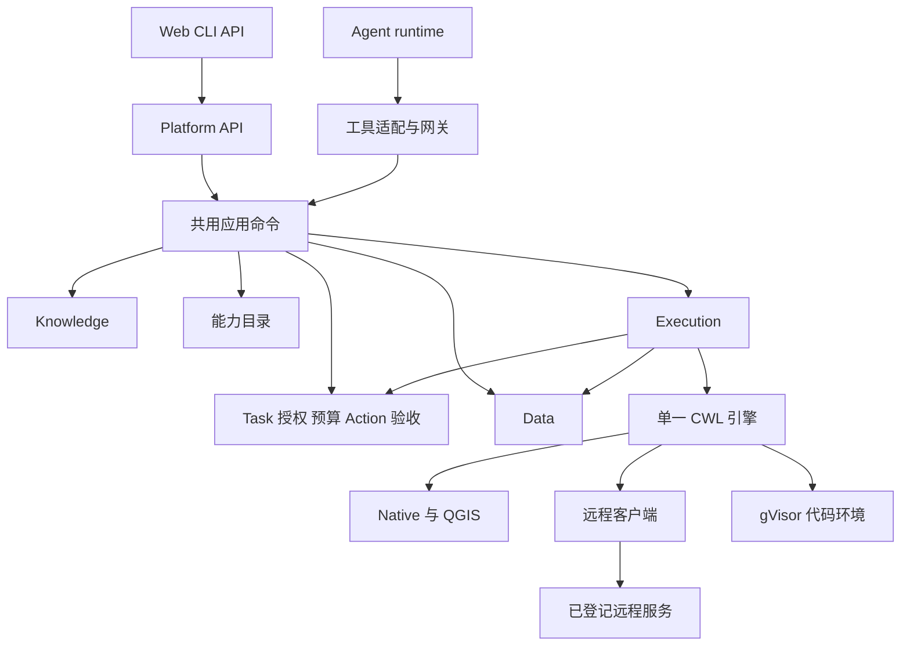

# V7 混合架构实施方案与局限分析

日期：2026-10-11。状态：设计提案，供架构决策和实施拆分使用。

实施状态与阶段边界以 [分阶段开发方案](../implementation-plan.md) 为准；P0 已完成，本轮交付 P1 组件验证，结果见 [P1 选型记录](../decisions/p1-execution-components.md)。本文其余业务能力尚未实现；完整 CWL 集成仍需 P4 验收。

基线：V6 `839c4f5aa8edb69bcd180bf24b45ead7dd20421b`。V7 在独立目录建设，保留 V6。本文细化既有升级目标；候选组件必须通过规定试验，其文档能力不直接构成 V7 的运行保证。

推荐组合为：迁入 V6 科学算子、Data、Knowledge Next 及可靠性规则，以 LangGraph 和按需 Deep Agents 承担 Agent 运行，选择一个 CWL 引擎承担计算图执行，平台集中实现任务、授权、预算、资产绑定、执行对账和验收。

Agent 内核的分层、行动接口、科学分析协议和上下文复用细化见 [V7 科学 Agent 内核架构](scientific-agent-kernel-architecture.md)。本文继续负责总体服务边界、执行与资产协议；具体 Agent 行为按内核专项收敛，框架采用仍需通过对照试验。

模块归属、内部依赖、统一应用命令和公开路由以 [V7 内部架构与对外接口设计](v7-architecture-and-interface-contracts.md) 为准。API 接入和 Agent 工具共用业务用例，工具网关不拥有独立的任务或行动真相。

优先验证 Toil runner，以 Weaver 作为同级对照；最终仅保留一个正式 CWL 后端。完整交付仍覆盖 95 个旧算子、领域工作流、远程算子和代码补缺。阶段交付不缩减最终范围。

## 1 产品范围与交付目标

用户在项目中提出目标并选择数据，平台形成明确要求和计划，在授权内自主选择方法、组织计算、核验结果和提交成果。用户可以跨会话继续任务，修改要求、暂停推进或取消。

首期面向一个可信操作者、多个项目、单台 Linux 私有服务器。项目隔离约束数据访问和 Agent 工作范围，不等于具备多租户 SaaS 的账户、计费和隔离能力。

完整 V7 包括：

1. 数据、知识、算子和工作流的发现、读取和精确版本引用。
2. 不依赖 LLM 的单算子与工作流执行 API。
3. 任务范围内的自主计算、有界修复和代码补缺。
4. 用户要求修订及受影响计划、结果和验收的标记。
5. 重启恢复、远程对账、取消和原子发布。
6. 全部既有科学能力的迁移和科学回归证据。
7. 独立部署、备份恢复、成果导出和 V6 使用入口回退。

普通问答不强制创建任务。Agent 使用项目工具、持久计算或正式交付时建立或绑定任务；用户手动浏览资料可使用有界查询。直接执行 API 使用 DIRECT 任务，全程不需要模型。缺少水位含义、单位、时间口径等关键信息时允许澄清。数据不支持的科学结论不能靠提高自主性补齐。

首期不承诺任意 CWL 全特性、任意代码安全证明、任意远程副作用恰好一次执行、多机高可用，或所有计算的透明断点续跑。

## 2 V6 资产迁移

| 资产 | 当前基础 | V7 处理 |
| --- | --- | --- |
| 算子包 | 95 个 manifest，80 Native、15 QGIS，独立 CLI | 保留算法及样例，增加 V7 输入输出适配 |
| Executor | 静态 DAG、租约、持久对象、结果发布 | 保留行为要求和故障案例，调度交给 CWL 引擎 |
| Resource | 文件校验、原子发布、提交与取消仲裁 | 必要机制迁入 Data，不保留第二套最终资产目录 |
| Data | PostgreSQL、不可变对象、语义修订、DuckDB | 增加多项目、通用资产、表示身份和执行来源 |
| Knowledge Next | 不可变证据、生命周期、pgvector、导入队列 | 增加项目隔离、文档解析和 Agent 取证登记 |
| Task | 用户来源、要求修订、完成记录 | 保留溯源原则，拆分要求、计划和验收 |
| ContextPolicy | 与 SDK 无关的事实选择和预算政策 | 迁入纯策略部分，适配新框架 |
| Web | React、OpenLayers、ECharts、成果查看 | 复用展示组件，重写 API 与任务状态绑定 |

迁移台账记录来源提交、文件摘要、V7 所有者、相关测试、协议变化、科学行为变化和验证状态。迁入算法不自动等于迁入其旧协议。

不复制旧数据库、会话、检查点、授权历史、秘密文件、运行卷、虚拟环境、构建产物及旧部署配置。V7 构建与运行不得引用 V6 路径或服务。

两个现有差异必须进入适配：Data 规范化表格使用 `f0/f1/...`，统计算子按参数中的物理列名取数；旧 CLI 捕获部分业务错误后写 JSON 并正常退出，新 CLI 必须统一退出码和错误封套。

依据（V6 历史工作区，需与 V7 并列检出）：[算子入口](../../../projects/platform/groundwater/v6/packages/operator-pack/src/moperators/runtime/task.py)、[表格规范化](../../../projects/platform/groundwater/v6/services/data/src/platform_data_service/adapters/readers.py)、[Data](../../../projects/platform/groundwater/v6/services/data/groundwater/README.md)、[Knowledge Next](../../../projects/platform/groundwater/v6/services/knowledge-next/README.md)。

## 3 开源组件的采用边界

| 组件 | 定位 | 采用范围 | 保留在平台的职责 |
| --- | --- | --- | --- |
| LangGraph | Agent 运行基础候选 | 运行图、检查点、中断和续接 | 任务完成、资产身份和授权 |
| Deep Agents | 可裁剪能力层 | 文件工具、上下文整理、辅助计划 | 正式计划、工具权限和交付 |
| cwltool | 必选验证依赖 | CWL 校验、包装验证和行为对照 | 业务执行服务 |
| Toil runner | 优先验证的执行候选 | CWL 调度、JobStore 和恢复 | API、远程副作用幂等和成果发布 |
| Weaver | 同级执行候选 | CWL 与 OGC 服务整合 | 任务、授权与验收 |
| pygeoapi | 远程适配与联调样例 | Processor 和 Process API | 平台工作流调度 |
| Docling | 可选解析器 | 复杂 PDF、表格、版面和 OCR | 知识有效性与证据版本 |
| gVisor | 代码隔离环境 | 运行生成代码 | 代码登记、预算和科学正确性 |
| OpenLineage | 模型参考与导出格式 | 血缘事件和输入输出关联 | 资产与执行权威状态 |
| React Flow | 前端组件 | 工作流图展示与后续编辑 | CWL 执行定义 |
| OpenHands SDK | 设计参考 | 工作区、文件操作和工具事件分层 | 首期主 Agent 运行 |

优先采用固定版本库、独立容器和公开 API。必要补丁记录上游问题、修改范围和退出条件。业务代码不依赖框架内部数据库结构，也不靠解析人类可读日志恢复关键身份。

### 3.1 Agent 采用门槛

用同一 Provider、工具集和任务比较 LangGraph 加最少中间件与 Deep Agents 完整 harness。完整 harness 只有在降低适配工作且满足以下条件时采用：

- 每次模型调用前能注入当前任务、授权、预算和执行事实。
- 能精确裁剪文件、Shell、记忆、子 Agent 和外部追踪能力。
- 正式回复、证据与交付仍经过平台校验。
- 恢复重放可复用业务调用身份。
- 工具调用、流式、结构化响应、取消与超时在目标 Provider 上有效。

若必须修改框架私有循环才能满足，采用 LangGraph 加少量中间件。LangGraph 中断恢复可能重放节点代码，检查点不能替代业务幂等。[恢复机制](https://docs.langchain.com/oss/python/langgraph/interrupts)。

### 3.2 CWL 引擎采用门槛

Toil 提供 JobStore 和 `--restart`，适合验证科学工作流恢复，但不能据此保证远程副作用恰好一次。[Toil 选项](https://toil.readthedocs.io/en/latest/running/cliOptions.html)。Weaver 提供 OGC 过程服务体系，同时引入 Celery、MongoDB 和过程部署管理，需衡量与 V7 的重叠。[Weaver 配置](https://pavics-weaver.readthedocs.io/en/latest/configuration.html)。

两者使用同一测试包，必须证明：

1. Native、QGIS、文件、值和多文件输出正常执行。
2. 顺序、并行、子工作流、scatter、条件满足选定 profile。
3. 工作流、步骤路径、scatter 实例、引擎作业和尝试可稳定关联。
4. 平台重启后可定位已有运行，不启动重复 leader。
5. 实际节点入口可接入平台执行许可检查。
6. 远程响应丢失不被引擎重试造成重复副作用。
7. 旧执行者不能发布正式成果。
8. 取消、输出和异常状态可由机器接口或受支持扩展获取。
9. 依赖与镜像可固定，空环境可重建。
10. gVisor 代码任务的启动路径有效，无需大规模私有修改。

这些是通过条件，不能用加权得分抵消失败。均通过时，比较适配代码、补丁、基础组件、资源开销和运维步骤。均不通过时停止正式集成，重新选择引擎或显式修订产品保证。

Toil 在线一致性说明可能针对开发分支，不能代替固定发行版上的验证。[一致性说明](https://toil.readthedocs.io/en/latest/cwl/conformance.html)。正式版本选择结束后删除不采用的运行适配；试验不扩展为通用多引擎平台。

## 4 架构与状态所有权



| 状态 | 权威所有者 | 其他模块的使用方式 |
| --- | --- | --- |
| 项目、消息、会话 | Platform | 业务 API |
| 要求、控制状态、完成记录 | Task 模块 | 精确修订与完成引用 |
| 授权、许可、预算 | Authorization 与 Task Budget | 权限判定、预留与结算回执 |
| 计划、frame、推进租约与等待 | Agent Coordination | 决策和恢复读取 |
| 行动、发送意图与服务回执关联 | Action 模块 | 所有入口共用准入和账本 |
| 研究记录、观察与依赖 | Research 与 Evidence | 来源关联及失效范围 |
| 检查计划、结果和验收报告 | Acceptance | 报告引用；由 Task 提交完成 |
| Agent 运行位置 | 可替换运行时 | 检查点关联，不作为业务状态 |
| 算子、实现、绑定、工作流包 | 能力目录 | 不可变身份引用 |
| 逻辑执行、尝试、远程账本 | Execution | 查询与事件 |
| DAG 调度、引擎检查点 | CWL 引擎 | 执行适配器读取 |
| 正式资产、语义、发布 | Data | AssetRef 和发布回执 |
| 知识正文、版本、生命周期 | Knowledge | EvidenceRef 和读取回执 |

Execution 负责准入、监督、对账和发布，不判断 DAG 后继依赖。步骤许可只决定已由引擎调度的调用能否开始，不计算调度顺序。

这里的 Execution 准入是计算服务对已登记行动的复核。用户 API 与 Agent 工具首先共用 Platform 的 SubmitAction；工具网关仅做参数适配，不能直接启动 Execution 或写行动表。Acceptance 产生报告，Task 在当前要求下提交完成，两个模块不互相覆盖状态。

初始部署包括 Platform API、Agent Worker、Execution Worker、Data API/Worker、Knowledge API/Worker 和 PostgreSQL。项目、任务、授权、目录在 Platform 内模块化。Web 可作为静态资源提供。

Toil 被选中时持久化 JobStore；Weaver 被选中时增加其必需组件。Native、QGIS 和 Sandbox 是不同运行环境，不要求每种算子都有常驻 HTTP 容器。服务使用独立数据库角色，不跨服务直接读内部表。

## 5 核心对象与不变量

| 对象 | 关键内容 | 不变量 |
| --- | --- | --- |
| TaskSpecRevision | 目标、来源消息、要求、交付、验收 | 修订不可覆盖，保留用户来源 |
| TaskPlanRevision | 要求修订、计划步骤、检查关联 | 改方法不能改要求 |
| ScopeGrant | 项目、任务、范围、预算、epoch、到期 | Agent 只能申请扩展 |
| OperatorSpec | 版本、端口、参数、语义、错误、副作用 | 发布版本不可覆盖 |
| Implementation | 契约摘要、镜像、源码、环境 | 实现改变产生新身份 |
| ServiceBindingRevision | 协议、地址、凭据引用、能力 | 地址不由普通工具调用提供 |
| WorkflowPackage | CWL、工具、lock、manifest、profile | 依赖闭合且有摘要 |
| Execution | 要求修订、目标、输入、参数、幂等键 | 同键同内容重放，不同内容冲突 |
| ExecutionAttempt | 引擎句柄、尝试、代次 | 真实尝试与逻辑执行分开 |
| StepInvocation | 步骤路径、scatter 坐标、调用身份 | 恢复重放保持逻辑调用身份 |
| Publication | execution、候选尝试、manifest、状态 | 同一执行至多一组正式输出 |
| AcceptanceReport | 要求修订、检查器、成果、检查结果 | 精确绑定，不随最新版漂移 |

ID 由所属服务生成。请求摘要规则版本化：校验类型、应用默认值、规范键与时间、保持数组语义顺序、拒绝非有限数值和未知业务字段。

内容相同但用户明确再次运行可以产生新执行。摘要用于验证重放，幂等键用于识别同一意图；不能按参数摘要合并所有相同计算。框架 tool call ID 不能成为唯一持久业务身份。

## 6 资产表示与字段语义

### 6.1 精确输入绑定

AssetRef 固定业务内容版本，InputBinding 进一步固定实际读取的表示和字段。下例仅示意字段形状：

```json
{
  "asset": {
    "project_id": "project_a",
    "asset_id": "observations",
    "version_id": "version_01",
    "version_manifest_digest": "sha256:..."
  },
  "representation_id": "normalized_parquet_01",
  "representation_digest": "sha256:...",
  "semantic_revision": "semantic_03",
  "field_bindings": {
    "groupField": "f0",
    "timeField": "f1",
    "valueField": "f2"
  }
}
```

原始文件、规范化 Parquet 和空间预览分别有表示身份、摘要与生成信息。原文件摘要不能表示规范化文件的字节身份。用户可见字段解析为具体表示的稳定字段 ID，重复列名通过 ID 区分；实际参数和映射一同冻结。

已公开的版本 manifest 不增删成员。需要后补一种表示时，创建新的资产版本或独立派生资产，并保留来源关系；历史 InputBinding 始终指向原 manifest。

字段语义至少包括物理类型、单位、含义、时区、缺失值约定和时间范围；空间数据增加水平 CRS、垂直基准和坐标轴约定。平台能验证字段与单位，却不能由 Schema 通过推导统计假设成立。

### 6.2 转换与派生

不改变业务含义的编码转换可以作为同版本的派生表示。过滤、聚合、插值，以及影响解释的单位、时间和坐标转换必须记录转换实现与输入来源。转换是否创建新资产由版本化策略决定，禁止下载时静默转换。

Data 保存原始输入、最终成果及显式提升为资产的中间结果。引擎保存内部恢复所需 JobStore 和中间文件，各自有保留策略。跨运行复用前，中间结果必须提升为正式资产，不能只引用临时目录。

初期关闭跨任务自动结果缓存。后续缓存键至少包含项目、契约、实现、输入表示、语义、字段映射、参数和随机种子；外部动态依赖未固定时不自动复用。

多文件对象使用相对路径 manifest，记录成员大小和摘要，拒绝路径逃逸、重复成员和缺失必需成员。整个对象原子公开。

## 7 算子运行与服务接入

算法只接收已准备的输入与参数，输出文件和小型值，不直接访问业务数据库、长期令牌或平台目录。

```text
科学算法 → OperatorRuntime → 本地 CLI → CWL 工具
                         └→ 服务适配 → pygeoapi Processor
```

两种入口共享契约，分别记录实现身份。pygeoapi 提供 Processor 和 Job Manager 扩展，可用于远程发布和联调；存储后端的存在不能证明满足 V7 全部恢复要求。[过程服务文档](https://docs.pygeoapi.io/en/stable/publishing/ogcapi-processes.html)。

一次运行依次完成执行许可检查、输入下载或只读挂载、摘要及语义检查、算法调用、输出 manifest 生成和输出校验。退出 0 表示成功；业务失败、资源耗尽和程序异常使用明确非零退出码。

错误分类为 INPUT_INVALID、SEMANTIC_MISMATCH、RESOURCE_EXHAUSTED、ALGORITHM_FAILED、INFRASTRUCTURE_FAILED、REMOTE_UNKNOWN 和 OUTPUT_INVALID，并标明失败阶段、对象及可公开详情。

结果 manifest 声明错误时，即使退出码为 0 也失败；非零退出即使留下文件也不发布成功。程序错误保留内部诊断，不转为空结果。重试由错误类别与提交事实共同决定。

Native、QGIS 和引擎环境分开。除 Python 外，还需固定 GDAL、PROJ、QGIS、NumPy、SciPy、PyTorch 等依赖和必要坐标网格文件，不能只复制当前 Dockerfile 中的浮动安装命令。

## 8 CWL 工作流包与支持范围

包包含 `main.cwl`、`tools/`、`operator-lock.json`、`package-manifest.json` 和例子。依赖图只写在 CWL，lock 仅映射契约、实现、包装器和服务绑定。

| 特性 | 完整 V7 目标 | 约束 |
| --- | --- | --- |
| File、Directory、值、record、array | 支持 | 明确对应的资产或值编码 |
| 顺序、并行、子工作流 | 支持 | 子工作流冻结在包内 |
| scatter | 支持 | 限制展开规模，区分重复值实例 |
| 条件 | 支持 | 下游明确接收可空类型 |
| 多文件关联 | 支持 | manifest 或 secondaryFiles 映射明确 |
| 资源与时限 | 支持 | 同时验证调度声明和容器实际限制 |
| 表达式 | 有界支持 | 必要参数变换与条件，限制复杂度和时长 |
| 任意命令与镜像 | 普通工作流不允许 | 通过 CodePackage 登记 |
| 外部 import/include | 上传时冻结或拒绝 | 运行时不获取任意网络定义 |
| 原地修改输入 | 不支持 | 输入只读 |

Agent 搜索工具描述、端口、格式和例子后形成草案。预检依次检查包完整性、特性、工具摘要、端口类型、参数、数据语义、资源和授权。

绑定或编译产生最终执行包时，保留源包与最终包摘要。引擎和前端图都基于最终包。计算性编辑形成新版本，不能覆盖运行中定义。

预检无法验证尚未产生的上游输出内容，实际节点仍做输入输出检查。动态 scatter 规模未知时逐实例获取许可并累计限制，不以提交时估算替代实际控制。

CWL 执行已明确的计算步骤；研究、澄清和方法修订由 TaskPlan 表达。Agent 调整方法时产生新的计算包或运行。

## 9 项目身份与任务授权

### 9.1 可信上下文

本机默认回环监听，私有服务器通过认证入口识别操作者。内部调用使用独立服务身份和短期任务能力凭据，绑定项目、任务、grant epoch、动作与到期时间。

请求中的项目字段只用于选择目标，权限由服务校验。代理移除客户端伪造的内部身份头。下载、回执、发布状态和知识读取都验证项目与任务范围。

操作者可以切换项目；切换不自动授权项目 A 的 Agent 读取项目 B。跨项目复用先通过显式复制完成，未来共享授权另设协议。

### 9.2 两层执行检查

ScopeGrant 固定资产、知识、算子、服务绑定、代码环境、派生写入、预算、并发、期限和外部副作用。默认允许已选数据上的纯计算与项目内派生发布，不授予任意地址调用、原始数据删除和部署修改。

提交时检查并冻结目标、输入、要求修订、授权与预算；实际节点开始计算前，再请求一次执行许可，核对授权代次、到期与剩余额度。

可信入口获取许可，科学进程不持有长期业务凭据。步骤身份通过引擎支持接口或经过验证的包装方式传递；不能用输入摘要区分 scatter 实例，因为不同实例可能具有相同值。

撤销保证为：撤销事务提交后不再签发新许可。之前已经获准的调用属于在途操作，按取消策略处理，不能承诺瞬间停止。

默认暂停只停止新 Agent 推进和新 Execution 提交，已有计算继续；用户可选择一并取消。首期不提供任意节点冻结后原地续跑。撤销计算授权会拒绝后续节点许可，工作流按真实失败或取消结果收敛。

### 9.3 预算账本

预算涵盖模型 token、执行次数、并发、CPU/内存/时长、临时磁盘和输出上限。预留与结算有幂等键，余额变更使用事务并发控制。

预算由 Task 模块拥有。Execution 先以业务 action_id 请求幂等预留，再将 reservation_id 与执行记录一同保存；请求中断通过原 action_id 查询，不重复预留。暂时没有 Execution 引用的预留只有经对账确认未提交后才释放，不能仅因客户端超时自动释放。

工作流整体预留作为父额度，节点许可从该额度分配；节点结算转移父额度占用，不再从任务余额重复扣除。无法估计展开规模时，只在配置上限内逐步分配。父运行停止后，未知远程调用的额度仍保留，直到对账或显式结算策略完成。

模型调用前预留输入与最大输出额度，返回后按用量结算；用量未知时保守保留预留并对账。计算开始前预留、结束后结算或释放，重复事件不重复扣减。

容器限制实际 CPU、内存和进程资源，受控目录与配额限制磁盘。账本负责准入，不等于所有远程服务的硬性计费上限。远程计量或停止能力不足必须在 ServiceBinding 中声明。

## 10 Execution 生命周期与恢复

### 10.1 状态模型

```text
ACCEPTED → QUEUED → RUNNING → COLLECTING → PUBLISHING → SUCCEEDED
```

非终态可以 FAILED，或进入 CANCELLING 后成为 CANCELLED。TIMED_OUT 表示正常执行流程因超时结束，不能单独证明远程计算已停止。

另存 `reconciliation = CLEAR / PENDING / UNKNOWN` 与 `external_activity = NONE / ACTIVE / STOPPED / UNKNOWN`。终态可能与外部状态未知并存，相关任务不能据此宣告完整交付或资源已释放。

StepInvocation 是步骤身份与状态投影，不是第二份调度图。工具请求完成、科学计算完成、资产公开和任务验收完成分别表达。

### 10.2 提交与接管

1. 验证身份、冻结包和输入。
2. 同一事务创建 Execution、提交意图、预算预留引用和 outbox 事件。
3. Worker 领取意图，取得租约和代次。
4. 用确定的引擎实例身份及目录启动或定位原运行。
5. 保存句柄，持续查询和对账。
6. 输出经 Data 发布后才推进为 SUCCEEDED。

引擎身份不能只使用可复用的 PID。租约过期不证明旧 leader 已退出；接管先确认容器或进程身份、目录锁和已有运行。无法确定时保持待对账，不在同一 JobStore 启动第二个 leader。

### 10.3 重放与重试

| 操作 | 身份处理 | 是否计算 |
| --- | --- | --- |
| HTTP 或框架重放 | 原幂等键、原内容 | 返回原执行 |
| 明确失败且允许重试 | 同一 Execution 下新 Attempt | 新尝试，保留原失败 |
| 修改参数、输入、方法或实现 | 新 Execution 并关联原执行 | 新计算 |

授权或要求变更后，重试必须重新检查适用性。引擎重试策略显式配置；远程重放保护验证通过前，关闭可能重复外部提交的自动重试。

远程调用区分逻辑操作身份与明确失败后的新提交尝试。响应丢失时保持同一远程幂等键；只有确认旧提交失败、契约允许再执行且预算许可时，才分配新的远程提交尝试。两者都关联同一逻辑调用，不能为每次 HTTP 重试生成新键。

### 10.4 远程调用账本

Execution 保存逻辑调用 ID、步骤和 scatter 身份、请求摘要、绑定修订、提交阶段、remote_job_id、结果位置与取消事实。

```text
PREPARED → SUBMITTING → ACCEPTED → RUNNING → RESULT_VERIFIED
                   └→ SUBMISSION_UNKNOWN
```

发送前记录意图，响应丢失后按服务端幂等键、客户端 ID 或其他支持方式查询。无幂等且无关联查询的服务进入 UNKNOWN，不自动重发。同一逻辑调用的引擎重试先读取该账本。

服务返回的结果 URL 也要按绑定允许的域、重定向和下载策略校验。结果保留期限必须覆盖计划的收集与对账窗口；无法保证时列为运行限制。

自动流程优先使用纯计算服务。收费提交或外部写入需要额外授权，且单独声明去重、查询、取消和保留能力。

### 10.5 恢复范围

支持跟踪仍存在的作业、从已验证检查点恢复，以及为不可恢复运行创建有来源关联的新执行。恢复前核对要求、授权、远程账本和发布状态。

已发布结果复用原回执；收集失败优先重试收集，不重新计算。远程未知先对账。引擎同运行恢复与新运行复用中间资产是两种操作，API 和 UI 分开表达。

## 11 原子发布与取消仲裁

Data 是成果公开状态的最终权威。Execution 更新不能撤回已公开资产。每个 Execution 对应唯一发布控制记录；某次成功 Attempt 经过代次检查后成为候选，Data 冻结候选、manifest 和摘要后不允许其他尝试覆盖。

流程为建立控制记录、暂存字节、验证完整性与来源、进入 READY、同事务公开整组资产并记录回执、Execution 查询或重放提交确认正式 AssetRef。

提交和中止锁定同一控制记录。中止先完成，迟到提交拒绝；发布先完成，取消返回已发布事实。取消可能早于发布组创建，因此允许按 Execution 身份幂等登记中止，保留禁止迟到发布的记录。

不能按用户点击时间推断跨服务先后。界面分别显示“取消已请求”“成果发布已阻止”“计算已停止”。Data 不可达时保持取消待对账，不提前宣告成功。

上传中断、准备失败、提交未知和已中止分别处理。冻结 manifest 后不同内容重放冲突；重试不得替换摘要掩盖字节损坏。发布与取消验证必须包括旧 Worker 迟到和提交响应丢失。

## 12 Agent 持续任务协议

模型调用前读取最新 TaskSpec、TaskPlan、ScopeGrant、预算、执行和交付事实，历史摘要仅补充对话背景。每任务同一时刻一个主 Agent 写计划，使用租约和预期版本更新。

任务 lifecycle 为 OPEN、COMPLETED、CANCELLED 或 FAILED；OPEN 下的调度状态包括 READY、RUNNING、WAITING_EXECUTION、WAITING_USER、WAITING_RECONCILIATION、BLOCKED_BUDGET 和 PAUSED。一个算子失败通常只形成计划缺口；只有无法继续且需要结束该任务时才进入 FAILED。用户明确继续失败任务或修订已完成任务时创建有来源的新任务修订，保留历史终态。

任务取消可以先使 lifecycle 成为 CANCELLED，并永久阻止该修订的新调度；它另带 cleanup_status 跟踪活跃计算与发布仲裁。界面不能把任务已取消直接显示为所有底层计算已停止。

能力选择按目标相关性、契约满足程度、适配成本、可靠性与预算决定，可采用有界查询、单算子、已有工作流、新 CWL 或代码补缺，不强制依次尝试所有路径。必要的规则文件和明确字段映射可在授权内自动生成、校验并登记；只有无法可靠消解且影响下一步的缺项才等待用户。

科学任务使用 AnalysisRevision、假设记录、观察回执、结论与检查结果关联研究过程。探索性剖析允许先行，正式比较前冻结相应验证协议，失败与反证保留。普通问答和确定性格式处理不强制走完整研究流程。

科学策略采用稳定来源/版本契约、可选领域规范和按实际能力判定的方法前提，不将地下水时间序列或预制 ScienceProfile 变成所有研究的必经结构。内核从用户交付要求、实际方法和拟交付主张组合必要检查；没有受信判据的条件明确保留为未验证，不因检查列表为空而通过。Agent 不能靠更换任务分类删除必要条件。缺项保存为有范围、有依赖的 GapRecord，能独立进行的工作继续推进。详见 [P5 开放式科学策略与知识方案](p5-open-science-and-knowledge-plan.md)；对象与接口的通用边界仍见 [科学 Agent 内核方案](scientific-agent-kernel-architecture.md) 第 6、10、13 节。

工具网关通过 SubmitAction，在副作用前由 Action 模块固定 action_id、输入摘要、要求修订和状态。直接执行 API 使用同一用例。框架重放使用原记录；模型重新生成语义相似调用不能直接等同于原调用。

动作唯一键绑定任务修订、决策 frame 和动作序号；Worker 代次只用于阻止旧写入者提交，不改变原行动身份。对不可重复的业务操作还需服务端逻辑操作键，避免模型在新 frame 重复提出相同命令。首期运行时优先在工具调用边界交还内核，每条调用只采用一个执行路径。

### 12.1 等待与唤醒

平台持久化 task、execution、等待条件和事实水位。登记后再次查询执行状态，处理完成早于等待的情况。消费者用 inbox 去重，等待状态和唤醒 outbox 同事务提交。

Agent Worker 启动及周期对账扫描未满足等待，补偿事件延迟或丢失。框架检查点与业务记录不使用分布式事务；检查点落后时依据 action_id 和权威事实重新进入。

浏览器 SSE 只展示，不承担后台队列。游标过期时读取完整快照再续接；浏览器关闭不结束服务端任务。

### 12.2 要求修订与循环终止

用户修订形成不可变 TaskSpecRevision，保留来源消息，标记受影响计划、执行和检查。旧成果保留，但不适用者不能计入新验收；旧 Agent 代次不能提交新计划或完成记录。

仍运行的计算按用户策略继续、取消或保留为历史结果，不静默改变输入。普通算子失败允许重新规划，不立即永久失败整个任务。

限制模型步数、总预算、相同错误重复次数和无事实进展次数。参数修正记录差异及预期作用。预算耗尽进入 BLOCKED_BUDGET，必要语义缺失进入 WAITING_USER，未知执行进入 WAITING_RECONCILIATION。

## 13 文档与知识证据

原始文件归 Data；解析结果绑定原文件版本、解析器版本、参数、必要模型权重摘要和页码或位置。Knowledge 保存校验后的正文版本和证据单元。

第一版支持文本、Markdown、文本 PDF 和已有知识包，复用 V6 文本抽取与定位。复杂版面与 OCR 按需接入 Docling，不让所有文档都依赖模型解析。[Docling](https://github.com/docling-project/docling)。

EvidenceRef 包含项目、文档、正文版本、单元 ID、checksum 和定位。观察回执记录读取时的生命周期修订。搜索命中只表示发现，正式引用要求读取正文并登记回执。

同任务内的精确版本正文可受控跨轮复用，权限、生命周期和适用范围分别重检，关键提交前强制核对。不能用旧对话摘要代替正文，也不必在版本和权限均有效时重复下载所有内容。文件自描述信息、用户明确说明和计算回执同样可以提供任务事实，知识库不是所有请求的强制入口。

交付前重新核对必要证据的当前状态。撤回、过期或版本不符时不能用最新版替换历史正文。历史报告保存当时事实，新任务按当前证据状态评估。

多项目改造覆盖导入幂等键、文档身份、向量和词法过滤、回执、数据绑定和缓存。第一版不跨项目共享正文与 Embedding 缓存。解析文本是资料，不能成为扩大授权、安装工具或变更网络策略的指令。

## 14 验收与科学质量

任务条件分为用户明确要求、系统解释和待澄清项。Agent 可建议补充检查，不能删除或放宽必要条件。必要交付条件绑定要求修订；正式验证的检查器、阈值和覆盖范围在对应验证执行前绑定分析协议。允许先开展探索和质量剖析，后续协议变化保留明确来源，不能在看到结果后无痕调整成功标准。

| 类型 | 验证内容 | 不能单独证明 |
| --- | --- | --- |
| artifact_exists | 正式成果存在且可读取 | 内容正确 |
| schema_valid | 类型、字段和格式 | 业务含义正确 |
| coverage | 站点、时间、空间覆盖 | 输入真实 |
| numeric_check | 参考值、规则或数值不变量 | 全部科学结论正确 |
| provenance_complete | 输入、参数、方法与实现可追踪 | 方法适用 |
| evidence_check | 正文读取、身份和生命周期有效 | 所有推论都得到支持 |
| human_review | 指定评审者完成评审 | 未声明范围的质量 |

CheckPlanRevision 由受控编译器生成，覆盖每项必要要求，并在对应正式分析冻结时固定。检查调用后续绑定实际产物的精确版本。未覆盖要求不能因没有检查项而通过；Agent 临时生成的验证代码只能作辅助证据，不能自动登记为可信验收器。

已完成且适用的检查输出 PASS、FAIL 或 INDETERMINATE，记录版本、输入和证据。检查器运行错误、未运行、规则不适用分别记录；必要条件未知不能完成。不适用必须由预定规则及事实证明，且对应要求仍需其他检查或明确的替代交付覆盖。

科学结论与任务交付分开判定。任务事先允许报告反证或无法确定时，可以交付有依据的不确定结论；但必要产物和报告检查仍须通过，不能借此绕过失败的必要验证。来源存在和引用有效不单独证明方法正确或结论受支持。

允许部分对象无法评估时，AcceptanceSpec 明确原因记录、覆盖要求及是否允许全部无法评估。范围和可评估性检查必须通过，不能用 INCONCLUSIVE 掩盖错误算法。独立检查记录参考实现、性质、数据或评审依据，共享代码和假设的限制可见。自由文本中的关键数字与结论关联已检查结果，无法自动判断的科学主张按既定范围复核。

完成事务核对当前要求、全部必要检查、正式成果以及相关未对账执行，再原子写入完成记录和事件。新要求或证据失效形成重新评估状态，不改写历史完成记录。

跨服务验收记录检查时间和事实水位。任务事务能够锁定自身要求修订，不能锁定所有 Knowledge 和 Execution 事务；报告因此表达“在这些精确事实和检查时点下通过”。已登记的证据撤回或状态变更事件使受影响检查失效，并触发复核。历史通过不是知识永久有效的承诺。

科学回归有三层：V6/V7 固定输入对照验证迁移；独立参考值、可人工计算样例和性质验证检查旧算法；真实地下水任务评审检查方法适用、口径和解释。与 V6 一致只能证明兼容，不能证明科学正确。

内核第 18 节提供合成井数据和手算参考，第 19 节定义 K01 至 K14 的行为验收，包括错误斜率、检查器超时、全部不可评估、迟到回答、接管重放和版本失效。它们是实施测试规格，当前尚未执行，不代表真实数据科学效果已获验证。

容差按算子定义。表格按业务键和数值精度比较；空间结果检查 CRS、范围、几何或栅格数值；地图检查必要视觉内容；机器学习固定种子和环境，按允许的数值或统计差异验证。

## 15 代码补缺

CodePackage 固定源码、依赖锁、输入输出、环境、种子、资源和网络策略。修改代码产生新包，不覆盖历史运行。

采用验证过的 gVisor 配置，只提供授权只读输入和独立输出目录，不暴露数据库凭据或宿主机 Docker socket。可信启动组件拥有容器管理权限，生成代码所在容器没有该权限。

默认关闭网络，依赖来自固定镜像或预备包集合。新增依赖构建新的环境并记录摘要，不能运行中任意安装后仍宣称环境固定。gVisor 有兼容性和系统调用开销限制，不能保证算法正确。[官方说明](https://gvisor.dev/docs/)。

代码结果走同一 Execution、Data 和验收协议。有复用价值的代码导出为算子候选，补契约、样例与回归后由管理员登记。第一版不再引入 OpenHands 作为第二套主运行时，仅参考其工作区和工具设计。

## 16 API 与用户界面

公开前缀为 `/api/v1`，项目内资源统一位于 `/api/v1/projects/{project_id}`。完整路由、错误、接受回执、分页、版本和事件约定集中维护在 [接口设计](v7-architecture-and-interface-contracts.md) 第 7 至 13 节。Data 与 Knowledge 保留独立内部契约，入口负责可信身份传递。

| 接口组 | 关键操作 | 业务边界 |
| --- | --- | --- |
| projects | 创建、列表、详情 | 切换项目不扩大任务权限 |
| sessions | 消息、任务关联、事件 | 每次业务操作明确目标任务 |
| tasks | 创建、修订、计划、暂停、继续、取消 | 要求与计划分别修订 |
| grants | 查看、申请扩展、授予、撤销 | Agent 不调用授予接口 |
| operators | 搜索、描述、版本、输入验证 | 返回精确能力身份 |
| workflows | 校验、发布包、详情、导出 | 草案与冻结包分开 |
| executions | 提交、状态、取消、事件、输出 | 提交只返回接受回执 |
| deliverables | 提交正式成果引用 | 临时目录不是交付物 |
| acceptance | 启动检查、报告、人工评审 | 只有任务模块完成任务 |

状态变更使用幂等键；控制、要求和缺项分别使用 expected_control_version、expected_spec_revision 和 expected_gap_revision，避免用一个模糊的 revision 混合所有变化。错误返回稳定 code、对象或字段位置及 request_id，不泄露秘密与内部路径。只读 POST 查询使用查询资源限制，不按副作用写命令处理。

异步接口返回持久 command 回执；远端资源尚未创建时，调用者先查询回执，再取得 ExecutionRef 或其他资源身份。命令接受、计算完成、资产发布、验收报告和 Task 完成分别可查询。DIRECT 与 AGENT 模式遵守相同权限和预算，不公开框架或引擎内部接口。

页面覆盖项目、对话、任务、资产、知识、算子、工作流、执行和系统配置。单算子闭环后即提供最小任务页，展示真实状态、成果和控制结果；完整交互后续扩展。

React Flow 展示冻结 CWL 图，布局单独保存。编辑后重新生成校验 CWL，计算性变化产生新包。OpenLayers、ECharts 优先复用已有组件。

明确区分模型临时文本、正式回答、计算状态、公开成果和验收结果。无真实百分比时展示阶段，不按运行时间猜进度。用户可从结论追溯到资产、执行、方法、输入和必要知识。

## 17 工程组织与运维

以下目录树是本方案提出的目标布局，不表示这些路径目前都已建立；当前实施状态以分阶段开发方案和对应阶段证据为准。

```text
apps/platform-api
apps/agent-worker
apps/web
packages/platform-core
services/execution
services/data
services/knowledge
packages/contracts
packages/agent-tools
packages/operator-runtime
packages/scientific-operators
packages/workflow-support
operators/manifests
operators/fixtures
workflows/groundwater
domains/groundwater
deploy/compose
deploy/images
tests/contracts
tests/integration
tests/recovery
tests/scientific
tests/e2e
docs/architecture
docs/decisions
docs/migration
docs/operations
docs/verification
```

独立 Compose 项目、网络、角色、卷、端口和凭据，构建不依赖 V6。锁定 Python 包、Git 提交、系统包来源、镜像 digest 和必要模型权重，不只固定顶层版本。

日志关联 request、task、execution 和 attempt；保留结构化事件与必要诊断。普通诊断不记录长期凭据、完整数据正文或未裁剪模型上下文。调用成本从账本汇总，进度从实际执行投影。

容量控制包括活动引擎数、算子容器数、对象数量、磁盘和临时目录。引擎自身资源限制不能代替子容器限制。性能在目标硬件形成基线，不预先承诺吞吐和任务时延。

备份覆盖业务数据库、框架检查点、Data 对象、Knowledge 正文与索引配置、引擎状态、未完成发布记录和依赖清单。停止新提交并冻结必要写入后保存统一清单；远程活动不能被本机快照冻结，单独保存待对账清单。

恢复到新部署后校验引用与文件，恢复引擎并对账，最后开放 Agent 和新提交。切回 V6 只恢复使用入口；V7 新任务不迁入旧库，成果留在 V7 可导出。

框架或引擎升级优先排空活跃运行，或为旧运行保留原镜像直至结束。不能默认用新版程序打开所有历史检查点；需要迁移时单独验证并保留旧版本恢复路径。

## 18 实施阶段与交付门槛

| 阶段 | 工作 | 具体交付 | 通过条件 |
| --- | --- | --- | --- |
| P0 基线 | 独立工程、迁移清单、核心契约草案 | 来源记录、契约样例、检查入口 | 无 V6 运行依赖，全部目标有归属 |
| P1 候选 | Agent 对比、Toil/Weaver、gVisor 试验 | 固定环境、行为矩阵、选型记录 | 第 3 节通过，选定唯一引擎 |
| P2 业务基础 | 项目、最小任务、授权、预算、事件 | API、迁移、身份与并发规则 | 重放、撤销、项目及代次边界通过 |
| P3 单算子 | Data、字段绑定、代表算子、Execution | API/CLI 计算与发布 | 错误、重启、取消和发布未知收敛 |
| P4 CWL 远程 | 包冻结、步骤映射、控制结构、远程账本 | 混合工作流 | 实例身份稳定，未知提交不盲重放 |
| P5 开放式科学策略与知识 | 可选资料接入、语义声明、领域规范、主张及组合检查 | 精确引用、覆盖/未验证项和验收报告 | 非时间序列不受 P3 模板限制；生命周期、冲突和科学检查范围可追踪 |
| P6 自主任务 | 工具、等待、计划修订、最小 UI | 真实任务自主闭环 | 浏览器断开、Agent 重启及要求修改可继续 |
| P7 完整能力 | 代码补缺、95 算子、领域工作流、完整 UI | 迁移台账、科学回归 | 无静默减少，旧新能力分别验收 |
| P8 发布 | 故障集中验证、负载、恢复、切换 | 发布证据、限制与手册 | 无阻断问题，空环境可启动并验收 |

P1 使用最小契约，不先冻结所有 Schema。P2 的授权和预算必须先于正式计算。P4/P5 在基础资产稳定后可分别推进，P6 依赖两者。全量算子迁移可从 P3 后逐批开展。

代表算子包括完整率、Mann–Kendall、线性趋势、一个现成 fixture 的 QGIS 算子、PNG 渲染和一个远程样例。每类证明其环境、输入和错误路径后再扩展。

### 18.1 全量能力迁移步骤

| 迁移层 | 工作 | 必须核对的行为 |
| --- | --- | --- |
| 算法 | 白名单迁入实现和依赖 | 数值、边界、随机种子、资源要求 |
| 契约 | 从 manifest 转换端口和参数，补语义 | 默认值、可空性、多输入、条件输出格式 |
| 包装 | CLI、容器、CWL 工具描述 | 错误退出、输入只读、输出完整性 |
| 旧 Model | 迁移输入绑定、参数绑定和默认值 | 用户参数确实到达原先对应节点 |
| 旧 Workflow | 转为 CWL 图与明确的输出选择 | 顺序、并行、节点参数和 finalOutputs |
| 领域知识 | 转换知识包与身份绑定 | 旧 model_id 映射到新模板或能力身份 |
| 交互 | 迁入结果查看组件 | 正式资产链接、字段与状态一致 |

旧 Model 可转为命名 WorkflowTemplate，保留便于用户选择的领域入口，但不再成为执行的唯一入口。迁移必须同时读取 Model 和 Workflow 定义，不能只转换旧 DAG 而丢失参数映射、默认值、并发和总时限。

知识中的旧身份经过显式映射重新导入，不静默删去限制或改成泛化知识。包装变化产生新的实现身份；科学含义或输入输出变化另发算子契约版本。

故障验证随相应阶段交付，P8 集中复核，不能到最后才验证取消和恢复。缺陷修复更新代码、契约及相关证据，不通过降低断言跳过。

不按阶段数量推算工期。P1 后依据适配代码与恢复差异估算执行改造，代表算子后依据分类台账估算全量迁移。95 个身份成本不相同，空间和机器学习环境单独评估。

## 19 验证矩阵与发布条件

公开 Agent 基准、知识与数据对照实验、评分隔离及部署步骤见 [V7 开源 Agent 评测平台搭建方案](agent-evaluation-platform-plan.md)。该专项先建立独立于地下水资料的官方基线，再分别接入 V7 Agent 核心和完整平台；公开基准成绩不能代替以下业务契约和科学回归验收。

| 类别 | 必测情形 | 判据 |
| --- | --- | --- |
| 幂等 | 同键同内容、不同内容、响应丢失 | 原对象重放或明确冲突 |
| 步骤身份 | 重复值 scatter、子工作流、重试 | 实例区分，重放仍是原调用 |
| 进程恢复 | Worker 退出、leader 未停、租约过期 | 无重复 leader、无旧代次发布 |
| 远程 | 接收后断连、无查询、不可取消 | UNKNOWN 可见，无自动重复副作用 |
| 发布 | 上传中断、摘要错、提交丢失、取消先到 | 整组公开或不公开，仲裁可恢复 |
| 授权 | 撤销、过期、伪造项目、跨项目下载 | 拒绝新许可和越界读取 |
| 预算 | 并发预留、scatter 超限、用量未知 | 不超发准入额度，未知保留预留 |
| 唤醒 | 完成早于登记、重复事件、重启 | 无永久丢失唤醒和重复执行 |
| 要求变更 | 旧 Agent 迟到、完成前目标更新 | 不完成错误修订 |
| 科学 | 固定样例、边界、独立参考 | 符合容差与性质要求 |
| 证据 | 搜索未读、撤回、过期、更新 | 不伪造有效引用 |
| 代码 | 超时、内存不足、越界、无运行时 | 明确失败，不降为宿主机执行 |
| 恢复 | 数据库/文件恢复、活跃远程作业 | 引用完整，先对账后开放 |

每项保留输入、版本、预期、实际结果和必要日志。确定性契约和关键恢复测试全部通过才可发布。

真实 Agent 评测覆盖问答、完整率、趋势比较、过滤计算制图报告、远程算子、字段修正、科学澄清、代码补缺和控制操作。每类至少重复三次以发现波动，记录成功、人工干预、重试、成本和时长；三次成功不能作为高可靠率的统计证明。

模型质量目标在评测前按场景固定，失败人工归因。正式通过以必要交付与检查为准，不以模型说出“完成”为准。全量迁移的 95 个旧身份都必须有明确归属和验证结果。

## 20 局限与适用边界

| 局限 | 影响 | 控制措施 | 保留的边界 |
| --- | --- | --- | --- |
| 组件间无天然事务 | 检查点、引擎、发布可能暂时不同步 | 账本、幂等、事件与对账 | 无跨组件瞬时一致性 |
| 引擎扩展未必足够 | 步骤身份、许可、取消可能需要私有修改 | P1 真实试验和退出条件 | 两个候选都可能不合格 |
| CWL 面向明确计算图 | 探索和方法修订难放进单个 DAG | Agent 调整计划，提交冻结子流程 | 不能用一个 CWL 表达全部开放推理 |
| 远程能力不齐 | 断连后可能不知是否执行 | 能力声明、账本、停止盲重试 | 无幂等和查询时可能需要人工介入 |
| 自动验收有限 | 格式正确仍可能方法不当 | 独立检查、证据、必要人工评审 | 不能保证全部领域结论正确 |
| V6 回归继承旧缺陷 | 相同结果可能同样错误 | 独立参考和性质检查 | 复杂方法仍需专家判断 |
| 代码补缺范围开放 | 一次性算法未长期验证 | 隔离、限额、同等验收 | 隔离不解决逻辑错误 |
| 科学环境复杂 | QGIS/GDAL/ML 差异改变结果 | 分镜像、锁依赖、容差 | 跨硬件未必字节一致 |
| 文件型流程有复制成本 | 大栅格和多步流程耗磁盘 | 只读挂载、暂存回收、容量检查 | 未提供通用零拷贝或分布式数组计算 |
| 全量迁移规模大 | 长流程和特殊格式工作量较高 | 分类台账、代表案例先行 | 无法只转换 manifest 完成迁移 |
| 单机存在单点 | 主机故障导致中断 | 备份、恢复、可重建镜像 | 无自动高可用或零停机承诺 |
| 多项目不是多租户 | 同主机和统一操作者缺少租户隔离 | 身份、任务范围和项目过滤 | 对外 SaaS 需要重新设计 |
| 预算有估计误差 | 远程费用或模型用量迟报 | 保守预留和待对账 | 不能保证所有外部账单绝不超额 |
| 框架升级影响恢复 | 检查点格式和代码改变 | 固定版本、排空或专门迁移 | 不保证任意历史状态跨版本恢复 |

### 20.1 自主性边界

平台可以自动发现能力、修正结构性参数错误、组合计算并检查输出，但不能从字段名可靠补全业务事实，也不能自己授予更大范围。

例如水位可能指埋深或高程，同一数值变化的解释不同。此时应显式等待语义确认，而非给出形式完整但含义错误的报告。方法选择的可靠性仍取决于数据描述、知识质量和领域评测。

### 20.2 恢复与取消边界

可保证持久事实可解释、已发布结果不被重复覆盖、未知请求不盲重试。对于平台外且不支持幂等或查询的系统，无法保证恰好一次副作用。

可以阻止尚未公开的成果，但远程服务可能继续消耗资源。任务界面必须保留实际外部状态；本地取消不能被描述为远程副作用撤销。

### 20.3 维护成本边界

混合架构减少自研 Agent 循环和 DAG 语义工作，同时增加依赖升级、适配、对账和运行环境维护。降低总成本的前提是通用组件承担完整职责，平台只保留业务差异。

如果接入后仍需重写调度、长期维护大量补丁或解析内部日志，采用目标未达成，应重新选型。框架数量增加本身不构成架构升级。

逐节点许可也会带来请求延迟与控制服务可用性依赖。应先测代表性短算子和大规模 scatter；第一版保持严格检查。未来若采用批量许可或短期额度，需要明确会扩大撤销生效的时间窗口，不能无声改变原保证。

### 20.4 重新评估条件

- 多计算节点或互不信任用户成为实际需求：重新评估调度、身份和租户隔离。
- 大量长周期外部业务流程成为核心：评估持久业务协调机制，并与科学 DAG 分工。
- 文件复制成为主要瓶颈：评估对象存储、分块格式和科学计算后端。
- OGC 远程服务成为主要能力来源：重新衡量 Weaver 的完整整合收益。
- 代码补缺成为多数任务的默认路径：先核查目录覆盖和发现质量，再考虑专门代码 Agent。
- 验收长期依赖人工：调整产品承诺和检查器建设，不能只增加提示词。

## 21 首个端到端样例

任务：对指定站点和时间范围的地下水监测序列检查完整率，执行 Mann–Kendall 与线性趋势，输出结果表和方法说明。

1. 用户选定资产版本，明确字段含义、单位、站点和时间。
2. TaskSpec 固定交付与验收，ScopeGrant 授予必要纯计算和派生发布。
3. Agent 描述数据、读取必要知识，形成字段绑定和方法计划。
4. 过滤与转换形成明确来源，生成包含完整率和两种趋势的 CWL 包。
5. Execution 预留预算并提交，各节点许可通过后执行。
6. 输出校验后由 Data 原子发布。
7. 完成事件或对账唤醒 Agent，读取真实结果并解释差异和不可评估站点。
8. 方法说明作为正式资产发布；检查覆盖、字段、数值性质、来源和引用。
9. 必要条件全部通过后完成当前任务修订。

边界包括重复时间戳、样本不足、空过滤结果、缺字段、单位不明、Agent 重启、提交响应丢失及发布前取消。样本不足保持不可评估，不能生成虚假有效趋势。

随后扩展 QGIS、远程和代码场景。V6 迁移学习工作流有 58 节点，需单独验证资源、环境、输出和恢复，不能由短流程通过推导其通过。相关历史发布资料见 [V6 发布基线](../../../projects/platform/groundwater/v6/docs/v11-release-baseline.md)；V6 工作区不属于本仓库，检出缺失时该对照文件不可用。

## 22 最终交付与决策记录

最终交付：独立工程、迁移台账、契约包、唯一引擎采用记录、Agent 采用记录、95 算子回归、领域工作流包、多项目资产和知识、任务授权预算、执行恢复、代码隔离、前端、验收报告及部署恢复手册。

重要决策记录问题、候选、选择、依据、代价、未解决项和重新评估条件。官方资料解释机制，正式发布以固定版本的运行证据为准。

OpenLineage 用于血缘导出，React Flow 用于图形展示，OpenHands SDK 供工作区分层参考；它们不增加任务完成的权威来源。[OpenLineage](https://openlineage.io/docs/spec/object-model/)、[React Flow](https://reactflow.dev/learn)、[OpenHands SDK](https://github.com/OpenHands/software-agent-sdk)。

首先完成 Agent 组合、唯一 CWL 引擎及其步骤身份、执行许可和运行定位方案的决策，随后冻结执行协议并扩大迁移。
