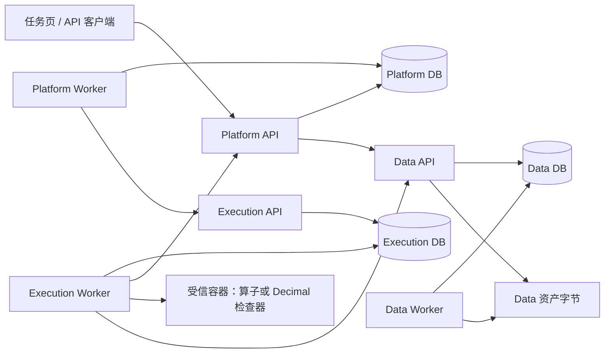

# P3 API 与科学契约（0.2.1）

P3 增量建立在 P2 的身份、角色、命令、幂等、预算和租约之上。P2 报告是历史验收记录，见 `verification/p2-followup-report.md`。正式 OpenAPI：`/api/v1/openapi.json`；任务页：`/`。

## 所有权与事务

Platform 只持有任务、授权、预算、Action、候选、检查报告及完成记录；Data 只持有上传、资产、语义修订和发布控制；Execution 只持有计算身份、尝试、容器关联及外部执行事实。三个 PostgreSQL 数据库使用不同角色。服务经带独立凭据的内部 HTTP 通信，不跨库查表。核心包只有标准库；检查器不导入生产算子或 NumPy。



跨服务 HTTP 均在 Platform 事务之外；Action 准入、预留、命令及 outbox 同事务。完成时锁定 Task，重新检查要求修订、当前控制版本、暂停/取消状态、候选及活动收敛。API 不启动后台计算协程。

## 公开接口

以下 `P` 为 `/api/v1/projects/{project_id}`。所有接口重新验证当前 Bearer Token 与成员权限。改变状态的 POST 必须携带 `Idempotency-Key`。P2 的创建/控制/命令回执保持兼容；新请求中的未知字段返回 `400 MALFORMED_REQUEST`。

| 接口 | 成功状态与用途 |
| --- | --- |
| POST / GET `P/uploads`；GET `P/uploads/{upload_id}` | 201 创建；200 列出/查询。状态 AWAITING_CONTENT → UPLOADED → QUEUED/IMPORTING → READY 或 FAILED |
| PUT `P/uploads/{upload_id}/content` | 200；完整原始字节，必须匹配创建时的 size 与 sha256。断流不链接部分对象，同对象可重传 |
| POST `P/uploads/{upload_id}/finalize` | 202 UploadReceipt（upload_id/status/status_url）；导入由 Data Worker 推进 |
| GET `P/assets` | 200；已原子公开的资产，未完成导入/发布不在列表中 |
| GET `P/assets/{asset_id}/versions/{version_id}` | 200；精确引用、不可变 manifest、追加的语义修订 |
| GET `P/assets/{asset_id}/versions/{version_id}/representations/{representation_id}/content` | 原始字节流，Digest 响应头 |
| POST `P/assets/{asset_id}/semantic-revisions` | 201；expected_revision 检查，不修改旧 manifest 或修订 |
| GET `P/operators`；GET `P/operators/{operator_id}/versions/{version_id}` | 200；仅两个登记算子；含实现 ID、V6 原 ID/版本/源码摘要映射 |
| POST `P/executions` | 202 CommandReceipt；目标只允许登记的 LOCAL 实现 |
| GET `P/executions/{execution_id}`；POST `.../cancel` | 200 查询计算/发布事实；202 持久请求取消。取消回执的关联不表示清理完成 |
| GET `P/tasks/{task_id}/activities` | 200；页面刷新所需的 Action、命令、执行关联与冻结请求，受项目访问权约束 |
| POST / GET `P/tasks/{task_id}/deliverables` | 201 不可变候选；200 列出，候选只能引用本任务同要求修订的已发布算子成果 |
| POST `P/tasks/{task_id}/acceptance` | 202 AcceptanceReceipt（acceptance_id/status/status_url），检查使用自己的 Action 和预算 |
| GET `P/tasks/{task_id}/acceptance`；GET `.../{acceptance_id}` | 检查状态、不可变报告及摘要、旧修订标记、完成关联 |

列表目前按服务返回最多 100 条；P2 项目、Task、grant 的游标机制保持不变。上传/资产的内部游标可继续推进，公共页以当前项目最小操作规模为定位。

P3 上传、资产、算子、执行、候选和验收的正常 JSON 响应在 OpenAPI 中有具体 DTO。已受理的 `POST P/executions` 使用原 `Idempotency-Key` 重放时先核验当前令牌和项目 EDITOR 权限，再比较冻结请求；原命令可在 Data 暂不可达时恢复，同键改内容仍返回 `409 IDEMPOTENCY_CONFLICT`。新请求仍需 Data 核实资产与语义，不能凭旧命令获得新的计算许可。

## 上传与精确输入

CSV 原始内容必须为 UTF-8，列类型由 finalize 显式传入：

```json
{"columns":[{"name":"station","type":"string"},{"name":"time","type":"string"},{"name":"value","type":"string"}],"null_values":[""]}
```

支持 string/int64/float64/boolean；string 保留前导零和原始空值文本。Parquet 只接受平面标量表。20 MiB 原文件、100000 行、128 列；不接受压缩包、嵌套字段或 URL。原文件与规范化 Parquet 都持久保存。字段身份固定为 f0、f1……，显示名称不承担身份。

InputSelection 固定 `asset`（完整 AssetRef）、`representation_id`、`representation_digest`、`semantic_revision` 和 `field_bindings`（groupField/timeField/valueField）。提交前 Data 核对精确清单和表示摘要；算子输入只接受 `normalized` Parquet，原始 Parquet 的物理列名不能冒充稳定的 f0/f1 字段。语义快照被冻结进 Action。语义包含 IANA 时区、ISO8601、value_unit、quantity、missing_values；不推断高程与埋深，不进行隐式单位换算。

分析参数为 groups、start、end、frequency、min_samples。groups 显式列出 1–1000 组，完全缺失的组仍输出。范围 `[start,end)`，边界带偏移且与声明时区下的日/月/季度/年对齐；无偏移观测按显式时区解释，DST 歧义或不存在时间拒绝。

## 两个算子

- `timeseries-completeness@1.0.0` / `p3-completeness-v1`：预期、有效、缺失周期，重复周期数，空值记录数和完整率。同周期多个有效值只覆盖一次。**重复周期数**定义为有多条记录的周期个数（包含空值记录），不是额外记录条数；方法说明与独立重算采用同一明确口径。
- `statistics-linear-trend@1.0.0` / `p3-numpy-v1`：NumPy 带截距最小二乘，时间为 UTC 实际经过天数；每日斜率、乘 365.2425 的年化斜率、首个有效时点截距、R²。重复时间戳拒绝；默认至少 3 个不同有效时点，不足为 NOT_EVALUABLE / INSUFFICIENT_DISTINCT_TIMES；常量序列斜率 0、R² 为 null。

非法时间、非数值、布尔数值、非有限数形成失败，不插值、聚合或静默删除重复记录。不输出 p 值、预测或因果结论。最低样本数是交付配置，不是科学充分性保证。

## 执行、预算与发布恢复

Execution 的 QUEUED 观察可携带 execution_id 且 executed=false。CommandReceipt.RESOLVED 只说明服务关联已取得。实际启动后 executed 单调转为 true；累计额度只记一次。确认从未启动且被拒绝/取消时释放预留；已启动失败仍计费。直到执行与发布收敛才释放在途名额，未知事实保留占用。

容器镜像来自安装配置中的不可变 image ID，客户端不能指定镜像/命令/地址/路径。普通 UID、只读根目录/输入、独立输出、禁网、1 CPU、1 GiB、120 秒、100 MiB 输出检查。执行意图、稳定名称、尝试先持久化；重启核对名称、标签、容器 ID、请求摘要，继续收集原结果。没有自动重算。运行器启动前调用 Platform 许可校验；许可之后的撤销/取消竞争按执行窗口内活动处理。

Data 用 Execution ID 仲裁固定尝试、manifest 摘要和发布代次。文件落盘、摘要验证后 READY；整组表示和回执在一个数据库事务内可见。中止可先创建墓碑；提交/中止锁同一行。提交先完成就保留成果，中止先完成就拒绝迟到提交。响应丢失查询原身份，不创建第二份成果。Data 不可达时清理 UNKNOWN，不把容器停止视为发布停止。

## 验收与完成

`TaskSpec.acceptance_spec` 可选；没有它的旧 P2 Task 不能自动完成。模板仅 `p3-timeseries-v1`，冻结输入/参数、required_outputs、allow_not_evaluable、minimum_evaluable。ScopeGrant 需显式 `derived_outputs=true` 和 `acceptance_profiles=["p3-timeseries-v1"]`；旧 grant 默认没有新增许可。派生授权只覆盖可验证的本任务成果与精确输入。

受信检查器独立解析输入，用 Decimal 高精度公式重算；核对分组、Schema、原始输入引用、来源、单位、JSON/Parquet 表示及真实无法评估原因。固定绝对容差 1e-10、相对 1e-8。报告只判断结构化要求。

PASS 才可能完成任务；真实 FAIL 保持 OPEN，相同候选换键仍返回原检查，不重扣/重跑。ERROR 的新运行必须携带 retry_of，重新通过授权和预算；NOT_EVALUABLE、ERROR、FAIL、CANCELLED 与未运行/超时/资源失败分开记录。暂停、取消、要求修订或未收敛活动会阻止完成；旧修订报告保留并标记 stale。

默认 3 次额度恰好覆盖两个算子和一次检查，不含重试余量。沿用 P2 的固定任务预算，本轮没有额度调整接口；需要容许额外计算或 ERROR 重试时，应在创建任务时明确设置更高额度，不能通过换幂等键绕过预算。

## 本阶段边界

这是单主机受信运行器与本机令牌方案。Execution Worker 必须共享同一主机的持久工作目录与 Docker daemon（文件锁串行保护运行器操作）；不支持跨主机 HA。服务凭据由部署配置持有，容器不获得数据库或用户令牌。当前科学契约不能证明用户声明的单位、指标含义或现实观测本身真实；合成测试也不能替代真实业务评估。远程工作流、CWL、QGIS、Knowledge、Agent、任意代码和完整工作台都未实现。
